<!-- Source: 2022_FSAE_Cost_Module_Guide_.pdf, pages 1–32 -->

FORMULA SAE SERIES

COST MODULE GUIDE V.4

PUBLISHED FEBRUARY 23, 2022

COMMON MISTAKES

- Process “Lamination Manual” is needed for every individual layer CR.7.1.1
- Not following rules supplement section CL.4, CL.5, CL.6
- Improper raw material cost: 1mm added to outside and is not hollow (example gun drilled axles are not tubes). The only time tubing should be used as raw material is if it is a common tube size and common material. CR.1.2.b, CR.4.1, CR.4.4
- You can only forgo the 1mm added dimension if the part shows up to competition with a mill formed surface
- Wheel bearings and suspension rod ends have their own special parts
- Using “Weld round tubing” improperly (read process description)
- Monocoque Production Volume Factor (PVF) is always 120
- Forgetting the reaction tool when a counterforce is needed to install a fastener
- Using “Connector, Single Wire” for multiple pin connectors. This is for single pin connectors as noted in its description

SUPPORTING DOCUMENTATION

- Drawings are absolutely critical to document how parts are made.
- Drawings and images are an integral part of the cost accuracy score.
- Drawings should have enough details to sufficiently verify part costing.
    - Material type
    - Dimensions to sufficiently assess
        - Raw material size
        - Finished material size
        - Material removal
        - Tooling size or quantity

WHERE TO ATTACH DRAWINGS

- NOTE currently drawings need to be attached 1 page at a time in order to properly export to pdf report
- Assemblies: Attach an assembly drawing, CAD rendering, CAD rendering exploded view or actual picture of the assembly on the same page as the assembly
- Parts: Attach a drawing (preferred) or CAD picture or actual picture(bought parts) of the individual part in the same page that makes the part
- Note that only .pdf, .jpeg file types will export images to the exported pdf report.
- Be careful not to make the file sizes too large

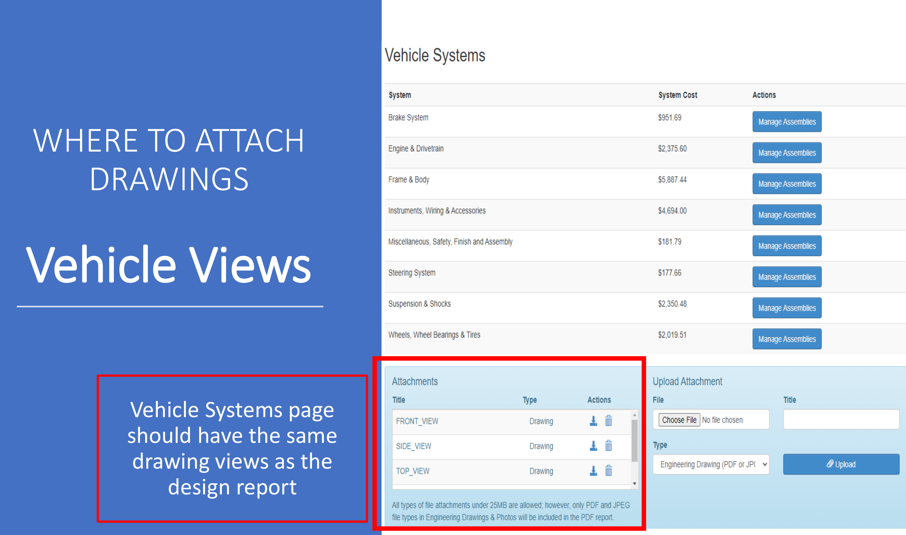

WHERE TO ATTACH

DRAWINGS

Vehicle Views

Vehicle Systems page should have the same drawing views as the

design report

RAW MATERIALS

- Label material dimensions when possible in “Use”
    - One exception would be near net shape parts such as 3d printed and castings
- Sheet thickness should always be noted
- Sheet area should be listed especially if it is CAD modeled
- Tubing can easily list diameter, wall thickness and length

TUBING

Cutting tubes:

- All tubes need at least 1 cut (assume it is cut from full length stock ) Process multiplier repeat can be used on tubes of same diameter in the same assembly
- All complex shape tube ends that get welded need surface prep for welding

Welding tubes:

- Weld round tubing is intended for butt welded custom tube welding that would be difficult to use welding jigs such as exhaust manifolds. Tooling is not required.
- Spaceframe tubing should use Weld and be cost per linear distance of weld. Tooling “Welds-Welding Fixture” must be used.

OP NUMBER

- OP number is purely for organizing purposes and teams can use any way they want.
- For example if multiple parts are in the same assembly the OP numbers can be numbered in a way to show relationships between different processes
- One part is 10.1, 10.2, 10.3 etc.
- Another part could be 20-1, 20-2, 20-3 etc.
- Fasteners and installation processes should be with the part itself
    - Ex. the control arm bolts and installing the bolts should be listed on the control arm page

FRONT LOWER CONTROL ARM - EXAMPLE

- Lower control arm
    - Parts
        - Machined components in parts
        - Control arm tubes in parts
    - Materials
        - Rod end, Suspension
        - Bearing, Spherical
    - Process
        - Weld
        - Assembly of control arm itself (install rod ends and bearing)
        - Assembly of control arm to vehicle (This could also be put in a different assembly page )
        - Hand start
        - Ratchet
        - Reaction tool
- Fasteners
    - Bolt
    - Nut
    - Washer
- Tools
    - Welds-Welding Fixture
- Attachments
    - Drawing(s) of control arm assy
    - Drawing(s) of individual machined components

FRONT LOWER CONTROL ARM – EXAMPLE Materials

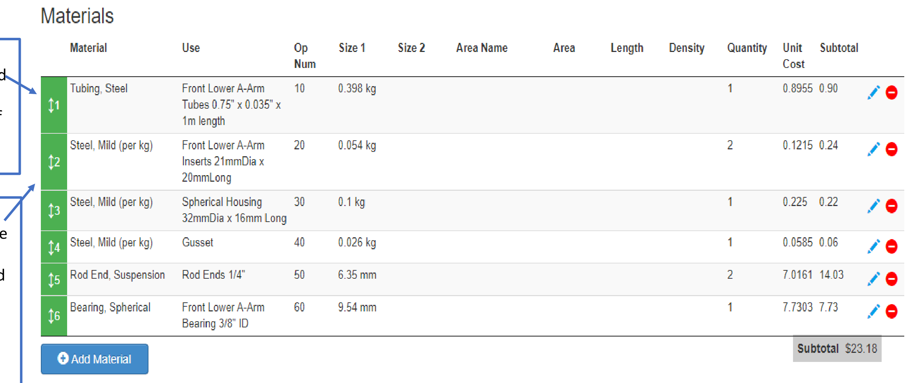

Tubing dimensions listed in description. List the length of tubing when possible.

Machined part raw materials are solid round bar with 1mm added to all surfaces.

All material dimensions are listed.

FRONT LOWER CONTROL ARM – EXAMPLE Processes

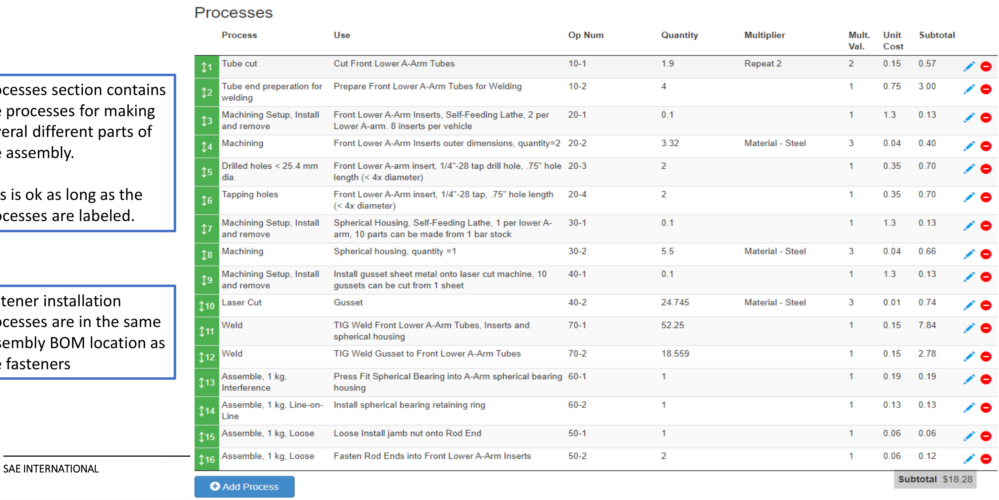

Processes section contains the processes for making several different parts of the assembly.

This is ok as long as the processes are labeled.

Fastener installation processes are in the same Assembly BOM location as the fasteners

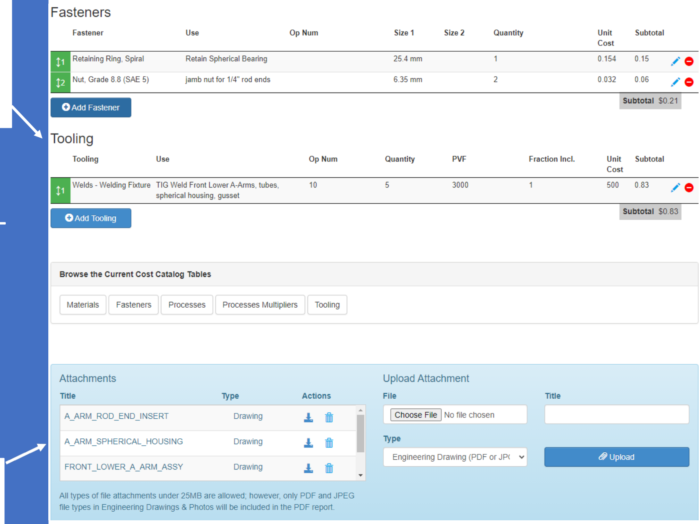

FRONT LOWER CONTROL

ARM – EXAMPLE

Fasteners & Tooling

Only PDF and JPEG will export to the PDF cost report.

MAKE SURE TO SAVE AND CLOSE!!

Make sure to put a

number in Fraction Incl.

Usually 1 unless the

tooling is used on

multiple parts.

Drawing or picture of

the CAD assembly

model.

Drawings of individual

machined parts.

PDF or JPEG

Only PDF and JPEG files export to PDF

Type must be set to Engineering Drawing

(PDF or JPG)

Frame Assembly typically consists of the Tube frame, Monocoque, any permanent attachments and fasteners that join any sub frames

- Frame assembly
    - Parts
        - Tube Frame
        - Tube Frame weld on attachment brackets
        - Monocoque
        - Monocoque permanent attachments (example: bonded on components)
    - Materials
        - Paint for rust prevention
    - Process
        - Aerosol or brush apply for paint
        - Any process to connect the frame sub assemblies together
    - Fasteners
        - Any fasteners that connect the frame sub assemblies together
    - Tools
        - Welds-Welding Fixture
        - Lamination – Mold Tool for Monocoque with PVF of 120
    - Attachments
        - Drawing or picture of CAD model of the assembly
        - The same drawing(s) submitted for SES with tubes labeled by thickness and color coded.

Tube Frame Assembly typically consists of the Tubing (welded on tabs could also be included)

- Tube Frame
    - Parts
        - Probably none but parts are allowed
    - Materials
        - Tubing (separate each individual size)
    - Process
        - Tube cut (separate operation for each tube diameter)
        - Tube bends
        - Tube end preparation for welding (usually 2x tube cut)
        - Weld
    - Fasteners
        - Probably none but it is allowed
    - Tools
        - Welds-Welding Fixture
    - Attachments
        - Drawing or CAD picture which should identify tube sizes

Monocoque typically consists of composite materials and inserts

(This also applies to most composite parts)

- Monocoque
    - Parts
        - Probably none but parts are allowed
    - Materials
        - Composite raw materials
        - Insert raw material
    - Process
        - Lamination, Manual
        - Curing
        - Hand Finishing
        - Assembly
        - Cutting holes
        - Fabrication of inserts
        - Installing inserts
    - Fasteners
        - Probably none but it is allowed
    - Tools
        - Lamination- Mold Tool (PVF=120 for the monocoque)
    - Attachments
        - Drawing or CAD picture should identify layers and thicknesses
        - Should match the SES (SES documentation can also be used)

REAR SUBFRAME – EXAMPLE

- This example is of a rear subframe that would attach to a front monocoque (not pictured)
- Rear subframe has been divided into 2 parts to more easily organize(could be 1 part).

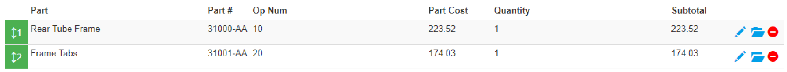

REAR SUBFRAME – EXAMPLE Tube Frame

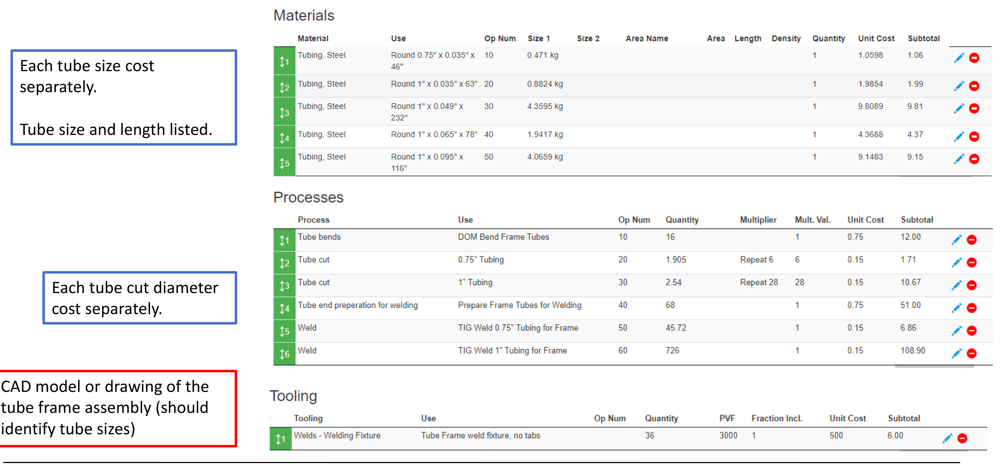

Each tube size cost separately.

Tube size and length listed.

Each tube cut diameter cost separately.

CAD model or drawing of the tube frame assembly (should identify tube sizes)

REAR SUBFRAME – EXAMPLE Frame Tabs Materials

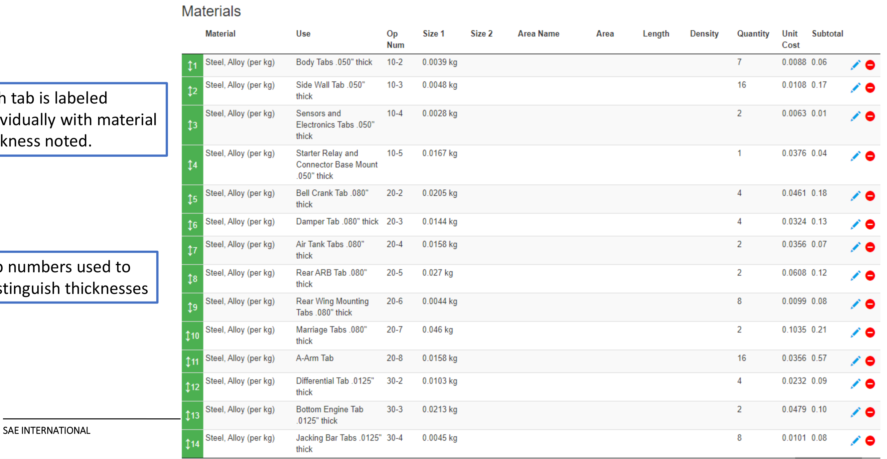

Each tab is labeled individually with material thickness noted.

Op numbers used to distinguish thicknesses

REAR SUBFRAME – EXAMPLE Frame Tabs Processes

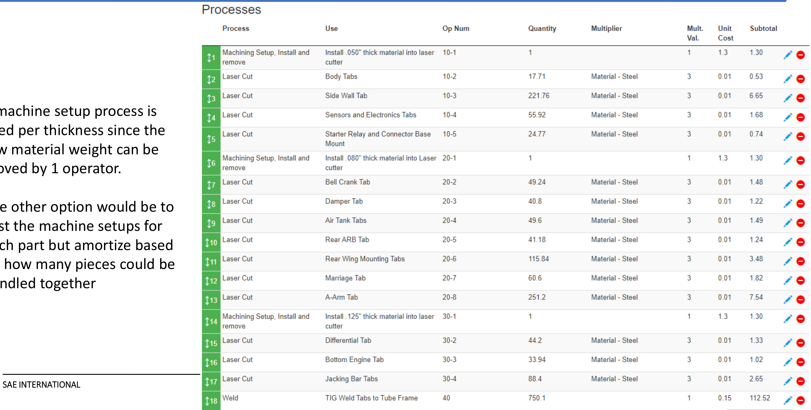

1 machine setup process is used per thickness since the raw material weight can be moved by 1 operator.

The other option would be to cost the machine setups for each part but amortize based on how many pieces could be handled together

REAR SUBFRAME – EXAMPLE Frame Tabs Tooling & Drawings

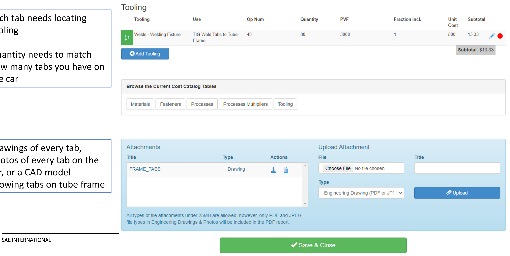

Each tab needs locating tooling

Quantity needs to match how many tabs you have on the car

Drawings of every tab, photos of every tab on the car, or a CAD model showing tabs on tube frame

UNDERTRAY– EXAMPLE Materials

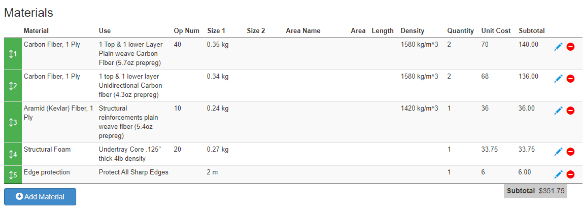

Different types of Carbon for different pieces of overall assembly

Composite material cost mass must match the actual part mass.

Uses and specifications of the materials are listed in Use

UNDERTRAY– EXAMPLE Processes

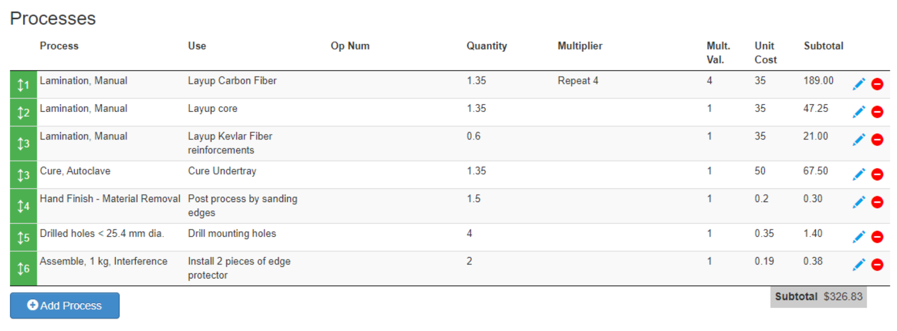

No process is needed for cutting of uncured composite raw materials

Use “Hand Finish-Material Removal” or similar process for post processing including sanding and cutting excess

UNDERTRAY– EXAMPLE Tooling and Attachments

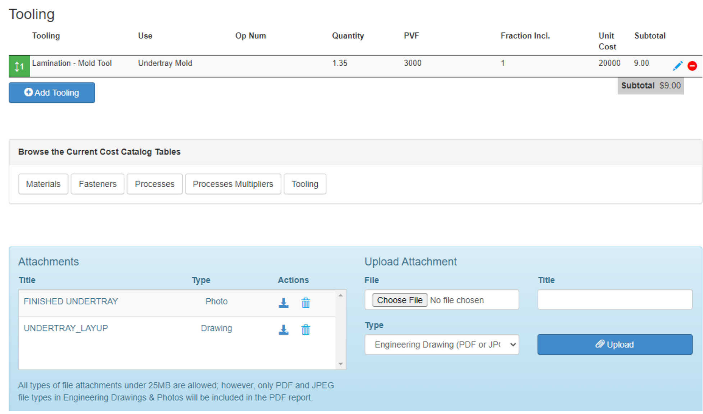

Include multiple “Mold Tools” as required. (“flat panel” tool for flat pieces and “mold tool” for contoured shapes.

Use “Hand Finish-Material Removal” or similar process for post processing including sanding and cutting excess

Include a drawing detailing part dimensions Pictures of the completed or in work part are also helpful

- Cut wire
- Strip wire
- Attach wire
    - Crimp on connector or connector pin
    - Install connector pins into multi pin connector
- Bundle wires
    - Tape, heat shrink tubing,
- Lay wires
- Secure wires
- Connect connectors and wire ends
    - Attach single wire ends to terminal blocks, terminal posts, lugs etc.
    - Join connectors

WIRING

SUBMIT eAIR

Teams entering any international competition prior to competitions in North America must first inquire with those organizing bodies via their process found online their competition websites.

With the online question and answer system teams should submit requests for additional items to be added to the cost tables through the Rules Q&A system.

To find out how to do this follow this link. However, you must include documentation to support the retail price for the item or we will not be able to add it to the tables.

Excel format AIR - please attach to the online submission through the Rules Q&A system

GENERAL RULES QUESTION

With the online question and answer system teams should submit inquiries regarding the rules or onsite operations via the Rules Q&A system.

To find out how to do this follow this link.

HOW TO TURN IN YOUR COST REPORT

Start at the main page for the

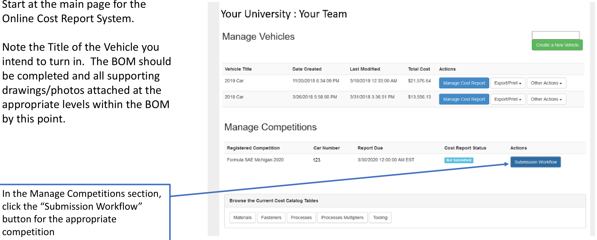

Online Cost Report System.

Note the Title of the Vehicle you intend to turn in. The BOM should be completed and all supporting drawings/photos attached at the appropriate levels within the BOM by this point.

HOW TO TURN IN YOUR COST REPORT

This page walks you through all steps for turning in

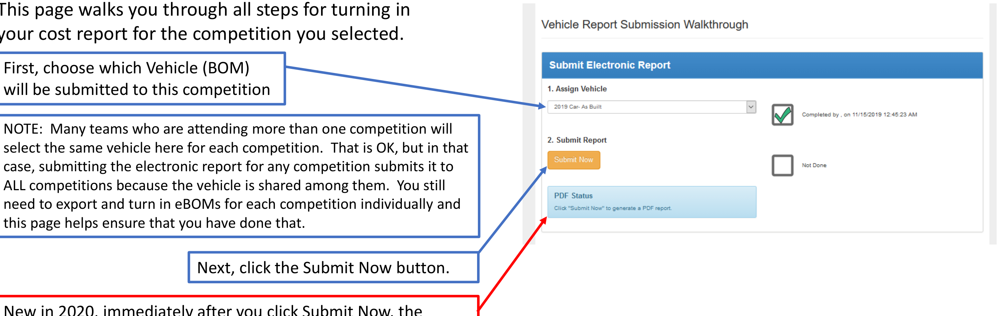

your cost report for the competition you selected.

First, choose which Vehicle (BOM) will be submitted to this competition

Next, click the Submit Now button.

New in 2020, immediately after you click Submit Now, the system will automatically begin generating a PDF version of your report that will be available to both your team and the cost judges. Therefore, YOU DO NOT NEED TO UPLOAD A PDF REPORT before the due date any longer. Your team will get an email as soon as your PDF has finished and is available.

HOW TO TURN IN YOUR COST REPORT

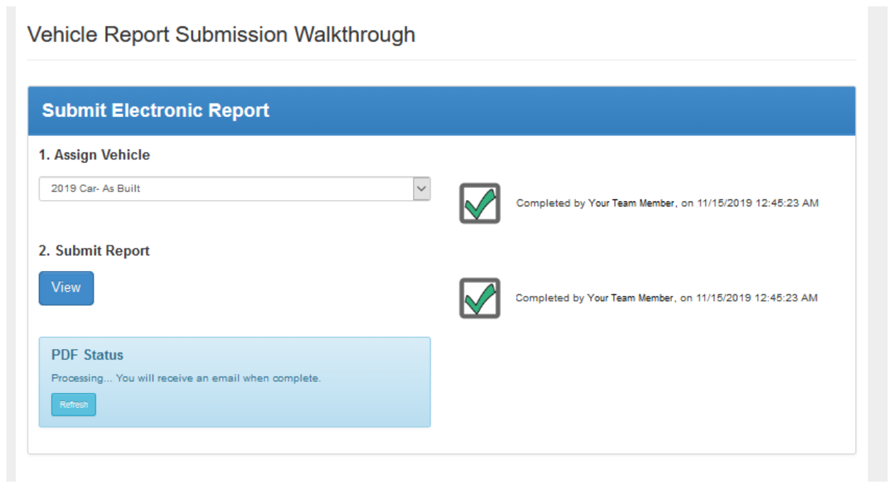

You have now completed the Submission Workflow for the selected competition.

New in 2022, there is no longer a need to export an eBOM Excel document and turn it in. The electronic report is now the only submission.

HOW TO TURN IN YOUR COST REPORT

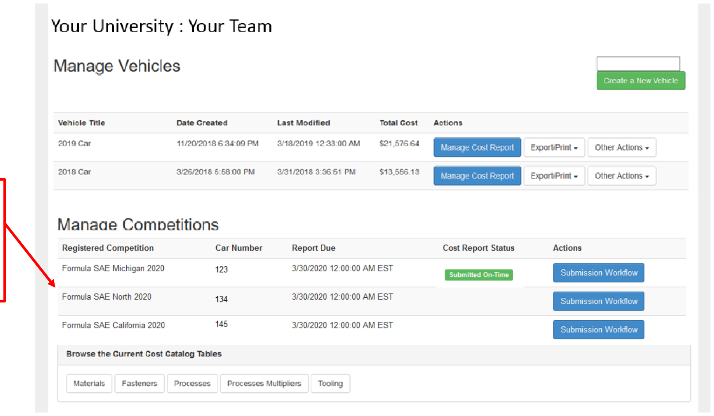

IF ATTENDING MULTIPLE NORTH AMERICAN COMPETITIONS, your team must repeat this Submission Workflow process for each competition listed in the Manage Competitions section!

HOW TO TURN IN YOUR COST REPORT

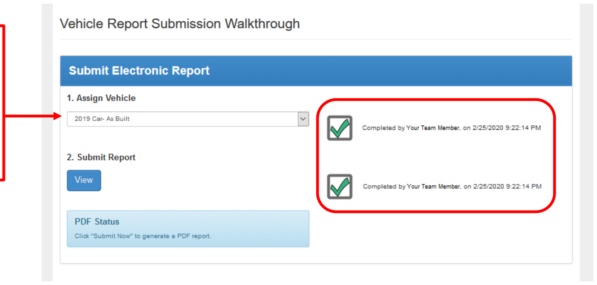

When following the Submission Workflow for a second or third competition for the season,

IF you select a vehicle that has already been “Submitted” for another competition, steps 1 and 2 will already show as completed. This is normal.

SAE CONTACT

With all other inquiries you may email collegiatecompetitions@sae.org.

Be sure to include the following in your email:

- 1\. Full university name
- 2\. Team Name and Car Number
- 3\. Competition registered for
- 4\. Purpose of email
