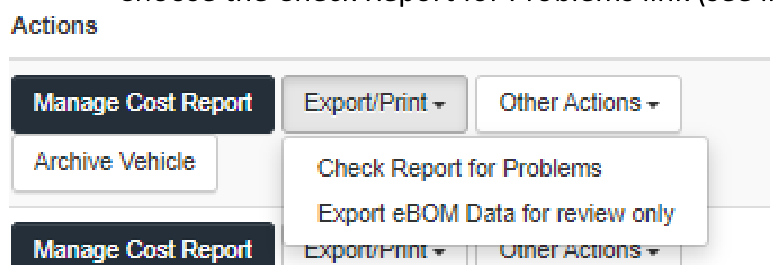
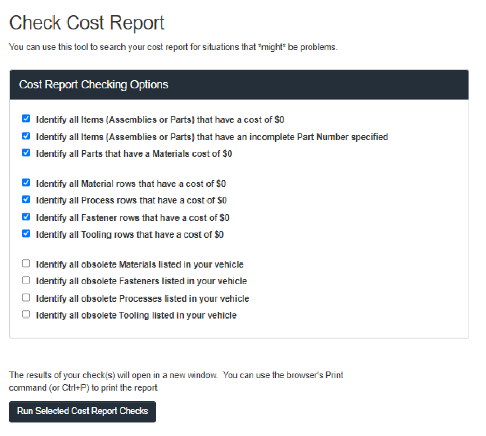

<!-- Source: Check_Cost_Report_Tool.pdf, pages 1–1 -->

### Cost Report Comparison Tool

Steps to use this tool:

- 1\. Log into your Formula SAE account
- 2\. Select Online Cost Report System link under Activity Menu
- 3\. Under Manage Vehicles, using your current Vehicle report, select the Export/Print button, Choose the Check Report for Problems link (see image below)

- 4\. On this page, you will have several options to check your report for situations that might be a problem (especially if using your previous years report as a starting point). Select all areas you want to check. (see image below)

