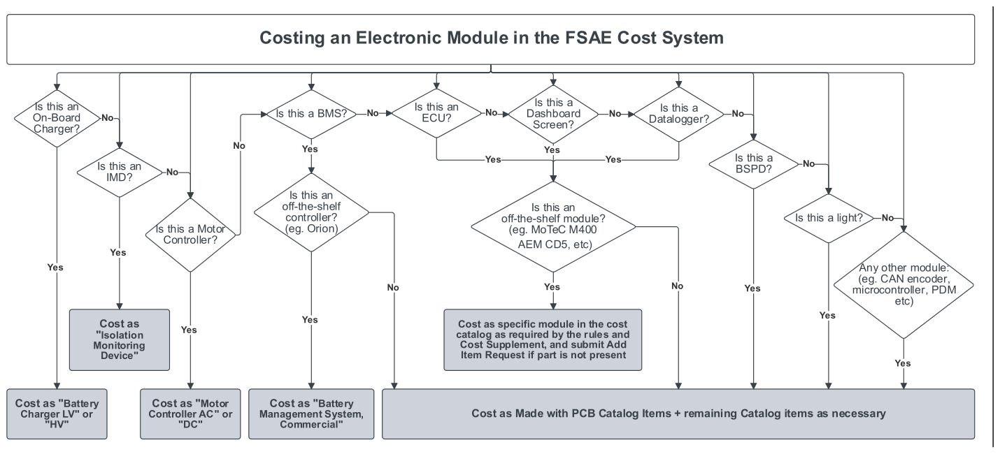
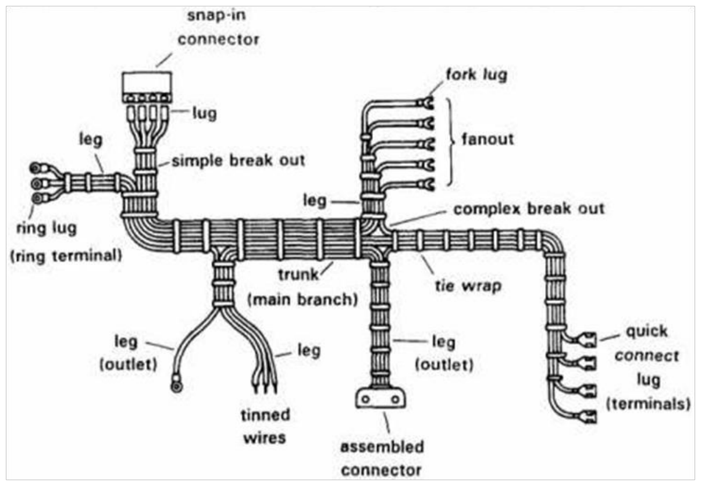

<!-- Source: FSAE_Cost_Supplement_V4.pdf, pages 1–19 -->

COST EVENT SUPPLEMENT

TABLE OF CONTENTS

CM - Cost Model and Methodology ....................................................................................................2

CM.1 Cost Tables ........................................................................................................................................... 2

CM.2 Process Multipliers ............................................................................................................................... 2

CD - Cost Documentation ...................................................................................................................3

CD.1 Cost Report........................................................................................................................................... 3

CS - Cost Report Specific Items ...........................................................................................................3

CS.1 Engine - Combustion ............................................................................................................................ 3

CS.2 Tires and Wheels .................................................................................................................................. 3

CS.3 Data Acquisition Systems ..................................................................................................................... 4

CS.4 Finishes ................................................................................................................................................. 4

CS.5 Excluded Items ..................................................................................................................................... 4

CR - Cost Report Implementation .......................................................................................................5

CR.1 Materials .............................................................................................................................................. 5

CR.2 Make versus Buy .................................................................................................................................. 5

CR.3 Assembly Labor .................................................................................................................................... 6

CR.4 Machining ............................................................................................................................................. 6

CR.5 Tooling & Fixturing ............................................................................................................................... 8

CR.6 Fastener Installation ............................................................................................................................. 9

CR.7 Composites ......................................................................................................................................... 10

CR.8 Electronics and Wiring ....................................................................................................................... 11

CL - Cost Report Systems and Assemblies .......................................................................................... 16

CL.1 Systems .............................................................................................................................................. 16

CL.2 Assembly and Part Numbering ........................................................................................................... 16

CL.3 Fasteners ............................................................................................................................................ 16

CL.4 System and Assembly List – All Vehicles ............................................................................................ 17

CL.5 System and Assembly List – Internal Combustion Vehicles ............................................................... 18

CL.6 System and Assembly List – Electric Vehicles .................................................................................... 19

Marked changes are for courtesy only, GR.6.6

Verify this is the current version of this document at the FSAE Online website www.fsaeonline.com

# CM - COST MODEL AND METHODOLOGY

The Cost Models are the underlying methodology and equations that relate the final cost of a part to the different operations and goods used in that part.

## CM.1 COST TABLES

### CM.1.1 Table List

All costs in the Cost Report must come from the standardized Cost Tables:

- Materials
- Processes
- Process Multipliers
- Fasteners
- Tooling

### CM.1.2 Bases

- a. All Cost Tables are presented using metric units. The tables do not differentiate between parts designed in metric and US systems of measure.
- b. The tables represent cost based on specific parameters.
    - Most items have a cost expressed as a function of one parameter
    - When more than one parameter is necessary, additional categories are listed
- c. Certain types of parts are supplier specific and other types are generic, as specified in the table entry
- d. The comment section for each Material, Process or Fastener may refer to the specific part by actual local designation.

Example - a 6.35mm bolt is cost but the comments would say “1/4 inch A-arm bolt”

## CM.2 PROCESS MULTIPLIERS

Process Multipliers are used to modify the standard costs of different operations to account for material and geometric differences in the part.

For every process included in the Cost Report:

- a. Check the list of Process Multipliers to determine if any apply
- b. Include any applicable Process Multipliers with the cost

# CD - COST DOCUMENTATION

## CD.1 COST REPORT

Supporting Information in the Cost Report may consist of:

- a. Vehicle Views
- b. Assemblies
- c. Individual Part Drawings
- d. Electrical Schematics
- e. Photos

# CS - COST REPORT SPECIFIC ITEMS

## CS.1 DRIVETRAIN – COMBUSTION VEHICLE

### CS.1.1 Engine Cost

Engine cost includes:

- Transmission - whether integral or not by design
- Components used to transmit power between engine and transmission
- All components necessary to run including spark plugs, coils, wires, oil filter, etc.
- Fully internal engine changes

### CS.1.2 Separate Combustion Drivetrain Items

- a. The following parts of the Drivetrain cost must be included separately:
    - Air induction and fuel system components
    - Any driveline component downstream of the transmission output gear/shaft
    - Custom parts such as dry sump pans, PCV changes, etc.
- b. If covers or other parts are removed, disassembly labor must be included in labor cost

## CS.2 DRIVETRAIN – ELECTRIC VEHICLE

### CS.2.1 High Voltage Motor Cost

High Voltage motor cost includes:

- Transmission - whether integral or not by design
- Fully internal motor changes

### CS.2.2 Separate Electric Drivetrain Items

- a. The following parts of the Drivetrain cost must be included separately:
    - Motor Control Unit
    - Battery Management System
    - High Voltage Battery
    - Any driveline component downstream of the transmission output gear/shaft
- b. If covers or other parts are removed, disassembly labor must be included in labor cost

## CS.3 TIRES AND WHEELS

- a. The tires and wheels that are declared as Dry tires must be Included in the Cost Report
- b. Wet tires and wheels are not included in the Cost Report

## CS.4 DATA ACQUISITION SYSTEMS

- a. Data acquisition systems must be costed. This includes display screens, control modules, wiring and all sensors.
- b. Data logger control modules that are “standalone” data acquisition systems (a device that passively logs data) are to be included at $0.
    To be “standalone”, a system must be removable without compromising any vehicle functionality.
- c. Systems offering additional functionality have to have this functionality (such as a driver display) included, whether it is used or not.

## CS.5 FINISHES

- a. Any finishes (paint, polish, etc) that are only used to beautify are not costed
- b. Preservative finishes intended to protect the appearance or function of a part for an extended period of time must be costed

## CS.6 EXCLUDED ITEMS

Items that do not need to be included in the Cost Report, if installed:

- An onboard fire suppression system
- Transponders, video and/or radio system(s)

# CR - COST REPORT IMPLEMENTATION

## CR.1 MATERIALS

### CR.1.1 Definitions

- a. Raw Material - the stocks used to produce parts from scratch, such as billet steel for machining or aluminum ingot for casting.
- b. Gross Weight - the weight of the raw material, including all machining stock
- c. Net Weight - the weight of the finish machined part

### CR.1.2 Bases

- a. Bar, sheet and tube stock are purchased using Raw Material costs.
- b. Material costs are based on part Gross Weight.

Example - a steel hub is machined from solid bar. The interior is removed by boring. The cost of the bar must include this interior material.

- c. Raw materials are normally cost by volume. A cost by weight is also given using a density listed in the tables.
- d. Any parts that are weighed at competition to confirm cost will use the table density when calculating cost.

## CR.2 MAKE VERSUS BUY

### CR.2.1 Made or Bought

Every part may be classified as Made or Bought.

- This designation does not necessarily refer to whether a team actually purchased or fabricated a part but defines how the part must be cost from the Cost Tables.
- The Made versus Bought designation enables certain parts to be simplified to a relatively few number of entries.

Example - most steering racks are bought but then significantly modified. Steering racks are designated Made parts so even teams that purchase them and make no modifications must cost them as if they had made them starting with raw materials.

### CR.2.2 Made Parts

Made (or manufactured) Parts must be cost as if the company manufacturing the vehicle was going to make the part internally. That is by purchasing raw materials and processing them into a finished product.

- Parts that must be Made do not appear explicitly in the Cost Tables or appear with a “Cost as Made” option.

### CR.2.3 Bought Parts

Bought Parts must be cost as if the company manufacturing the vehicle was going to outsource the fabrication of that part. These parts would be received by the vehicle manufacturer in a relatively finished state (see the particular table entry comments field for specific information).

- Teams costing Bought parts as Made parts will be penalized

### CR.2.4 Made Parts Listed as Bought

**CR.2.4.1** If a team genuinely Makes a part which is listed in the Cost Table as a Bought part, they may alternatively cost it as a Made part only if a place holder entry is listed in the Cost Tables enabling them to do so.

Example - in the category of dampers a “student built” entry is included. The team must create a new component named “Damper, Student built” and cost the damper they actually designed and built.

**CR.2.4.2** Any part which is normally purchased that is optionally shown as a Made part must have supporting documentation submitted to prove team manufacture.

Documentation may include engineering drawings, pictures of machining, etc.

## CR.3 ASSEMBLY LABOR

### CR.3.1 Mass

The mass of the part influences the time and effort it takes the operator to assemble the part to the assembly or vehicle.

- The actual part mass must be equal to or less than the value selected.

Example - a 300 g part would have an assembly labor category of 1 kg

### CR.3.2 Interfaces

Each interface a part has with surrounding parts must be costed

### CR.3.3 Fit Type

The ease with which a part can be assembled is described by the fit. There are three categories of fits:

- a. Loose – the part assembles with no force. Examples include a quick release steering wheel onto the steering shaft and a bracket bolted to a monocoque.
- b. Line on Line – the part is designed to have a close fit to the surrounding parts and some buildup of force is required to get the part started. Examples include a rod end inserted between two tabs in double shear and a splined axle shaft into the differential gear.
- c. Interference – significant force is required to insert the part and mechanical assistance may be necessary. Examples include a rubber hose onto a barbed fitting and a ball bearing into a bore.

## CR.4 MACHINING

### CR.4.1 Machining Basis

Costs for machining operations are based on the volume of material removed.

All processes require a minimum of 1 mm (approx 0.040 in) of machining stock to be removed from each surface of the part with machining, regardless of the actual amount removed.

### CR.4.2 Machining Type

The actual machine used, whether mill, lathe or otherwise, is the same unless a specific line item is included for that machine, such as gear hob.

### CR.4.3 Process Multiplier

The Process Multiplier for the material must also be used to calculate the total process cost of the operation.

- a. If a Process Multiplier is required, it will be listed in the Processes table in the column labeled ‘Process Multiplier Type’
- b. If the column is blank for a process, no Process Multiplier is required.

### CR.4.4 Machining Stock

When costing the raw materials that go into making machined parts the machine stock must be included in the purchased material mass, even though this material is machined away to produce the final part.

Example - an upright bore is machined into a piece of billet aluminum. The interior material that is milled away must be included in the billet mass and hence cost. The same feature machined into a casting need only include 1 mm of machine stock of the machined away material

### CR.4.5 Fixturing

Machining requires labor operations to account for the time it takes an operator to fixture the part onto the machine.

**CR.4.5.1** Every machined part requires at least a ‘Machining Setup, Install and Remove’ operation.

This is the time it takes to pick up the work piece, fixture on the machine, and remove it when the machining is complete.

**CR.4.5.2** For a part that requires an intermediate change in position, such as to machine the back of the part which would not be accessible in a single fixturing setup, the labor step of ‘Machining Setup, Change’ is also required.

Example - an upright that requires three different orientations on a mill to fully machine would require two of the ‘Machining Setup, Change’ and the ‘Machining Setup, Install and Remove’ labor operations.

### CR.4.6 Fixturing – Special Case

It may be possible to fixture a work piece of raw material and machine more than one part out of it.

- a. Fixturing for this case may be distributed among the quantity of resulting parts that could reasonably be handled as one part by one single operator.
- b. This assumption must be clearly noted in the Cost Report, with enough details for the Cost Judges to verify the part geometry is appropriate for the machine being used.

Example - a self-feeding lathe could machine 10 suspension inserts out of a single piece of bar stock. These 10 pieces are small enough to be handled together. In this case the quantity of the ‘Machining Setup, Install and Remove’ may be set to 0.1. This represents the 10 parts that can be machined per setup.

## CR.5 TOOLING & FIXTURING

### CR.5.1 Tooling Basis

Tooling is necessary when certain processes are used. These processes are identified in the Cost Tables where the Tooling required will be indicated.

Use the Tooling costs from the Tooling Table. These Tooling costs:

- Are generalized to assume a design with a lifespan of the Production Volume Factor
- Already include any material or process to build the tooling itself

### CR.5.2 Tooling Types

Sometimes several types of Tooling are available for the same process. Each has a description and an associated process with which it can be used.

- If a process has more than one Tooling type associated with it the team must use the Tooling that is closest to the actual Tooling used in their prototype vehicle construction.

### CR.5.3 Tooling Cost

**CR.5.3.1** Production Volume Factor

The Production Volume Factor (PVF) represents the ability of the Tooling to produce parts in volume production.

After calculating the total Tooling Cost for a part, the cost must be divided by the PVF before being included in the Cost Report.

Production Volume Factor (PVF) = All parts not otherwise listed: 3000

Composite Monocoque (composite tub): 120

**CR.5.3.2** Part Tooling Cost

The following equation is used to calculate the Tooling cost to be included for each part:

```
                                 Table Tooling Cost
Part Tooling Cost =
                      PVF * Number of Parts Using Exact Tooling
```

The Tooling Cost is to be included with the appropriate part on the BOM, not a separate section.

- a. Example - Aluminum upright, cast using a 2 piece sand core package
    - Total table price is $5000 + $5000 = $10000
    - The casting is designed to be used for both the left and right hand rear corners.
    - Calculating the Part Tooling Cost gives:
        Part Tooling Cost = $10000 / ( 3000 \* 2 ) = $1.67 per upright
    - The $1.67 must be included as a line item on the Costed Bill of Material for each Upright.
- b. Example - Manufacturing a composite monocoque
    - The tub is constructed by building the top and bottom separately and bonding them together
    - Both the top and bottom use a two piece composite tool and the cost of all four tools is $45000
    - The PVF for tub tooling is only 120 because of the amount of time required to construct each tub so the tub Part Tooling Cost is:
        Part Tooling Cost = $45000 / ( 120 \* 1 ) = $375

## CR.6 FASTENER INSTALLATION

### CR.6.1 Installation Basis

The cost to tighten or loosen Fasteners is based on:

- The tool (or motion) needed to turn it
- The diameter and length of the Fastener
- Whether the Fastener requires a secondary tool for reacting the torque (such as a wrench on a nut)

### CR.6.2 Installation Types

**CR.6.2.1** Hand

No tool is necessary for tightening, such as quick release fasteners or hand tightened nuts

- a. Loose operations are those accomplished by using the fingers of the hand
- b. If the entire hand is moving to rotate the fastener the tight category should be used

**CR.6.2.2** Screwdriver

A tool that can be held in the hand and turned with the wrist

Any type of bit can be fitted such as straight, Philips, Torx, etc.

**CR.6.2.3** Wrench

An open end or box wrench or similar tool requiring motion of the hand

After a turn the wrench may have to be removed and repositioned for the next turn

**CR.6.2.4** Ratchet

A tool with internal clutch that allows the hand to be moved and returned to the starting position without removal of the tool

Compatible with any bolt head style such as 6 point hex, 12 point hex, Torx or other

**CR.6.2.5** Power Tool

An electric, pneumatic or other power assisted tool for running down fasteners

To qualify for power tool use, a Fastener must meet the following requirements:

- a. A socket of the size needed to drive the fastener must fit in the fully secured position
- b. An extension may be used to fit the power tool but it may not exceed 0.35 m in length
- c. One power tool must fit onto the socket
    - Any power tool may be used. There are no restrictions on size or shape.
    - Teams should bring the actual power tool with them to the discussion at the Competition along with sockets and extensions, if applicable, and be prepared to prove that the tool has access to each fastener that used the power tool cost.

**CR.6.2.6** Reaction Tool

Where the Fastener is not being attached into the part but requires a nut or other separate threaded piece, a reaction tool will be required

This will appear as a separate line item and should appear whenever a nut is used on a bolt

## CR.7 COMPOSITES

### CR.7.1 Composite Manufacturing

**CR.7.1.1** Lamination

Used to build the laminate one ply at a time

A ply is a single layer of the laminate consisting of a single sheet of material, regardless of material or thickness. A ply may consist of woven carbon, unidirectional glass, adhesive film or honeycomb core, for example.

**CR.7.1.2** Resin Application

Used to apply resin to non prepreg materials.

**CR.7.1.3** Curing Operations

Used to take a laminate and convert it to a finished composite structure

- a. All curing operations include vacuum bagging, peel ply, breather cloth and other consumable materials and labor
- b. Costs also include part removal from the mold
- c. Curing operations require tooling

**CR.7.1.4** Cure Types

- a. Room Temperature – ambient temperature curing resin systems at one atmosphere of external pressure or less
- b. Oven – increased temperature cure cycles for composites at one atmosphere of external pressure or less
- c. Autoclave – high temperature and pressure composites curing

### CR.7.2 Composite Material Cost

**CR.7.2.1** Fiber and Resin

The composite material must be the cost of both the fiber and resin together. This is true for both prepreg and dry fiber systems and is further stated in the Materials Table.

**CR.7.2.2** Hybrid Weaves

- a. If hybrid weaves are used the cost should reflect the ratio of the materials in the ply.

Example - a 50% carbon fiber, 50% glass woven ply may use the average cost of the carbon and glass materials.

- b. If the actual fiber ratio is not used, then the cost of the ply must be the cost of the highest cost material present.

### CR.7.3 Composite Mass

**CR.7.3.1** Mass Comparison

- a. When costing composite materials, the total mass of the part in the Cost Report must match the actual mass of the part as presented on the vehicle for Cost Judging
- b. The mass of each ply may be adjusted to make the finished part mass match the Cost Report
- c. Parts may be weighed during the event. The Cost Report mass must be equal to or greater than the actual mass of the part.

**CR.7.3.2** Mass Includes the Finish

Actual mass of the Part includes clear coat, paint and other finishes

The paint and finish mass is included to eliminate questions about how much weight the paint (or clear coat) has added.

The cost of the paint and paint application is not included if it is solely for cosmetic purposes but the mass of paint must be included in the composite cost

## CR.8 ELECTRONICS AND WIRING

The wiring harness is cost as a number of connectors of a certain style, each interconnected by a number of wires of a certain type

### CR.8.1 Low Voltage Wiring Types

The Low Voltage wiring harness contains two wiring types.

- a. Signal and Control – Input/Output in the control system such as wheel speed, mass airflow or the position of a driver toggle switch
- b. Power – Wires carrying current for vehicle distribution or actuators. These include but are not limited to vehicle power from the Low Voltage battery, engine starter, solenoids, motors

### CR.8.2 High Voltage Wiring Types

Wiring used in High Voltage applications is costed as:

- a. High Voltage Power – All wire 12 mm<sup>2</sup> or larger
- b. High Voltage Signal – All wire smaller than 12 mm<sup>2</sup>

Costing High Voltage wiring as types listed in CR.8.1 will be penalized

### CR.8.3 Wiring Harness Manufacturing

Wiring Harness assembly processes appear in the “Electrical” section of the Processes Catalog.

Include the following process categories with each piece of the wiring harness:

**CR.8.3.1** Preparation

Preparation processes include cutting, stripping, laying, and tinning wire

**CR.8.3.2** Connection

Connection processes include installing wires into connectors via soldering or crimping, or attaching wire to rings or solder points The number of connections should match the number of wire ends prepared in the previous step

**CR.8.3.3** Bundle Processing

Bundle processes include installation into tubes, sleeving, lacing, shrink tube, taping, tie wrapping, and/or dressing

Each bundle must Include one or more of these processes

**CR.8.3.4** Assembly

The harness must be assembled to the vehicle using:

- The standard assembly processes in CR.3 Assembly Labor
- Fasteners in the Catalog, if applicable

### CR.8.4 Printed Circuit Boards Manufacturing

A Board, Components, and at least one Assembly Process are usually necessary for Printed Circuit Board costing

**CR.8.4.1** Board

- a. Perforated Circuit Board
    Single layer, bare circuit board or breadboard generally restricted to thru-hole items, low-cost prototype components. Need to include manual wiring.
- b. Printed Circuit Board (PCB)
    Any student designed PCB, used in conjunction with PCB Components and/or Integrated Circuits. This may be a single or multi-layer board, costed by size.
- c. Flexible Printed Circuit Board
    Any student designed PCB made of polyamide or similar flexible materials, used in conjunction with Simple PCB Components and/or Integrated Circuits. This may be a single or multi-layer board, costed by size.

**CR.8.4.2** Components

- a. Complex Integrated Circuit
    Any instance of FPGAs/MCUs/ASICs/standalone ADCs/DACs/DSPs/etc. on student-designed circuit board assemblies
- b. Semi-complex PCB Component
    Use for simple semiconductor-based components (Diodes, Transistors, Logic gates) and similar
- c. Simple PCB Components
    Passive components, or any component not covered by Complex Integrated Circuit or Semi-complex PCB Component. Includes low-cost components such as surface mount resistors, capacitors, etc.
- d. Development Boards
    Commercial off the shelf components that are modules designed for evaluation of microcontrollers, hobby applications, and low-cost computing systems
    - Hobby – low-cost boards such as Arduino or evaluation boards with custom firmware
    - OS – Boards intended to function as computers and run operating systems or complex software such as Raspberry Pi
- e. X-to-Board Connectors
    X-to-Board connectors are required for headers, screw terminals, computer connections, and other harness or sensor connections on the Printed Circuit Board.
    The X-to-Board designation represents the specific Connector design that is for assembly to the board, while other connector catalog items are designed to be assembled to wires or a harness. Use of the improper Connector type will be penalized.

**CR.8.4.3** Assembly Process

Necessary assembly processes for the Printed Circuit Board include Solder Application, Component Placement, Soldering Processes, and Other Processes.

- a. Solder Application
    - With Wire
        No additional application process is necessary
    - Solder Paste Apply
        Use for paste solder only, Stencil Tooling per Side is necessary
- b. Component Placement
    - Manual Placement
        No additional placement process is necessary
    - Circuit Card Assembly Labor - Pick and Place
        Use for machine placement operations and cost per component
        A ‘Machine Setup, Install and Remove’ operation is necessary for all Pick and Place operations
        For a PCB with two sides, the labor step of ‘Machine Setup, Change’ is necessary
- c. Soldering Processes
    - Circuit Card Assembly Labor - Hand Soldering
        For processes by hand using an iron or similar device. Cost is per component.
    - Circuit Card Assembly Labor – Reflow Oven
        Solder reflow process per PCB side using an Oven or similar device
        At least one ‘Solder Paste Apply’ operation and ‘Machine Setup, Install and Remove’ operation are necessary
        If the assembly requires operations for a double-sided board, a Machining Setup, Change is necessary
    - Attach Wire, Solder
        For attachment of wires directly to a PCB, bar, wire, or similar. Cost is per wire.
    - Connector Assembly, Solder
        Should only be used to solder wires to connectors
        Not for X-to-Board connections, use ‘Circuit Card Assembly Labor - Hand Soldering’ instead
- d. Other Processes
    - Circuit Card Assembly Labor - Conformal Coating
        Conformal Coating process is per Side

### CR.8.5 Electronics Module – Made or Bought

Refer to CR.2 Make versus Buy for detail of Made or Bought components

**CR.8.5.1** Non-specific and student built control module enclosures must be Cost as Made

**CR.8.5.2** If covers or other parts are removed from Cost as Bought modules, labor processes must be included in the Report

**CR.8.5.3** Reports costing Commercial Modules as Made will be penalized

Commercial Modules include but are not limited to BMS, Motor Controllers, off the shelf ECUs/Dashboards/Dataloggers

**CR.8.5.4** The following examples provide additional guidance

- a. Example 1 - A Commercial BMS is used in the vehicle and comes with an aluminum enclosure
    Select “Battery Management System, Commercial” from the Online Catalog
    If the enclosure is used in the vehicle, the enclosure must be Cost as Made
    If the BMS is removed from the enclosure and placed in the vehicle, labor processes to remove the circuit board and auxiliary components must be included, but the enclosure material does not need to be included
- b. Example 2 - A Commercial ECU which is specifically listed in the Materials Catalog is used in the vehicle without modification
    Select the specific Commercial ECU from the Online Catalog
- c. Example 3 - A motor controller is used with an aluminum enclosure
    Select “Motor Controller AC” or “DC” from the Online Catalog
    The enclosure must be Cost as Made, unless the enclosure is directly listed in the Online Catalog
- d. Example 4 - A student designed PCB has a purchased plastic enclosure
    The enclosure and the PCB are Cost as Made
- e. Example 5 - A off the shelf CAN transceiver board is used in the vehicle
    The transceiver PCB and enclosure are Cost as Made

**CR.8.5.5** Refer to the following Decision Flowchart for guidance on how to cost an Electronic Module:



### CR.8.6 Wiring Harness Terms



From “Product Design for Manufacture & Assembly” by Geoffrey Boothroyd, 1994

# CL - COST REPORT SYSTEMS AND ASSEMBLIES

## CL.1 SYSTEMS

The Cost Report must follow the organized list of Systems in the following sequence:

|  |  |  |
|---|---|---|
| 1 | Brake System | BR |
| 2 | Drivetrain | DT |
| 3 | Frame & Body | FR |
| 4 | Electrical | EL |
| 5 | Miscellaneous, Finish and Assembly | MS |
| 6 | Steering System | ST |
| 7 | Suspension System | SU |
| 8 | Wheels, Wheel Bearings and Tires | WT |

Fasteners (regardless of where used) FS

Assignment of Assemblies to each System is provided later in this section.

## CL.2 ASSEMBLY AND PART NUMBERING

Each Assembly and Part in the BOM must have a Part Number using the following convention:

- a. System Designation – The two letter code for the system under which the part is associated, as shown in the table above
- b. Base Number (for each Part) – Five digit numbers assigned at Team discretion (example “00001”)
- c. Base Number (for each Assembly) – A four digit number with preceding character of “A” (example “A0001”)
- d. Suffix – Two character code showing part change history. These are provided for team use only so if desired all can be “AA”

## CL.3 FASTENERS

- a. All Fasteners are included in the BOM under the Assembly and Part where they are used
- b. Fasteners use the two letter abbreviation “FS” regardless of the system where they are used
- c. Fasteners are assigned a Part Number as shown above

## CL.4 SYSTEM AND ASSEMBLY LIST – ALL VEHICLES

Brake System - BR

Brake Fluid

Brake Master Cylinder

Brake Lines

Brake Discs

Brake Pads

Balance Bar

Calipers

Proportioning Valve

Frame & Body - FR

Aerodynamic Devices (if used)

Body Attachments

Body Material

Body Processing

Clutch

Floor Pan

Frame / Frame Tubes

Mounts Integral to Frame

Pedals

Shifter

Shifter Cable / Linkage

Throttle Controls

Tube End Preps

Tubes Cuts / Bends

Miscellaneous, Finish and Assembly – MS

Driver’s Harness

Firewall

Headrest / Restraints

Mirrors

Paint – Body

Paint – Frame

Seats

Impact Attenuator

Shields

Brake Light Housing

Steering System – ST

Steering Rack

Steering Shaft

Steering Wheel

Steering Wheel Quick Release

Rod Ends / Clevis

Tie Rods

Suspension System – SU

Bell Cranks

Front A-Arms or Equivalent

Front Uprights

Pushrods / Pullrods

Rear A-Arms or Equivalent

Rear Uprights

Rod Ends

Shocks / Dampers

Springs

Suspension Mechanism

Wheels, Wheel Bearings and Tires - WT

Front Hubs

Lug Nuts

Rear Hubs

Tires

Valve Stems

Wheel Bearings

Wheel Studs

Wheel Weights

Wheels

## CL.5 SYSTEM AND ASSEMBLY LIST – INTERNAL COMBUSTION VEHICLES

Drivetrain – DT

Air Filter

Axles

Carburetor

Chain / Belt

Coolant

Coolant Lines

CV Joints / U Joints

Differential

Differential Bearings

Differential Mounts

Engine

Engine Mounts

Engine / Diff Oil

Exhaust Manifold

Fuel Filter

Fuel Injectors

Fuel Lines/Rails

Fuel Pressure Regulator

Fuel Pump

Fuel Tank

Fuel Vent / Check Valve

Hose Clamps

Intake Manifold

Muffler

Oil Cooler

Overflow Bottles

Radiator

Radiator Fans

Restrictor

Shields

Sprockets / Pulleys

Throttle Body

Turbocharger / Supercharger

Electrical – EL

Battery

Brake Light

Bulbs

Dash Panel

Displays

ECM / Engine Electronics

Fuses

Gages (any)

Indicator Lights

Relays

Solenoids

Switches / Buttons / Controls

Wire Harness / Connectors

## CL.6 SYSTEM AND ASSEMBLY LIST – ELECTRIC VEHICLES

Drivetrain – DT

Accumulator Container

Accumulator Isolation Relays (AIR)

Accumulators / Batteries

Axles

Battery Management System (BMS/AMS)

Cell Module

Chain / Belt

Converter (AC-DC / DC-DC)

Coolant

Coolant Lines

CV Joints / U Joints

Differential

Differential Mounts

ECU

Hose Clamps

HV Wiring

Inertia Switch

Isolation Monitoring (IMD)

Motor Controller

Motor Mounts

Motors

Overflow Bottles

Radiator

Radiator Fans

Shields

Sprockets / Pulleys

Tractive System Active Light

TSMP

Electrical – EL

Brake Light

Bulbs

Dash Panel

Displays

Fuses

Gages (any)

Indicator Lights

Relays

Solenoids

Switches / Buttons / Controls

Wire Harness / Connectors
