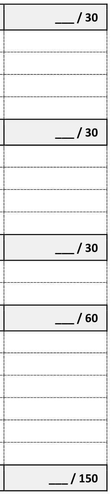

<!-- Source: FSAE_Driverless_Design_ScoreSheet_v1.pdf, pages 1–8 -->

### Formula SAE Design Judging Score Sheet – Driverless Electric Vehicle (EV)

School Name: \_\_\_\_\_\_\_\_\_\_\_\_\_\_\_\_\_\_\_\_\_\_\_\_\_\_\_\_\_\_\_\_\_\_\_\_\_ Car #: \_\_\_\_\_

Paddock #: \_\_\_\_\_ Contact Name/Cell #: \_\_\_\_\_\_\_\_\_\_\_\_\_\_\_\_\_\_\_\_\_\_\_\_\_\_\_\_

| Summary of Design Judge Scoring Areas |  |
|---|---|
| Overall Vehicle Concept | /30 |
| Software & Computation | /30 |
| Vehicle Performance | /30 |
| Autonomous Functionality | /60 |
| Total | /150 |

About your score…

This Design Judging Score Sheet totals 150pts. Your official Design Event score will differ from the score on this page. Do not panic! This scoresheet is a tool.

The score listed on this sheet reflects your assigned judges’ assessments relative to other teams in your queue. Despite attempts to ensure consistency, judge scores always vary somewhat from queue to queue. Hence, the chief judges compare notes across queues, working to normalize scores and minimize bias via multi-tier rankings of teams. The official Design Event score is the result of this process.

Design Judging Score Sheets with written judges’ comments shall be distributed to the teams but are not shared with other teams. Teams should expect to receive written comments along with verbal feedback from their First Round Design Judges.

About this scoresheet...

This scoresheet divides the autonomous vehicle into four scoring categories. NOTE: The topics listed are not all-inclusive and should not be treated as a checklist by students or judges. Each topic should be understood in the context of the overall autonomous system’s performance.

As always, Design, Build, Validation/Refinement and Understanding are essential aspects of the Design Event. For any topic, students should be ready to discuss their decision-making process, goals, the underlying theory, modeling choices, options considered, constraints, assumptions, component/material selection, manufacturing, testing, validation/correlation and any successes/failures encountered.

Remember, judges are evaluating your knowledge and understanding, along with your vehicle.

More on the Design Process…

Design Judges are interested in your implementation/execution of the full design process as applied to every aspect of your car. The process begins with underlying theory and proceeds through several steps, culminating in your understanding. Reflective of this, Design Judges evaluate the teams and assess points per the following breakdown:

- Design (~25%): Were different design options considered? What criteria were used to make design decisions? How much is a new design, an evolution or a carryover? How well do students understand the underlying science/engineering? What pre-build analyses were performed? Is this an integrated design, or a series of independent sub-systems?
- Build (~25%): Does the car reflect the design work? Does it reflect the design documents? If not, why not? What special manufacturing considerations were encountered? Were the build methods and processes appropriate and well-executed?
- Refinement/Validation (~25%): How thorough and objective was the team’s testing? Was a test plan developed and executed? Were discrepancies between predicted and tested results documented and acted upon to improve final build? How has the team developed their car through testing?
- Understanding (~25%): Do the students at competition understand their car? Are they intimate with the design and the engineering fundamentals it attempts to exploit? What has the team learned from testing their car? How would the team improve their car for a future competition? For autonomous systems in particular, judges will probe whether students understand the probabilistic nature of their system — how uncertainty propagates from sensing through to actuation, and how the design manages that uncertainty safely.

More on Scoring Categories…

This scoresheet divides the autonomous vehicle into four scoring categories. These overlap, as do the expertise of individual Design Judges and the focus areas of individual students. During First Round Judging, Design Judges and students alike work together to ensure all areas of the vehicle are discussed. Approximately three to six Design Judges will be evaluating your team in First Round Judging.

The Overall Vehicle Concept category (30 pts) necessarily spans the other three sub-systems. Teams should be prepared to discuss top-level design, goals, and safety strategy. The remaining three sub-systems also have some overlap, as no sub-system exists in a vacuum. Design Judges will be looking for interactions between various subsystems while focusing on each specific category.

Final thoughts…

Be sure to read the Design Event section of the official Rules and the supplemental Design Event Description found on the Series Resources page of fsaeonline.com.

Keep in mind that Design Judges are not picking the fastest car, nor do they presume that certain design elements are the best way to win the competition. Instead, Design Judges want to know your top-level goals. They will then evaluate your subsequent decisions, engineering and implementation in that context. The knowledge/understanding demonstrated by students is paramount to high Design Event scores.

The next few pages provide a survey of topics within each subsystem. Again, these lists are not all-inclusive and should not be treated as a checklist. Each topic should be understood in the context of the overall vehicle’s performance. Don’t miss the big picture!

<table>
<tr><th></th><th></th><th>Overall Vehicle Concept Judges evaluate whether the team has a clear, integrated design philosophy connecting competition goals through vehicle architecture, safety strategy, and project execution. How do choices across all sub-systems support the team’s top-level goals, and what trade-offs were made?</th><th></th></tr>
<tr>
<td></td>
<td colspan="2">Goals, Resources &amp; Specifications</td>
<td></td>
</tr>
<tr>
<td rowspan="11" colspan="2"></td>
<td>• Competition and design strategy: Demonstrate depth of understanding of the racecar</td>
<td rowspan="11"></td>
</tr>
<tr>
<td>engineering domain, competition rules and competition point structure</td>
</tr>
<tr>
<td>• Vehicle architecture selection: Driver vs. driverless trade-off; sensor and compute platform</td>
</tr>
<tr>
<td>selection rationale; are these questions answered for multiple vehicle concepts?</td>
</tr>
<tr>
<td>• Synthesis of sub-systems: Does autonomous vehicle design work as a whole?</td>
</tr>
<tr>
<td>• Team constraints: Impacts on approach, impact minimization and work-arounds</td>
</tr>
<tr>
<td>• Correlate competition points to vehicle performance; correlate vehicle performance to</td>
</tr>
<tr>
<td>vehicle characteristics</td>
</tr>
<tr>
<td>• Were multiple competition strategies and vehicle concepts considered?</td>
</tr>
<tr>
<td>• Overall vehicle goals: Consistent with competition point allocation, vehicle performance,</td>
</tr>
<tr>
<td>vehicle characteristics, and stated team objectives and constraints?</td>
</tr>
<tr>
<td></td>
<td colspan="2">Sub-systems &amp; Cross-Functional Knowledge</td>
<td></td>
</tr>
<tr>
<td rowspan="7" colspan="2"></td>
<td>• Sub-system specifications (performance &amp; characteristics) for selected concept</td>
<td rowspan="7"></td>
</tr>
<tr>
<td>• Integration between perception, localization, planning, controls, and mechanical systems —</td>
</tr>
<tr>
<td>no sub-system exists in a vacuum</td>
</tr>
<tr>
<td>• Sensors, compute, and other large components are well-packaged; straight-line load-paths</td>
</tr>
<tr>
<td>lead to low mass and disciplined mass management</td>
</tr>
<tr>
<td>• Aero (if equipped) is designed and well-integrated into vehicle</td>
</tr>
<tr>
<td>• Use of integrated simulations, including sim-to-real validation, to resolve these trade-offs</td>
</tr>
<tr>
<td></td>
<td colspan="2">Functional Safety</td>
<td></td>
</tr>
<tr>
<td rowspan="9" colspan="2"></td>
<td>• Safety concept: Hazard Analysis and Risk Assessment (HARA) (reference ISO 26262);</td>
<td rowspan="9"></td>
</tr>
<tr>
<td>foreseeable misuse and performance limitations (reference SOTIF ISO 21448).</td>
</tr>
<tr>
<td>• Emergency stop (EBS) architecture: Software and hardware watchdog strategy; fail-</td>
</tr>
<tr>
<td>operational vs. fail-safe design decisions</td>
</tr>
<tr>
<td>• Fail-safe and fallback behaviors: What happens on sensor failure, compute timeout, or</td>
</tr>
<tr>
<td>communications loss? How is safe state reached?</td>
</tr>
<tr>
<td>• Safety validation: How was the safety concept verified and tested? What scenarios were</td>
</tr>
<tr>
<td>exercised?</td>
</tr>
<tr>
<td>• Compliance with FSAE autonomous and EV safety rules</td>
</tr>
<tr>
<td></td>
<td colspan="2">Project Management, Execution &amp; Validation</td>
<td></td>
</tr>
<tr>
<td rowspan="7" colspan="2"></td>
<td>• Schedule and milestone rigor; Team Organization: Structure and Effectiveness</td>
<td rowspan="7"></td>
</tr>
<tr>
<td>• Resource Management: Budget, Facilities, Team Size; Knowledge Management: Training and</td>
</tr>
<tr>
<td>documentation</td>
</tr>
<tr>
<td>• Build quality: Welds, bodywork, machining, composites, sensor and compute hardware</td>
</tr>
<tr>
<td>integration</td>
</tr>
<tr>
<td>• Clarity, depth, and utility of analytical, computational, and experimental processes; sim-to-</td>
</tr>
<tr>
<td>real gap characterization</td>
</tr>
</table>

### Software & Computation

Judges evaluate the rigor and professionalism of the team’s software engineering practice — from architecture and development process discipline through to the compute infrastructure that enables real-time autonomous operation. What trade-offs connect software architecture to real-time performance and hardware constraints?

<table>
<tr>
<td></td>
<td colspan="2">Software Architecture</td>
<td></td>
</tr>
<tr>
<td rowspan="7" colspan="2"></td>
<td>• Overall system design: Modularity, middleware choice (e.g., Robot Operating System 2</td>
<td rowspan="7"></td>
</tr>
<tr>
<td>(ROS2)), publish/subscribe vs. service communication patterns</td>
</tr>
<tr>
<td>• Node/module decomposition: Rationale, interfaces, and data flow diagrams</td>
</tr>
<tr>
<td>• Real-time constraints: Determinism, latency budgets, thread priorities</td>
</tr>
<tr>
<td>• Safety and fault-tolerance patterns embedded into architecture; how are failures detected</td>
</tr>
<tr>
<td>and isolated?</td>
</tr>
<tr>
<td>• Version control, code review, and software quality practices</td>
</tr>
<tr>
<td></td>
<td colspan="2">Software Development Process</td>
<td></td>
</tr>
<tr>
<td rowspan="7" colspan="2"></td>
<td>• Development methodology: Agile, V-model, or other — rationale for choice and how it drove</td>
<td rowspan="7"></td>
</tr>
<tr>
<td>quality outcomes</td>
</tr>
<tr>
<td>• Testing strategy: Unit tests, integration tests, hardware-in-the-loop (HITL), simulation-based</td>
</tr>
<tr>
<td>regression testing</td>
</tr>
<tr>
<td>• Continuous integration / continuous deployment (CI/CD) pipeline</td>
</tr>
<tr>
<td>• Documentation practices: Architecture docs, interface contracts, runbooks</td>
</tr>
<tr>
<td>• How have software failures during testing driven process improvements?</td>
</tr>
<tr>
<td></td>
<td colspan="2">Data Management &amp; Analytics</td>
<td></td>
</tr>
<tr>
<td rowspan="7" colspan="2"></td>
<td>• Data acquisition strategy: What is logged, at what rate, and why? How is data quality</td>
<td rowspan="7"></td>
</tr>
<tr>
<td>assured?</td>
</tr>
<tr>
<td>• Storage architecture: On-board vs. off-board, redundancy, and data integrity</td>
</tr>
<tr>
<td>• Simulation integration: Synthetic data generation, sim-to-real gap characterization,</td>
</tr>
<tr>
<td>regression suites (e.g., CARLA (Car Learning to Act) simulator, Gazebo)</td>
</tr>
<tr>
<td>• Tools and pipelines used for post-processing and analysis</td>
</tr>
<tr>
<td>• Feedback loop: How does data analysis drive design and software improvements?</td>
</tr>
<tr>
<td></td>
<td colspan="2">Compute Platform</td>
<td></td>
</tr>
<tr>
<td rowspan="12" colspan="2"></td>
<td>• Compute hardware selection: central processing unit (CPU), graphics processing unit (GPU),</td>
<td rowspan="12"></td>
</tr>
<tr>
<td>field-programmable gate array (FPGA) rationale, trade-offs, thermal/power budget</td>
</tr>
<tr>
<td>• Inference acceleration: GPU/accelerator for perception workloads (CUDA (Compute Unified</td>
</tr>
<tr>
<td>Device Architecture), TensorRT, ONNX (Open Neural Network Exchange) runtime) —</td>
</tr>
<tr>
<td>throughput vs. power trade-offs</td>
</tr>
<tr>
<td>• Operating system (OS) and runtime environment: Real-time OS, scheduler configuration,</td>
</tr>
<tr>
<td>latency profiling</td>
</tr>
<tr>
<td>• Resource utilization: CPU/GPU load, memory, input/output (I/O) bandwidth under</td>
</tr>
<tr>
<td>competition conditions</td>
</tr>
<tr>
<td>• Redundancy and watchdog design: Hardware watchdog timer strategy, software heartbeat</td>
</tr>
<tr>
<td>monitoring</td>
</tr>
<tr>
<td>• Packaging, vibration isolation, thermal management of compute hardware</td>
</tr>
</table>

### Vehicle Performance

Judges evaluate how well the team understands and exploits the physical performance of the vehicle as an autonomous platform — connecting tire physics and suspension dynamics to system-level lap performance.

<table>
<tr><th></th><th></th><th>What trade-offs exist between vehicle aggressiveness and autonomous system robustness?</th><th></th></tr>
<tr>
<td></td>
<td colspan="2">Vehicle Dynamics &amp; Tires (+Brakes)</td>
<td></td>
</tr>
<tr>
<td rowspan="11" colspan="2"></td>
<td>• Vehicle dynamics concepts: F=ma, masses, inertias, balance, tire friction coefficient</td>
<td rowspan="11"></td>
</tr>
<tr>
<td>• Synthesis of center of gravity (CG) location, tire selection, lateral load transfer distribution</td>
</tr>
<tr>
<td>and aero balance, wheelbase, track width, chassis stiffness</td>
</tr>
<tr>
<td>• Effect of brakes, drivetrain, torque-vectoring, etc. on vehicle response in autonomous mode</td>
</tr>
<tr>
<td>• Performance/handling/balance metrics; friction circle utilization</td>
</tr>
<tr>
<td>• Tire selection: Size, manufacturer, compound; static settings: Toe, inclination, pressure</td>
</tr>
<tr>
<td>• Dynamic operating conditions: Loads, slip angles, inclination angles, pressures, temperatures</td>
</tr>
<tr>
<td>• Brake system: Front/rear balance, anti-lock braking system (ABS) strategy, integration with</td>
</tr>
<tr>
<td>autonomous controls</td>
</tr>
<tr>
<td>• Use/analysis of collected data (accelerometers, wheel speeds, etc.); full-vehicle</td>
</tr>
<tr>
<td>calculations/modeling &amp; correlation</td>
</tr>
<tr>
<td></td>
<td colspan="2">System-Level Performance Integration</td>
<td></td>
</tr>
<tr>
<td rowspan="13" colspan="2"></td>
<td>• Lap time simulation: How is the vehicle model constructed, validated, and connected to the</td>
<td rowspan="13"></td>
</tr>
<tr>
<td>autonomous controller’s performance targets?</td>
</tr>
<tr>
<td>• How are performance targets (speed, acceleration, braking) set for the autonomous</td>
</tr>
<tr>
<td>controller, and how are vehicle dynamics measurements used to inform them?</td>
</tr>
<tr>
<td>• Performance envelope exploration: How are vehicle limits identified and leveraged?</td>
</tr>
<tr>
<td>• Powertrain sizing and torque delivery strategy for autonomous operation</td>
</tr>
<tr>
<td>• Aerodynamics (if equipped): Downforce/drag targets, center of pressure management,</td>
</tr>
<tr>
<td>integration with autonomous balance</td>
</tr>
<tr>
<td>• Optimization methodology: What metrics are optimized (lap time, consistency, energy)? How</td>
</tr>
<tr>
<td>are competing objectives balanced?</td>
</tr>
<tr>
<td>• Trade-off between peak performance and robustness/reliability under autonomous operation</td>
</tr>
<tr>
<td>• Track testing results: Agreement/disagreement with predictions, system feedback, and</td>
</tr>
<tr>
<td>lessons learned</td>
</tr>
</table>

### Autonomous Functionality

Judges evaluate the full autonomous stack from sensing through to vehicle commands. Sub-section points: Perception & Sensors (15), Localization & Mapping (10), Trajectory & Planning (10), Vehicle Controls (10), Sensor Integration (Hardware) (5), Integrated Vehicle Validation (10). These point values are provided for reference and are not a binding requirement on how judging is performed. How do perception, localization, planning, and

<table>
<tr><th></th><th></th><th>control decisions interact to produce safe, fast, and consistent lap performance?</th><th></th></tr>
<tr>
<td></td>
<td colspan="2">Perception &amp; Sensors</td>
<td></td>
</tr>
<tr>
<td rowspan="17" colspan="2"></td>
<td>• Sensor suite selection: LiDAR (Light Detection and Ranging), camera, radar, inertial</td>
<td rowspan="17"></td>
</tr>
<tr>
<td>measurement unit (IMU) rationale, performance criteria, cost/weight trade-offs</td>
</tr>
<tr>
<td>• Sensor placement and coverage: Field of view, overlap, blind spots, and how placement was</td>
</tr>
<tr>
<td>validated</td>
</tr>
<tr>
<td>• Cone detection algorithm: Approach (classical, deep learning, or hybrid), accuracy metrics,</td>
</tr>
<tr>
<td>precision/recall, false positive/negative management</td>
</tr>
<tr>
<td>• Low-level sensor fusion: State estimation method (Extended Kalman Filter (EKF), Unscented</td>
</tr>
<tr>
<td>Kalman Filter (UKF), error-state Kalman Filter (KF)) for combining IMU, wheel odometry, and</td>
</tr>
<tr>
<td>absolute sensor measurements — theory and tuning</td>
</tr>
<tr>
<td>• Object-level fusion: How detections from multiple modalities (LiDAR, camera) are associated</td>
</tr>
<tr>
<td>and combined; data association methods</td>
</tr>
<tr>
<td>• Scene understanding: Free-space estimation, dynamic object tracking (if applicable), and</td>
</tr>
<tr>
<td>confidence/uncertainty representation in detection outputs</td>
</tr>
<tr>
<td>• Robustness and reliability: Performance under varying lighting, weather, and surface</td>
</tr>
<tr>
<td>conditions; test coverage and failure modes</td>
</tr>
<tr>
<td>• Perception pipeline latency: End-to-end delay budget and its effect on safe vehicle operation</td>
</tr>
<tr>
<td>• Ground truth and perception validation methodology</td>
</tr>
<tr>
<td></td>
<td colspan="2">Localization &amp; Mapping</td>
<td></td>
</tr>
<tr>
<td rowspan="14" colspan="2"></td>
<td>• Localization concept: Simultaneous Localization and Mapping (SLAM), map-based, global</td>
<td rowspan="14"></td>
</tr>
<tr>
<td>navigation satellite system (GNSS)-aided — rationale for chosen approach</td>
</tr>
<tr>
<td>• Map representation: Landmark-based, occupancy grid, topological graph — what suits FSAE</td>
</tr>
<tr>
<td>cone courses and why?</td>
</tr>
<tr>
<td>• Vehicle state estimation: Position, heading, velocity, and uncertainty quantification</td>
</tr>
<tr>
<td>(covariance estimation)</td>
</tr>
<tr>
<td>• Filter/algorithm selection: EKF, particle filter, factor graph/SLAM backend (e.g., iSAM2 (incr.</td>
</tr>
<tr>
<td>Smoothing &amp; Mapping), g2o (General Graph Optimization), GTSAM (Georgia Tech Smoothing</td>
</tr>
<tr>
<td>&amp; Mapping)) — theory and tuning</td>
</tr>
<tr>
<td>• Map initialization and convergence: Startup from known vs. unknown position; convergence</td>
</tr>
<tr>
<td>time and reliability</td>
</tr>
<tr>
<td>• Loop closure and drift correction: Detection method (scan matching, descriptor) and graph</td>
</tr>
<tr>
<td>update strategy</td>
</tr>
<tr>
<td>• Localization accuracy: How is it measured? What is achieved vs. required?</td>
</tr>
</table>

### Autonomous Functionality (continued)

Continuation of Autonomous Functionality. Trajectory & Planning (10), Vehicle Controls (10), Sensor Integration (Hardware) (5), Integrated Vehicle Validation (10). These point values are provided for reference and are not a

<table>
<tr><th></th><th></th><th>binding requirement on how judging is performed.</th><th></th></tr>
<tr>
<td></td>
<td colspan="2">Trajectory &amp; Planning</td>
<td></td>
</tr>
<tr>
<td rowspan="8" colspan="2"></td>
<td>• Planning concept: Global planner, local planner, or unified — rationale and trade-offs</td>
<td rowspan="8"></td>
</tr>
<tr>
<td>• Path generation: Minimum curvature, minimum time, or other optimization criterion</td>
</tr>
<tr>
<td>• Vehicle model used in planning: Kinematic vs. dynamic; fidelity vs. compute trade-off; how</td>
</tr>
<tr>
<td>was it validated against physical measurements?</td>
</tr>
<tr>
<td>• Speed profile planning: Acceleration and braking limits, jerk constraints, integration with tire</td>
</tr>
<tr>
<td>friction limits</td>
</tr>
<tr>
<td>• Re-planning: How quickly and reliably can the planner respond to new information?</td>
</tr>
<tr>
<td>• Validation: How were planning decisions tested in simulation and on track?</td>
</tr>
<tr>
<td></td>
<td colspan="2">Vehicle Controls</td>
<td></td>
</tr>
<tr>
<td rowspan="9" colspan="2"></td>
<td>• Lateral vehicle control: Geometric path-tracking (pure pursuit, Stanley) vs. feedback control</td>
<td rowspan="9"></td>
</tr>
<tr>
<td>— Proportional-Integral-Derivative (PID) or Model Predictive Control (MPC) selection</td>
</tr>
<tr>
<td>rationale and tuning</td>
</tr>
<tr>
<td>• Longitudinal vehicle control: Acceleration and braking controller design</td>
</tr>
<tr>
<td>• Dynamic limits and control strategy: Tire saturation and friction circle utilization, stability and</td>
</tr>
<tr>
<td>limit handling</td>
</tr>
<tr>
<td>• Actuator interfaces: Steering, throttle, brake — bandwidth, latency, accuracy, and delay</td>
</tr>
<tr>
<td>compensation; integration with powertrain (regenerative braking, torque vectoring)</td>
</tr>
<tr>
<td>• Control validation: Simulation, HIL, and track data correlation</td>
</tr>
<tr>
<td></td>
<td colspan="2">Sensor Integration (Hardware)</td>
<td></td>
</tr>
<tr>
<td rowspan="8" colspan="2"></td>
<td>• Sensor mounting and placement: Structural loads, vibration isolation, accessibility for</td>
<td rowspan="8"></td>
</tr>
<tr>
<td>maintenance</td>
</tr>
<tr>
<td>• Calibration and alignment: Intrinsic/extrinsic calibration procedures, validation method, and</td>
</tr>
<tr>
<td>re-calibration strategy</td>
</tr>
<tr>
<td>• Connectivity and data links: Cable management, connector selection, electromagnetic</td>
</tr>
<tr>
<td>interference (EMI) shielding</td>
</tr>
<tr>
<td>• Power management for sensors: Supply stability, filtering, protection</td>
</tr>
<tr>
<td>• Environmental protection: Sealing, thermal management, dust/water ingress prevention</td>
</tr>
<tr>
<td></td>
<td colspan="2">Integrated Vehicle Validation</td>
<td></td>
</tr>
<tr>
<td rowspan="10" colspan="2"></td>
<td>• Test scenario coverage: What scenarios were tested (track types, conditions, edge cases)?</td>
<td rowspan="10"></td>
</tr>
<tr>
<td>What was not tested, and why?</td>
</tr>
<tr>
<td>• Key performance indicator (KPI) baselines: What measurable targets were set pre-test (lap</td>
</tr>
<tr>
<td>time, cone hit rate, localization error)? What was achieved?</td>
</tr>
<tr>
<td>• Failure mode documentation: What failed during development? Root cause analysis and</td>
</tr>
<tr>
<td>design changes made in response</td>
</tr>
<tr>
<td>• Agreement/disagreement with predictions: How do simulation and real-world results</td>
</tr>
<tr>
<td>compare? How is the gap closed?</td>
</tr>
<tr>
<td>• Remaining risks and lessons learned: What known limitations exist at competition? How</td>
</tr>
<tr>
<td>would the team improve for next year?</td>
</tr>
</table>

Design Judge Comments Judge Name: \_\_\_\_\_\_\_\_\_\_\_\_\_\_\_\_\_\_\_\_\_\_\_\_\_\_\_

School Name: \_\_\_\_\_\_\_\_\_\_\_\_\_\_\_\_\_\_\_\_\_\_\_\_\_\_\_\_\_\_\_\_\_\_\_\_\_ Car #: \_\_\_\_\_\_

<table>
<tr>
<td colspan="3"></td>
<td colspan="2"></td>
</tr>
<tr>
<td></td>
<td>Overall Vehicle Concept</td>
<td></td>
<td>___ / 30</td>
<td></td>
</tr>
<tr>
<td colspan="3"></td>
<td colspan="2"></td>
</tr>
<tr>
<td colspan="3">Goals, Resources &amp; Specifications</td>
<td></td>
<td></td>
</tr>
<tr>
<td colspan="3">Sub-systems &amp; Cross-Functional Knowledge</td>
<td colspan="2"></td>
</tr>
<tr>
<td colspan="3">Functional Safety</td>
<td colspan="2"></td>
</tr>
<tr>
<td colspan="3">Project Management, Execution &amp; Validation</td>
<td colspan="2"></td>
</tr>
<tr>
<td colspan="3"></td>
<td colspan="2"></td>
</tr>
<tr>
<td></td>
<td>Software &amp; Computation</td>
<td></td>
<td>___ / 30</td>
<td></td>
</tr>
<tr>
<td colspan="3"></td>
<td colspan="2"></td>
</tr>
<tr>
<td colspan="3">Software Architecture</td>
<td></td>
<td></td>
</tr>
<tr>
<td colspan="3">Software Development Process</td>
<td colspan="2"></td>
</tr>
<tr>
<td colspan="3">Data Management &amp; Analytics</td>
<td colspan="2"></td>
</tr>
<tr>
<td colspan="3">Compute Platform</td>
<td colspan="2"></td>
</tr>
<tr>
<td colspan="3"></td>
<td colspan="2"></td>
</tr>
<tr>
<td></td>
<td>Vehicle Performance</td>
<td></td>
<td>___ / 30</td>
<td></td>
</tr>
<tr>
<td colspan="3"></td>
<td colspan="2"></td>
</tr>
<tr>
<td colspan="3">Vehicle Dynamics &amp; Tires (+Brakes)</td>
<td></td>
<td></td>
</tr>
<tr>
<td colspan="3">System-Level Performance Integration</td>
<td colspan="2"></td>
</tr>
<tr>
<td colspan="3"></td>
<td colspan="2"></td>
</tr>
<tr>
<td></td>
<td>Autonomous Functionality</td>
<td></td>
<td>___ / 60</td>
<td></td>
</tr>
<tr>
<td colspan="3"></td>
<td colspan="2"></td>
</tr>
<tr>
<td colspan="3">Perception &amp; Sensors</td>
<td></td>
<td></td>
</tr>
<tr>
<td colspan="3">Localization &amp; Mapping</td>
<td colspan="2"></td>
</tr>
<tr>
<td colspan="3">Trajectory &amp; Planning</td>
<td colspan="2"></td>
</tr>
<tr>
<td colspan="3">Vehicle Controls</td>
<td colspan="2"></td>
</tr>
<tr>
<td colspan="3">Sensor Integration (Hardware)</td>
<td colspan="2"></td>
</tr>
<tr>
<td colspan="3">Integrated Vehicle Validation</td>
<td colspan="2"></td>
</tr>
<tr>
<td colspan="3"></td>
<td colspan="2"></td>
</tr>
<tr>
<td></td>
<td>Total</td>
<td></td>
<td>___ / 150</td>
<td></td>
</tr>
<tr>
<td colspan="3"></td>
<td colspan="2"></td>
</tr>
</table>

Strengths: \_\_\_\_\_\_\_\_\_\_\_\_\_\_\_\_\_\_\_\_\_\_\_\_\_\_\_\_\_\_\_\_\_\_\_\_\_\_\_\_\_\_\_\_\_\_\_\_\_\_\_\_\_\_\_\_\_\_\_\_\_\_\_\_\_\_\_\_\_\_\_\_\_\_\_\_

\_\_\_\_\_\_\_\_\_\_\_\_\_\_\_\_\_\_\_\_\_\_\_\_\_\_\_\_\_\_\_\_\_\_\_\_\_\_\_\_\_\_\_\_\_\_\_\_\_\_\_\_\_\_\_\_\_\_\_\_\_\_\_\_\_\_\_\_\_\_\_\_\_\_\_\_\_\_\_\_\_\_\_\_\_\_\_

\_\_\_\_\_\_\_\_\_\_\_\_\_\_\_\_\_\_\_\_\_\_\_\_\_\_\_\_\_\_\_\_\_\_\_\_\_\_\_\_\_\_\_\_\_\_\_\_\_\_\_\_\_\_\_\_\_\_\_\_\_\_\_\_\_\_\_\_\_\_\_\_\_\_\_\_\_\_\_\_\_\_\_\_\_\_\_

Areas for Improvement:

\_\_\_\_\_\_\_\_\_\_\_\_\_\_\_\_\_\_\_\_\_\_\_\_\_\_\_\_\_\_\_\_\_\_\_\_\_\_\_\_\_\_\_\_\_\_\_\_\_\_\_\_\_\_\_\_\_\_\_\_\_\_\_\_\_\_\_\_\_\_\_\_\_\_\_\_

\_\_\_\_\_\_\_\_\_\_\_\_\_\_\_\_\_\_\_\_\_\_\_\_\_\_\_\_\_\_\_\_\_\_\_\_\_\_\_\_\_\_\_\_\_\_\_\_\_\_\_\_\_\_\_\_\_\_\_\_\_\_\_\_\_\_\_\_\_\_\_\_\_\_\_\_\_\_\_\_\_\_\_\_\_\_\_

\_\_\_\_\_\_\_\_\_\_\_\_\_\_\_\_\_\_\_\_\_\_\_\_\_\_\_\_\_\_\_\_\_\_\_\_\_\_\_\_\_\_\_\_\_\_\_\_\_\_\_\_\_\_\_\_\_\_\_\_\_\_\_\_\_\_\_\_\_\_\_\_\_\_\_\_\_\_\_\_\_\_\_\_\_\_\_

Additional Comments:

\_\_\_\_\_\_\_\_\_\_\_\_\_\_\_\_\_\_\_\_\_\_\_\_\_\_\_\_\_\_\_\_\_\_\_\_\_\_\_\_\_\_\_\_\_\_\_\_\_\_\_\_\_\_\_\_\_\_\_\_\_\_\_\_\_\_\_\_\_\_\_\_\_\_\_\_

\_\_\_\_\_\_\_\_\_\_\_\_\_\_\_\_\_\_\_\_\_\_\_\_\_\_\_\_\_\_\_\_\_\_\_\_\_\_\_\_\_\_\_\_\_\_\_\_\_\_\_\_\_\_\_\_\_\_\_\_\_\_\_\_\_\_\_\_\_\_\_\_\_\_\_\_\_\_\_\_\_\_\_\_\_\_\_

\_\_\_\_\_\_\_\_\_\_\_\_\_\_\_\_\_\_\_\_\_\_\_\_\_\_\_\_\_\_\_\_\_\_\_\_\_\_\_\_\_\_\_\_\_\_\_\_\_\_\_\_\_\_\_\_\_\_\_\_\_\_\_\_\_\_\_\_\_\_\_\_\_\_\_\_\_\_\_\_\_\_\_\_\_\_\_
