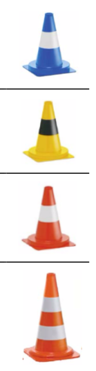
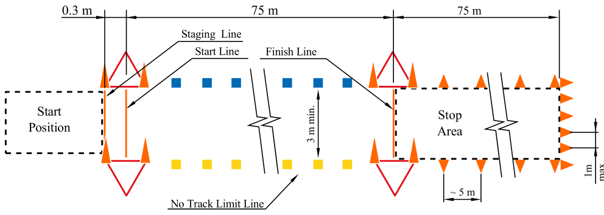
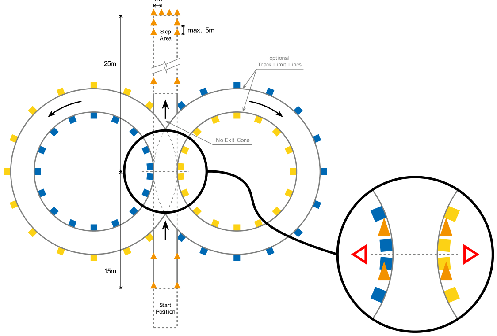
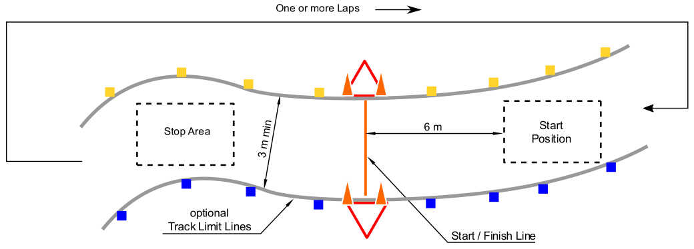

<!-- Source: FSAE_Driverless_2027_V1.pdf, pages 12–19 -->

# DD - DRIVERLESS DYNAMIC

## DD.1 TRACK MARKING

### DD.1.1 Dynamic Event Markings

All Dynamic Events are marked by:

- a. Track Border, Left Side - Small Blue Cones
- b. Track Border, Right Side - Small Yellow Cones
- c. Entry and Exit Lanes - Small Orange Cones
- d. Before and after start, finish and timekeeping lines - Large Orange Cones
- e. Timekeeping equipment may be surrounded by additional cones outside of the track boundary

### DD.1.2 Marking Limitations

**DD.1.2.1** Limitations from existing conditions and operational issues:

- a. Any track marking lines may not be perfectly and continuously drawn
- b. More markings may exist that are not part of the track (including but not limited to pavement markings, cone position markings, lines from other events, different colored surface) on or close to the track. These will not be removed
- c. Spare cones near the track or cones marking other event areas at distinguishable distance
- d. Time keeping equipment may be next to the track

**DD.1.2.2** Teams must not place additional landmarks, beacons, or other similar equipment on the track or inside the Dynamic Area

**DD.1.2.3** No special artificial landmarks are provided

**DD.1.2.4** No map data is given

### DD.1.3 Cones

**DD.1.3.1** Details of Cones used to mark the Driverless Dynamic tracks:

|  | Cone Type | Stripe | WEMAS Part Number |
|---|---|---|---|
| a. | Small Blue | Single White | 400.000043.00.00 |
| b. | Small Yellow | Single Black | 400.000013.01.10 |
| c. | Small Orange | Single White | 400.000013.00.00 |
| d. | Large Orange | Dual White | 307.610500.00.00 |



**DD.1.3.2** Cone Sizes

- a. Small Cones are 228 mm × 228 mm × 325 mm
- b. Large Cones are 285 mm × 285 mm × 505 mm

## DD.2 DYNAMIC PENALTIES

**DD.2.1.1** Cones that are Down or Out D.8.1.1

- a. Are not replaced or reset while the vehicle is running
- b. Do not cause a rerun if missing or in the path of the vehicle

**DD.2.1.2** Off Course

When the vehicle has all four wheels outside the track boundary as indicated by the edge marking

**DD.2.1.3** Unsafe Stop

When the vehicle does not do one or more of the three:

- a. Stop in the specified area
- b. Stay in the expected orientation
- c. Go to Driverless System Finished in 30 seconds or less after stopping

## DD.3 DYNAMIC OPERATIONS

### DD.3.1 Start Up Procedure

**DD.3.1.1** Team members must move the vehicle to the starting location

**DD.3.1.2** The vehicle must be staged with the steering system in the straight ahead position

**DD.3.1.3** No additional equipment (laptop, jack-up device, pressure tank, etc.) is permitted to start up the vehicle at the staging/starting line

**DD.3.1.4** The DSMS must only be switched on by the DSO after approval from an official

**DD.3.1.5** If the vehicle does not enter Driverless System Ready 1 min or less after being staged, the team may be sent back to the preparation area

### DD.3.2 Driving Under Power

**DD.3.2.1** When in Driverless Mode:

- a. A DSO must be at the given location with the Remote Stop Control Box
- b. Other team members must go to a given location

**DD.3.2.2** The vehicle may only enter Ready to Drive by the “Go” signal from the Remote Stop Control Box, after the system has remained in Driverless System Ready for 5 sec minimum

**DD.3.2.3** The vehicle must not start moving until the Driverless System has been in Driving DO.1.1.1 for 3 seconds minimum

**DD.3.2.4** If the vehicle does not start a run in 30 sec or less from the “Go” signal, that run is DNF

### DD.3.3 Run Completion or Unable to Complete

**DD.3.3.1** If a vehicle comes to standstill for any reason, it has 30 sec to attempt to continue

**DD.3.3.2** After approval from the officials the DSO must deactivate the vehicle using the Remote Stop Control Box

**DD.3.3.3** The vehicle must be collected by the DSO and an additional team member immediately after approval from the officials

**DD.3.3.4** Vehicle recovery may only be done under the control of the officials

## DD.4 DYNAMIC EVENTS

### DD.4.1 Dynamic Area

**DD.4.1.1** Driverless Dynamic Events:

- a. May be in the same area as the Formula SAE Electric Dynamic events
- b. May share all or part of the corresponding Formula SAE Electric Dynamic event setup

### DD.4.2 Acceleration

**DD.4.2.1** Layout

Setup per D.9.1 and DD.1

**DD.4.2.2** Staging

The front of the vehicle is staged at 0.30 m from the starting line

**DD.4.2.3** Event

- a. Each run is done per DD.3
- b. Timing starts when the vehicle crosses the starting line
- c. Timing ends when the vehicle crosses the finish line
- d. Each team may attempt up to 4 runs

**DD.4.2.4** Finish

After the finish line the vehicle must:

- a. Come to a full stop in 75 m or less behind the finish line in the marked exit lane
- b. Go to Driverless System Finished

**DD.4.2.5** Penalties

- a. Cones (DOO)
    Two second penalty for each DOO (including entry and exit gate cones) on that run
- b. Off Course (OC)
    DNF for that run
- c. Unsafe Stop (USS)
    DQ for that run

**DD.4.2.6** Scoring

- a. Corrected Acceleration Time = Run Time + Penalties for each completed run
- b. Scored Acceleration Time - from the run with the lowest Corrected Acceleration Time
- c. Starting Points = 25 points awarded for the vehicle crossing the start line with all four wheels on one or more runs
- d. Completion Points = 25 points awarded for completing one or more runs
- e. Performance Points = 25 points, determined from the Team Finishing Place based on the Scored Acceleration Time

```
Performance Points =   25 x   Number of Teams Finishing + 1 – Team Place
                                      Number of Teams Finishing
```

- f. Acceleration Score = Starting Points + Completion Points + Performance Points



### DD.4.3 Skidpad

**DD.4.3.1** Layout

- a. Setup per D.10.1 and DD.1
- b. Seventeen (17) pylons are put around the inside of each inner circle

**DD.4.3.2** Staging

The front of the vehicle is staged 15 m from the starting line

**DD.4.3.3** Event

- a. Each run is done per DD.3 and D.10.2.3
- b. Each team may attempt up to 4 runs

**DD.4.3.4** Finish

After the finish line the vehicle must:

- a. Come to a full stop in 25 m or less behind the finish line in the marked exit lane
- b. Go to Driverless System Finished

**DD.4.3.5** Penalties

- a. Cones (DOO)
    A 0.125 second penalty for each DOO (including entry and exit gate cones) on that run
- b. Off Course (OC)
    DNF for that run
- c. Incorrect Laps
    Vehicles that run an incorrect number of laps or run the laps in the wrong sequence will be DNF for that run
- d. Unsafe Stop (USS)
    DQ for that run

**DD.4.3.6** Scoring

- a. Corrected Skidpad Time = Run Time + Penalties for each completed run
- b. Scored Skidpad Time - from the run with the lowest Corrected Skidpad Time
- c. Starting Points = 25 points awarded for the vehicle crossing the start line with all four wheels on one or more runs
- d. Completion Points = 25 points awarded for completing one or more runs
- e. Performance Points = 25 points, determined from the Team Finishing Place based on the Scored Skidpad Time

```
Performance Points =   25 x   Number of Teams Finishing + 1 – Team Place
                                      Number of Teams Finishing
```

- f. Skidpad Score = Starting Points + Completion Points + Performance Points



### DD.4.4 Autocross / Trackdrive Layout and Procedure

**DD.4.4.1** Layout

The Driverless Autocross and Trackdrive courses will be designed with these specifications:

- a. Straights: No longer than 80 m
- b. Miscellaneous: Chicanes, multiple turns, decreasing radius turns, hairpin turns, etc.
- c. Minimum track width: 3 m
- d. Minimum required turning diameter: 9 m
- e. Length of one lap should be 200 - 500 m

**DD.4.4.2** Course Walk

- a. A Course Walk is done at a specified time before the Driverless Autocross / Trackdrive
- b. During the Course Walk, only non electronic measurement devices (measuring wheel, tape measure, etc) may be used. No antennas, sensors, cameras, GPS, etc

**DD.4.4.3** Staging

The vehicle is staged on the track with the front wheels 6 m behind the starting line

**DD.4.4.4** Finish

After the finish line the vehicle must:

- a. Come to a full stop in 30 m or less on the track
- b. Go to Driverless System Finished



### DD.4.5 Autocross

**DD.4.5.1** Autocross Event

- a. Autocross will run one lap
- b. Each team may attempt up to 4 runs

**DD.4.5.2** Autocross Procedure

Each run is done per DD.3

**DD.4.5.3** Autocross Penalties

- a. Cones (DOO)
    Two second penalty for each DOO (including cones after the finish line) on that run
- b. Off Course (OC)
    Ten second penalty for each OC
- c. Unsafe Stop (USS)
    DQ for that run

**DD.4.5.4** Autocross Scoring

- a. Corrected Autocross Time = Run Time + Penalties for each completed run
- b. Scored Autocross Time - from the run with the lowest Corrected Autocross Time
- c. Starting Points = 25 points awarded for the vehicle crossing the start line with all four wheels on one or more runs
- d. Completion Points = 25 points awarded for completing one or more runs
- e. Performance Points = 50 points, determined from the Team Finishing Place based on the Scored Autocross Time

```
Performance Points =   50 x   Number of Teams Finishing + 1 – Team Place
                                      Number of Teams Finishing
```

- f. Autocross Score = Starting Points + Completion Points + Performance Points

### DD.4.6 Trackdrive

Trackdrive will NOT be run in 2027, but is planned for future years

**DD.4.6.1** Trackdrive Event

- a. Trackdrive will run 10 laps
- b. The vehicle must determine when the run is complete
- c. No finishing or signal will be given
- d. Each team may be given multiple attempts, at the discretion of the officials

**DD.4.6.2** Trackdrive Procedure

Each run is done per DD.3

**DD.4.6.3** Trackdrive Speed

The vehicle will be DQ if one or the two:

- a. Average speed of the first three laps (combined) is less than 2.5 m/s
- b. Average speed of any of the following laps is less than 3.5 m/s

**DD.4.6.4** Trackdrive Penalties

Per DD.4.5.3

**DD.4.6.5** Trackdrive Scoring

To be provided later
