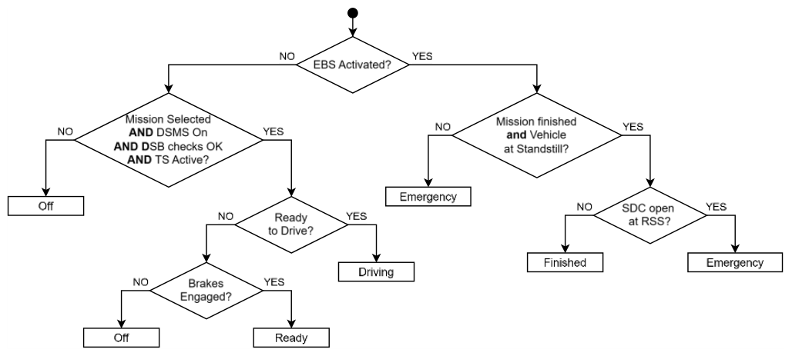

<!-- Source: FSAE_Driverless_2027_V1.pdf, pages 8–10 -->

# DO - DRIVERLESS OPERATIONS

## DO.1 DRIVERLESS SYSTEM

### DO.1.1 Driverless System Status

**DO.1.1.1** Determine the Driverless System Status as shown in the flowchart:

**DO.1.1.2** The “Emergency Brake System Activated” block in the flowchart is answered:

- a. YES – the ESB circuit DT.3.2.1.b is opened after passing the Startup Check DT.3.1.3
- b. NO – the Driverless System Brake has been released using the Deactivation Points DT.3.1.2 or does not pass the Startup Check DT.3.1.3

**DO.1.1.3** The Driverless System Status Indicator must show the status of the Driverless System:

|  | Driverless System Status | DSSI Indication |
|---|---|---|
| a. | Off | Off |
| b. | Ready | Yellow Continuous |
| c. | Driving | Yellow Flashing |
| d. | Finished | Blue Continuous |
| e. | Emergency | Blue Flashing |

### DO.1.2 Driverless Missions

**DO.1.2.1** The Driverless System must implement the following missions:

- Inspection DO.1.3
- Manual Driving
- Emergency Brake System Test
- Acceleration
- Skidpad
- Autocross

The Trackdrive mission or other missions may be included, but are not required

**DO.1.2.2** Mission selection must not use an external device

### DO.1.3 Inspection Mission

The Inspection Mission is used during Driverless Technical Inspection

**DO.1.3.1** The vehicle is supported off the ground with wheels removed

**DO.1.3.2** The Inspection Mission must:

- a. Slowly spin the drivetrain
- b. Slowly operate the steering system with a sine wave pattern
- c. Transition to Driverless System Finished after 25 sec to 30 sec

### DO.1.4 Driverless Mission Indicator

The vehicle must have a Driverless Mission Indicator that must:

- a. Show the selected Driverless Mission
- b. Be easily readable
- c. Be located as one of the two:
    - Part of the dash
    - Near the DSMS

## DO.2 VEHICLE OPERATIONS

### DO.2.1 Vehicle Operation

**DO.2.1.1** Outside of permitted areas:

- a. The detachable handle or key of the Driverless System Master Switch (DSMS) must be completely removed and kept by a DSO
- b. The lockout/tagout function must be used

### DO.2.2 Teleoperated Driving

**DO.2.2.1** Between the times that the vehicle crosses the starting line and crosses the finish line:

- a. Wireless communication to the vehicle is not permitted
- b. One way telemetry from the vehicle may be received

**DO.2.2.2** The Remote Stop Control Box is the only device that may send commands to the vehicle during any Driverless operation

### DO.2.3 Shutdown Circuit

**DO.2.3.1** The Driverless System may close the Shutdown Circuit if the following are obeyed:

- a. Manual Mode: Manual Mission is selected, the Driverless System has checked that DSB is deactivated, meaning no autonomous brake actuation possible
- b. Driverless Mode: A Driverless Mission is selected, DSMS is ON and sufficient brake pressure is built up, meaning the brakes are applied
