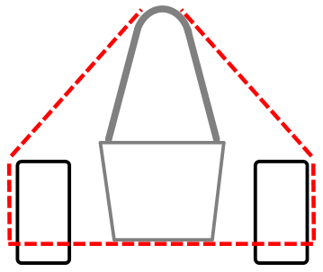
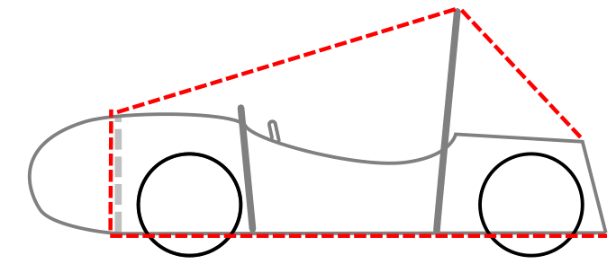

<!-- Source: FSAE_Driverless_2027_V1.pdf, pages 3–8 -->

# DT - DRIVERLESS TECHNICAL

## DT.1 CONTROLS AND INDICATORS

### DT.1.1 Driverless System Master Switch - DSMS

**DT.1.1.1** Each vehicle must have a Driverless System Master Switch that must:

- a. Meet T.9.3 for Configuration and Location
- b. Be direct acting, not act through a relay or logic

**DT.1.1.2** The Driverless System Master Switch must be:

- a. In the center of a completely blue circular area of \> 50 mm diameter
- b. Labeled “DS”
- c. Fitted with a "lockout/tagout" capability in the OFF position

**DT.1.1.3** When the Driverless System Master Switch is in the OFF position:

- a. The Driverless System must not be able to operate any steering, braking, or propulsion
    Sensors and processing may operate
- b. The vehicle must be able to be pushed D.2.1
- c. The vehicle must be able to operate in Manual Mode as a normal vehicle

**DT.1.1.4** When the Driverless System Master Switch is in the ON position:

- a. A person must not be in the vehicle
- b. The DSO may activate the Tractive System
- c. No other manual steps may be performed at the vehicle

### DT.1.2 Tractive System Activation Button

**DT.1.2.1** The vehicle must have a Tractive System Activation Button that is located near the Tractive System Master Switch

**DT.1.2.2** The Tractive System Activation Button must put the vehicle in Tractive System Active from outside the vehicle when pressed

**DT.1.2.3** When the Driverless System Master Switch is OFF, the Tractive System Activation Button must not do any function

### DT.1.3 Driverless System Status Indicators - DSSI

**DT.1.3.1** The vehicle must include three Driverless System Status Indicators, located:

- a. On each side of the vehicle behind the Cockpit, between 160 mm below the top of the Main Hoop and 600 mm above the ground on the two sides of the vehicle
- b. One at the rear of the vehicle, on the vehicle centerline, between 160 mm below the top of the Main Hoop and 100 mm above the Brake Light
- c. Where at least one DSSI must be visible from any angle of the vehicle from a point 1.6 m vertically from ground level, in a 3 m horizontal radius from the top of the Main Hoop

**DT.1.3.2** Each Driverless System Status Indicator must be:

- a. On a Black background
- b. Rectangular, triangular or near round shape with a minimum shining surface of 15 cm2

**DT.1.3.3** If LED lights are used without a diffuser, they must not be more than 20 mm apart

**DT.1.3.4** If a single line of LEDs is used, the minimum length is 150 mm

**DT.1.3.5** The Driverless System Status Indicator must:

- a. Show the Driverless System Status DO.1.1 when the GLVMS and DSMS are ON
- b. Perform no other functions

### DT.1.4 Driverless Alert Sound

**DT.1.4.1** The vehicle must make a characteristic sound when the Driverless System Status is Emergency

**DT.1.4.2** The Driverless Alert Sound must sound an intermittent tone:

- a. With a frequency between 1 Hz and 5 Hz with 50% duty cycle
- b. At a level between 80 dBA and 90 dBA, fast weighting, in a radius of 2 m around the vehicle
- c. For a duration between 8 sec and 10 sec

## DT.2 SENSORS AND ACTUATORS

### DT.2.1 Sensor Power

When the Driverless System Master Switch OR the Low Voltage Master Switch EV.8.9 are in the OFF position, power to all steering and brake actuators must be removed

### DT.2.2 Steering Actuation

**DT.2.2.1** Manual steering must be possible if the DSMS is Off without other steps or actions

For example, operating manual valves or connecting/disconnecting mechanical elements

**DT.2.2.2** Actuation of the steering system must only be possible if the vehicle is Ready to Drive

**DT.2.2.3** The steering system may stay active during an Emergency Brake Maneuver while the vehicle is moving

### DT.2.3 Actuator Decoupling

Actuators may be disconnected for Manual Mode if the four:

- a. No parts are removed for disconnection

Covers may be temporarily removed and reinstalled

- b. All parts must stay in contact with the vehicle

No tethers or similar, fasteners may be loosened but not removed

- c. The disconnection mechanism must not block manual operation in any position
- d. The disconnection mechanism is securely locked in all fixed positions

### DT.2.4 Sensor Camera and Electronics Mounting

**DT.2.4.1** Driverless System Components include but are not limited to sensors and cameras

Antennas are not Driverless System Components

**DT.2.4.2** All Driverless System Components must be positioned inside one or both:

- a. The volume formed by the outside surfaces of the chassis and tires, as shown:

- b. The permitted locations for Aerodynamic Devices T.7.5, T.7.6, T.7.7

## DT.3 BRAKE SYSTEMS

### DT.3.1 Driverless System Brake - DSB

The vehicle must have a Driverless System Brake. The Tractive System is not a Brake System

**DT.3.1.1** Technical Requirements

- a. All parts and their mountings must stay in the Rollover Protection Envelope
- b. Manual braking must always be possible and not prevented at any time
- c. The DSB may be part of the hydraulic brake system

**DT.3.1.2** Deactivation Points

- a. The Driverless System Brake must be designed to be deactivated by a maximum of two Deactivation Points
- b. The Deactivation Points must be:
    - Mounted inside the volume defined in DT.2.4.2.a
    - Mounted in one of the two: near the DSMS or on the top side of the vehicle between the Front Bulkhead and Front Hoop close to the vehicle center line
    - Near each other
    - Protected against unintended actuation (being hit by a cone) while driving
    - Marked with “Brake Release”
    - Fitted with a red handle
    - Able to work without electrical power
    - Operated by maximum two simple push/pull and/or turning actions, the order and direction of these actions must be shown next to the Deactivation Points

**DT.3.1.3** Function

- a. A Startup Check must be performed before Driverless System Status Ready is possible. This check must make sure that DSB is able to build up brake pressure as expected
- b. After the Startup Check the DSB and its signals must be continuously monitored for failures DT.3.2.3
- c. The above functions must be implemented on a single board
    Signals may be routed and processed separately

### DT.3.2 Emergency Brake System - EBS

The Driverless System Brake must include an Emergency Brake System (EBS)

**DT.3.2.1** Technical Requirements

- a. The EBS must only use passive systems with mechanical energy storage
- b. The EBS must be directly supplied by GLVMS, DSMS, Remote Stop Relay DT.4.2.2.b and the Emergency Brake System Relay DT.4.3 with no delay

**DT.3.2.2** The vehicle must start an Emergency Brake Maneuver DT.3.2.5 if:

- a. A failure of the DSB or its signals DT.3.1.3.b
- b. Electrical power loss at the EBS

**DT.3.2.3** The vehicle must go to the Safe State if:

- a. Functionality of the Emergency Brake System cannot be ensured
- b. An (additional) single point of failure would lead to total loss of brake capability
    The Brake Pedal itself is not included T.3.2.2

**DT.3.2.4** The Safe State is when the three:

- a. Vehicle at a standstill
- b. Brakes engaged to prevent the vehicle from rolling
- c. An open Shutdown Circuit

**DT.3.2.5** Emergency Brake Maneuver

The Emergency Brake System must decelerate the vehicle and stop vehicle motion

- a. The system reaction time, the time between opening of the Shutdown Circuit and the start of the deceleration, must be 200 ms or less
- b. The average deceleration must be more than 10 m/s2 under dry track conditions
- c. In case of a single failure the EBS should achieve at least half of the performance
- d. While decelerating, the vehicle must stay in a stable driving condition

### DT.3.3 Remote Stop System

The vehicle must have the standard Remote Stop System

Refer to the Event Website for additional information

**DT.3.3.1** The Remote Stop System has:

- a. Vehicle Module
- b. Control Box
- c. Remote Stop Relay DT.4.2

**DT.3.3.2** When the button on the Remote Stop Control Box is pressed:

- a. Stop Button - the Vehicle Module must Open the Shutdown Circuit
- b. Go Button - the preselected Driverless Mission may start

**DT.3.3.3** The antenna of the Remote Stop System must be mounted unobstructed and without interfering parts in proximity (other antennas, etc)

## DT.4 SHUTDOWN SYSTEM

The Shutdown Circuit for Driverless Vehicles must include:

### DT.4.1 Driverless System Relay

A permissive switch that lets the Shutdown Circuit Close when the Driverless System checks are completed

**DT.4.1.1** The Driverless System Relay must:

- a. Be a Normally Open relay
- b. Function per DO.2.3.1

### DT.4.2 Remote Stop Relay

**DT.4.2.1** The Remote Stop Relay must be included in the Shutdown Circuit in series with the Shutdown Buttons

**DT.4.2.2** The Remote Stop Relay must be bypassed by a normally closed relay when in Manual Mode

This bypass relay must:

- a. Be directly supplied by the DSMS
- b. Have a safety certified forcibly guided or a mirrored normally open contact which is directly connected in series to the DSMS

### DT.4.3 Emergency Brake System Relay

A fail open mechanical relay switch that starts the Emergency Braking System when the Shutdown Circuit Opens

**DT.4.3.1** The coil of the Emergency Brake System Relay must be in parallel to the Isolation Relays
