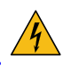
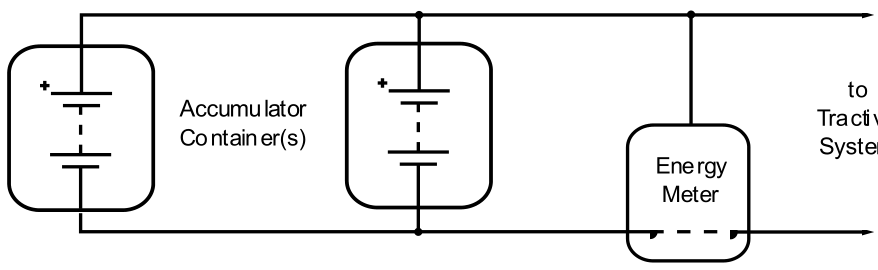
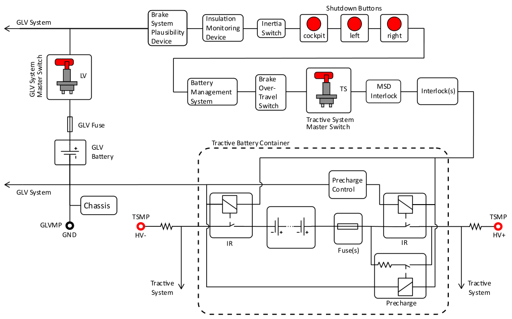
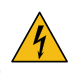
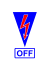

<!-- Source: FSAE_Rules_2027_V1.pdf, pages 92–114 -->

# EV - ELECTRIC VEHICLES

## EV.1 DEFINITIONS

### EV.1.1 Cell

Electrochemical energy storage unit consisting of a positive electrode, negative electrode, and an electrolyte

### EV.1.2 Module

A single unit containing a set of electrically connected and mechanically assembled Cells, and the structure supporting the Cells

### EV.1.3 Tractive Battery

A group of electrically connected Modules that is the storage device of electrical energy for the Tractive System

### EV.1.4 Tractive Battery Container

The enclosure and mechanical supports used to contain, mount and protect the Tractive Battery and components in the Container

### EV.1.5 Tractive Battery Pack

The assembly of the Tractive Battery Container and components in the Container

### EV.1.6 Tractive System – TS

Every part electrically connected to the Motor(s) and/or Tractive Battery(s). The Tractive System is always High Voltage

### EV.1.7 Grounded Low Voltage - GLV

Every electrical part that is not part of the Tractive System

## EV.2 DOCUMENTATION

### EV.2.1 Electrical System Form - ESF

**EV.2.1.1** Each team must submit an Electrical System Form (ESF) with a clearly structured documentation of the entire vehicle electrical system (including control and Tractive System)

Submission and approval of the ESF does not mean that the vehicle will automatically pass Technical Inspection with the described items / parts

**EV.2.1.2** The ESF may provide guidance or more details than the Formula SAE Rules

**EV.2.1.3** Use the format provided and submit the ESF as given in section PS - Pre-Competition Submissions

### EV.2.2 Submission Penalties

Penalties for the ESF are added as given in section PS - Pre-Competition Submissions

## EV.3 ELECTRICAL LIMITATIONS

### EV.3.1 Operation

**EV.3.1.1** Supplying power to the motor to drive the vehicle in reverse is prohibited

**EV.3.1.2** Drive by wire control of wheel torque is permitted

**EV.3.1.3** Any algorithm or electronic control unit that can adjust the requested wheel torque may only decrease the total driver requested torque and must not increase it

### EV.3.2 Energy Meter

**EV.3.2.1** All Electric Vehicles must run with the Energy Meter provided at the event

**EV.3.2.2** Refer to the Energy Meter User Manual on the Event Website for information and additional rules for the Energy Meter and installation GR.4.2.3

**EV.3.2.3** The Energy Meter, connections and sensors must be installed per the Energy Meter User Manual

**EV.3.2.4** All Tractive System power must flow through the Energy Meter

**EV.3.2.5** Each team must download and associate their Energy Meter data in a manner and timeframe specified by the organizer

**EV.3.2.6** Power and Voltage and temperature limits will be checked by the Energy Meter data

Energy is calculated as the time integrated value of the measured voltage multiplied by the measured current logged by the Energy Meter

### EV.3.3 Power and Voltage

**EV.3.3.1** The maximum power measured by the Energy Meter must not exceed 80 kW

**EV.3.3.2** The maximum permitted voltage that may occur between any two points must not exceed 600 V DC

**EV.3.3.3** The powertrain must not regenerate energy when vehicle speed is between 0 and 5 km/hr

### EV.3.4 Violations

**EV.3.4.1** A Violation occurs when one or two of these exist:

- a. Use of more than the specified maximum power EV.3.3.1
- b. Exceed the maximum voltage EV.3.3.2

for one or the two conditions:

- Continuously for 100 ms or more
- After a moving average over 500 ms is applied

**EV.3.4.2** Missing Energy Meter data may be treated as a Violation, with official discretion

**EV.3.4.3** Tampering, or trying to tamper with the Energy Meter or its data may result in Disqualification (DQ)

### EV.3.5 Penalties

**EV.3.5.1** Violations during the Acceleration, Skidpad, Autocross Events:

- a. Each run with one or more Violations will Disqualify (DQ) the best run of the team
- b. Multiple runs with Violations will DQ multiple runs, ex two runs with Violations DQ the two best runs

**EV.3.5.2** Violations during the Endurance event:

- Each Violation: 60 second penalty D.14.2.1

**EV.3.5.3** Repeated Violations may void Inspection Approval or receive additional penalties, including Disqualification, with official discretion

**EV.3.5.4** The respective data of each run in which a team has a Violation and the resulting decision may be made public

## EV.4 COMPONENTS

### EV.4.1 Motors

**EV.4.1.1** Only electrical motors are permitted. The number of motors is not limited

**EV.4.1.2** Motors must meet T.5.3

**EV.4.1.3** If Motors are mounted to the suspension uprights, their cables and wiring must:

- a. Include an Interlock EV.8.8
    This Interlock(s) must Open the Shutdown Circuit EV.8.2.2 before failure of the Tractive System wiring when the wiring is damaged or the Wheel/Motor assembly is damaged or knocked off the vehicle
- b. Stay in the Primary Structure Envelope F.1.11 between the Front Hoop and the Main Hoop
- c. Reduce the length of the parts of wiring and other connections that do not meet F.11.1.4 to the extent possible (no dangling cables, loops, coils, etc)

### EV.4.2 Motor Controller

The Tractive System Motor(s) must be connected to the Tractive Battery through a Motor Controller. No direct connections between Motor(s) and Tractive Battery.

### EV.4.3 Tractive Battery Container

**EV.4.3.1** Tractive Battery Container(s) must:

- a. Meet F.10
- b. Be removable from the vehicle while still remaining rules compliant
- c. Be completely closed at all times (when mounted to the vehicle and when removed from the vehicle) without the need to install extra protective covers

**EV.4.3.2** The Tractive Battery Container(s) may contain Holes or Openings

- a. Only the wiring harness, ventilation, cooling and fasteners may pass through the holes
- b. Holes and Openings in the Tractive Battery Container must meet F.10.4
- c. External holes must meet EV.7.1

**EV.4.3.3** Any Tractive Battery Container that may vent an explosive gas must have a ventilation system or pressure relief valve to release the vented gas

**EV.4.3.4** Modules sealed in Tractive Battery Containers must have a path to a pressure relief valve

**EV.4.3.5** Pressure relief valves must not have line of sight to the driver, with the Firewall installed or removed

**EV.4.3.6** Each Tractive Battery Container must be labelled with the:

- a. School Name and Vehicle Number
- b. Symbol specified in ISO 7010-W012  (triangle with black lightning bolt on yellow background) with:
    - Triangle side length of 100 mm minimum
    - Visibility from all angles, including when the lid is removed
- c. Text “Always Energized”
- d. Text “High Voltage” if the voltage meets T.9.1.1

### EV.4.4 Grounded Low Voltage System

**EV.4.4.1** The GLV System must be:

- a. A Low Voltage system that is Grounded to the Chassis
- b. Able to operate with the Tractive Battery Pack removed from the vehicle

**EV.4.4.2** The GLV System must include a Master Switch, see EV.8.9.1

**EV.4.4.3** A GLV Measuring Point (GLVMP) must be installed which is:

- a. Connected to GLV System Ground
- b. Adjacent to the TSMP EV.5.8
- c. 4 mm shrouded banana jack
- d. Color: Black
- e. Marked “GND”

**EV.4.4.4** Low Voltage Batteries must meet T.9.2

### EV.4.5 Accelerator Pedal Position Sensor - APPS

Refer to T.4.2 for specific requirements of the APPS

### EV.4.6 Brake System Encoder - BSE

Refer to T.4.3 for specific requirements of the BSE

### EV.4.7 APPS / Brake Pedal Plausibility Check

**EV.4.7.1** Must monitor for the two conditions:

- The mechanical brakes are engaged EV.4.6, T.3.2.4
- The APPS signals more than 25% Pedal Travel EV.4.5

**EV.4.7.2** If the two conditions in EV.4.7.1 occur at the same time:

- a. Power to the Motor(s) must be immediately and completely shut down
- b. The Motor shut down must stay active until the APPS signals less than 5% Pedal Travel, with or without brake operation

The team must be able to demonstrate these actions at Technical Inspection

### EV.4.8 Tractive System Part Positioning

All parts belonging to the Tractive System must meet F.11

### EV.4.9 Housings and Enclosures

**EV.4.9.1** Each housing or enclosure containing parts of the Tractive System other than Motor housings, must be labelled with the:

- a. Symbol specified in ISO 7010-W012  (triangle with black lightning bolt on yellow background)
- b. Text “High Voltage” if the voltage meets T.9.1.1

**EV.4.9.2** If the material of the housing containing parts of the Tractive System is electrically conductive, it must have a low resistance connection to GLV System Ground, see EV.7.7

### EV.4.10 Hand Cart

**EV.4.10.1** Teams must have a Hand Cart to transport their Tractive Battery Pack(s)

**EV.4.10.2** The Hand Cart must be used when the Tractive Battery Pack(s) are transported on the competition site EV.12.4.2 EV.12.5.1

**EV.4.10.3** The Hand Cart must:

- a. Be able to carry the load of the Tractive Battery Pack(s) without tipping over
- b. Contain a minimum of two wheels
- c. Have a brake that must be:
    - Released only using a dead man type switch (where the brake is always on until released by pushing and holding a handle) or by manually lifting part of the cart off the ground
    - Able to stop the fully loaded Hand Cart with Tractive Battery Pack

**EV.4.10.4** Tractive Battery Pack(s) must be securely attached to the Hand Cart

## EV.5 ENERGY STORAGE

### EV.5.1 Tractive Battery

**EV.5.1.1** Each Module must contain:

- Static voltage of 120 V DC maximum
- Energy of 6 MJ maximum
    The contained energy of a stack is calculated by multiplying the maximum stack voltage with the nominal capacity of the used cell(s)
- Mass of 12 kg maximum

**EV.5.1.2** No further energy storage except for reasonably sized intermediate circuit capacitors are permitted after the Energy Meter EV.3.1

**EV.5.1.3** All Tractive Battery components and/or Tractive Battery Containers (including spares and replacement parts) must be identical to the design documented in the ESF and SES

### EV.5.2 Electrical Configuration

**EV.5.2.1** All Tractive System components must be rated for the maximum Tractive System voltage

**EV.5.2.2** If the Tractive Battery Container is made from an electrically conductive material:

- a. The poles of the Modules(s) and/or Cells must be isolated from the inner wall of the Tractive Battery Container with an insulating material that is rated for the maximum Tractive System voltage
- b. All conductive surfaces on the outside of the Tractive Battery Container must have a low resistance connection to the GLV System Ground, see EV.7.7
- c. Any conductive penetrations, such as mounting hardware, must be protected against puncturing the insulating barrier

**EV.5.2.3** Each Module must be electrically insulated with suitable Nonflammable Material (F.1.18) (not air) for the two:

- a. Between the Modules in the Tractive Battery Container
- b. On top of the Module

The intent is to prevent arc flashes caused by inter Module or intra Module contact or by parts/tools accidentally falling into the Container during maintenance for example

**EV.5.2.4** Soldering electrical connections in the high current path is prohibited

Soldering wires to cells for the voltage monitoring input of the BMS is permitted, these wires are not part of the high current path

**EV.5.2.5** Each wire used in a Tractive Battery Container, whether it is part of the GLV or Tractive System, must be rated to the maximum Tractive System voltage

### EV.5.3 Maintenance Plugs

**EV.5.3.1** Maintenance Plugs must let electrical separation of the Modules meet the two:

- a. The separated Modules meet voltage and energy limits of EV.5.1.1
- b. The separation must affect the two poles of the Module

**EV.5.3.2** Maintenance Plugs must:

- a. Require the physical removal or separation of a component. Contactors or switches are not acceptable Maintenance Plugs
- b. Have access after opening the Tractive Battery Container and not necessary to move or remove any other components
- c. Not be physically possible to make electrical connection in any configuration other than the design intended configuration
- d. Not require tools to install or remove
- e. Include a positive locking feature which prevents the plug from unintentionally becoming loose
- f. Be nonconductive on surfaces that do not provide any electrical connection

**EV.5.3.3** When the Tractive Battery Containers are opened or Modules are removed, the Modules must be separated by using the Maintenance Plugs. See EV.12.4.1

### EV.5.4 Isolation Relays - IR

**EV.5.4.1** All Tractive Battery Packs must contain minimum one fuse (EV.7.6) and two or more Isolation Relays (IR)

**EV.5.4.2** The Isolation Relays must:

- a. Be a Normally Open type
- b. Open the two poles of the Tractive Battery Pack

**EV.5.4.3** When the Isolation Relays are open:

- a. High Voltage T.9.1.1 must not be external of the Tractive Battery Container
- b. There must be complete galvanic isolation between both sides of each relay, including any connected circuits

**EV.5.4.4** The Isolation Relays and any fuses must be separated from the rest of the Tractive Battery with an electrically insulated and Nonflammable Material (F.1.18)

**EV.5.4.5** A capacitor may be used to hold the Isolation Relays closed for maximum 250 ms after the Shutdown Circuit Opens EV.8.2.2

### EV.5.5 Manual Service Disconnect - MSD

A Manual Service Disconnect (MSD) must be included to quickly disconnect one or the two poles of the Tractive Battery Pack EV.12.3.2

**EV.5.5.1** The Manual Service Disconnect must be:

- a. An element, fuse or connector that will visually show disconnected
- b. More than 350 mm from the ground
- c. Easily visible when standing behind the vehicle
- d. Operable in 10 seconds or less by an untrained person
- e. Operable without removing any bodywork or obstruction or using tools
- f. Able to directly access and operate
    Remote operation through a long handle, rope or wire is not acceptable
- g. Clearly marked with "MSD"

**EV.5.5.2** The Energy Meter must not be used as the Manual Service Disconnect

**EV.5.5.3** An Interlock EV.8.8 must Open the Shutdown Circuit EV.8.2.2 when the MSD is removed

**EV.5.5.4** A dummy connector or similar may be used to restore isolation to meet EV.7.1.2

### EV.5.6 Precharge and Discharge Circuits

**EV.5.6.1** The Tractive Battery Pack must contain a Precharge Circuit. The Precharge Circuit must:

- a. Be able to charge the Intermediate Circuit to minimum 90% of the Tractive System voltage before closing the second Isolation Relay
- b. Be supplied from the Shutdown Circuit EV.8.1

**EV.5.6.2** The Intermediate Circuit must precharge before closing the second Isolation Relay

- a. The end of precharge must be controlled by feedback by monitoring the voltage in the Intermediate Circuit

**EV.5.6.3** The Tractive System must contain a Discharge Circuit. The Discharge Circuit must be:

- a. Wired in a way that it is always active when the Shutdown Circuit is open
- b. Able to discharge the Intermediate Circuit capacitors if the MSD has been opened
- c. Without fuses (must obey EV.7.6.6 )
- d. Designed to handle the maximum Tractive System voltage for minimum 15 seconds

**EV.5.6.4** Positive Temperature Coefficient (PTC) devices must not be used to limit current for the Precharge Circuit or Discharge Circuit

**EV.5.6.5** The precharge relay must be a mechanical type relay

### EV.5.7 Voltage Indicator

Each Tractive Battery Pack must have a prominent indicator light for the voltage present on the vehicle side of the Isolation Relays

**EV.5.7.1** The voltage present at the vehicle side of the Isolation Relays must directly control and power the Voltage Indicator using hard wired electronics with no software control

**EV.5.7.2** The control signal which closes the Isolation Relays must not control the Voltage Indicator

**EV.5.7.3** The Voltage Indicator light must show:

|  | When Voltage on the Vehicle Side of the Isolation Relays is: | Voltage Indicator must be: |
|---|---|---|
| a. | Equal to or more than 60 V T.9.1.1 | Always and Clearly ON |
| b. | Less than 50 V | Clearly OFF |

**EV.5.7.4** The Voltage Indicator must be:

- a. Located where it is clearly visible when connecting/disconnecting the Tractive Battery Pack connections
- b. Labelled “High Voltage Present”

### EV.5.8 Tractive System Measuring Points - TSMP

**EV.5.8.1** Two Tractive System Measuring Points (TSMP) must be installed in the vehicle which are:

- a. Connected to the positive and negative motor controller/inverter supply lines
- b. Adjacent to the Master Switches EV.8.9
- c. Protected by a nonconductive housing that can be opened without tools
- d. Protected from being touched with bare hands / fingers once the housing is opened

**EV.5.8.2** Two TSMPs must be installed in the Charger EV.9.2 which are:

- a. Connected to the positive and negative Charger output lines
- b. Available during charging of any Tractive Battery Pack(s)

**EV.5.8.3** The TSMPs must be:

- a. 4 mm shrouded banana jacks rated to an appropriate voltage level
- b. Color: Red
- c. Marked “HV+” and “HV-“

**EV.5.8.4** Each TSMP must have a current limiting resistor

- a. The resistor must be sized for the voltage:

|  |  |
|---|---|
| Maximum TS Voltage (Vmax) | Resistor Value |
| Vmax \<= 200 V DC | 5 kOhm |
| 200 V DC \< Vmax \<= 400 V DC | 10 kOhm |
| 400 V DC \< Vmax \<= 600 V DC | 15 kOhm |

- b. Resistor continuous power rating must be more than the power dissipated across the TSMPs if they are shorted together
- c. Direct measurement of the resistance must be possible during Technical Inspection

**EV.5.8.5** Any TSMP must not contain additional Overcurrent Protection (must obey EV.7.6.6 )

## EV.6 STATUS INDICATORS

### EV.6.1 Tractive System Status Indicator

**EV.6.1.1** The vehicle must have a Tractive System Status Indicator

Refer to the Rules FAQ on the Event Website for additional information

**EV.6.1.2** The Tractive System Status Indicator must have two different lights:

- a. One Green light – on the driver’s right hand side
- b. One Red light – on the driver's left hand side

**EV.6.1.3** The Tractive System Status Indicator lights must be one of the two:

- a. Commercially available EV.6.1.4
- b. Team built EV.6.1.5

**EV.6.1.4** Each commercially available Tractive System Status Indicator light must:

- a. Have a minimum luminous area of 130 mm2
- b. Be visible in direct sunlight

**EV.6.1.5** Each team built Tractive System Status Indicator light must be:

- a. Minimum height and minimum width 10 mm
- b. Minimum diameter 12 mm (if round)
- c. Minimum distance to any other indicator 5 mm
- d. If used, the center distance between LED elements must be between 2 and 3 times the smallest illuminated dimension of the LED element
- e. Visible in direct sunlight

**EV.6.1.6** Mounting location of the Tractive System Status Indicator must be:

- a. Near the Main Hoop at the highest point of the vehicle
- b. Above the Ready to Move Light
- c. In the Rollover Protection Envelope F.1.13
- d. Not able to let the driver’s helmet touch it
- e. Easily visible from the front of the vehicle

**EV.6.1.7** The Tractive System Status Indicator must show when the GLVMS is ON:

|  | Condition | Green Light | Red Light |
|---|---|---|---|
| a. | Lamp Check | EV.6.3 | EV.6.3 |
| b. | No Faults | Always ON | OFF |
| c. | Fault in one or the two: BMS EV.8.3.5 or IMD EV.8.6.5 | OFF | Flash 2.5 Hz to 5 Hz, 50% duty cycle |

### EV.6.2 Ready to Move Light

**EV.6.2.1** The vehicle must have two Ready to Move Lights:

- a. One pointed forward
- b. One pointed aft

Refer to the Rules FAQ on the Event Website for additional information

**EV.6.2.2** The Ready to Move Lights must be one of the two:

- a. Commercially available EV.6.2.3
- b. Team built EV.6.2.4

**EV.6.2.3** Each commercially available Ready to Move Light must be:

- a. A Marker Light that complies with DOT FMVSS 108
- b. Color: Amber
- c. Luminous area: minimum 800 mm2

**EV.6.2.4** Each team built Ready to Move Light must be:

- a. Comply with the Luminous Distribution/Projection criteria of DOT FMVSS 108
- b. Color: Amber
- c. Minimum height 15 mm and minimum width 30 mm
- d. Minimum diameter 25 mm (if round)
- e. Minimum distance to any other indicator 5 mm
- f. If used, the center distance between LED elements must be between 2 and 3 times the smallest illuminated dimension of the LED element
- g. Visible in direct sunlight

**EV.6.2.5** Mounting location of each Ready to Move Light must:

- a. Be near the Main Hoop near the highest point of the vehicle
- b. Be in the Rollover Protection Envelope F.1.13
- c. Be no lower than 150 mm from the highest point of the Main Hoop
- d. Not let the driver’s helmet touch it
- e. Be visible from 1300 mm vertically from ground level, anywhere in a 2000 mm horizontal radius from the light, with Bodywork and Aerodynamic Devices in place

**EV.6.2.6** The Ready to Move Light must:

- a. Be powered by the GLV system
- b. Be directly controlled by the voltage present in the Tractive System using hard wired electronics for the usual function ( EV.6.2.7.b, EV.6.2.7.c ). EV.7.5.4 Software control is not permitted.
- c. Not do any other functions

**EV.6.2.7** The Ready to Move Light must show when the GLVMS is ON:

- a. Lamp Check EV.6.3

|  | When Voltage Outside the Tractive Battery Container is: | Ready to Move Light must: |
|---|---|---|
| b. | Equal to or more than 60 V T.9.1.1 | Flash 0.66 Hz to 1.33 Hz, 50% duty cycle |
| c. | Less than 50 V | Be Clearly OFF |

### EV.6.3 Lamp Check

**EV.6.3.1** The identified indicators must do a Lamp Check

The Lamp Check may use software control (logical OR function) or a parallel circuit

**EV.6.3.2** The Lamp Check sequence must:

- a. Occur on all identified indicators at the same time
- b. Start in 1 second or less after the GLVMS is turned ON
- c. Turn Indicator ON continuously for 2 to 6 seconds
- d. Let Indicator go back to usual operation

**EV.6.3.3** Lamp Check circuits and software control (if used) for the Lamp Check must not prevent the function of any indicator

## EV.7 ELECTRICAL SYSTEM

### EV.7.1 Covers

**EV.7.1.1** Nonconductive material or covers must prevent inadvertent human contact with any Tractive System voltage

Covers must be secure and sufficiently rigid

Removable Bodywork is not suitable to enclose Tractive System connections

**EV.7.1.2** Contact with any Tractive System connections with a 100 mm long, 6 mm diameter insulated test probe must not be possible when the Tractive System enclosures are in place

**EV.7.1.3** Tractive System components and Tractive Battery(s) must be protected from moisture, rain or puddles

A rating of IP65 is recommended

### EV.7.2 Insulation

**EV.7.2.1** Insulation material must:

- a. Be appropriate for the expected surrounding temperatures
- b. Have a minimum temperature rating of 90°C

**EV.7.2.2** Insulating tape or paint may be part of the insulation, but must not be the only insulation

### EV.7.3 Wiring

**EV.7.3.1** All wires and terminals and other conductors used in the Tractive System must be sized for the continuous current they will conduct

**EV.7.3.2** All Tractive System wiring must:

- a. Be marked with wire gauge, temperature rating and insulation voltage rating
    A serial number or a norm printed on the wire is sufficient if this serial number or norm is clearly bound to the wire characteristics for example by a data sheet
- b. Have temperature rating more than or equal to 90°C

**EV.7.3.3** Tractive System wiring must be:

- a. Done to professional standards with sufficient strain relief
- b. Protected from loosening due to vibration
- c. Protected against damage by rotating and / or moving parts
- d. Located out of the way of possible snagging or damage

**EV.7.3.4** Any Tractive System wiring that runs outside of electrical enclosures:

- a. Must meet one of the two:
    - Enclosed in separate orange nonconductive conduit
    - Use an orange shielded cable
- b. The conduit or shielded cable must be securely anchored at each end to let it withstand a force of 200 N without straining the cable end crimp
- c. Any shielded cable must have the shield grounded

**EV.7.3.5** Wiring that is not part of the Tractive System must not use orange wiring or conduit

### EV.7.4 Connections

**EV.7.4.1** All Tractive System connections must:

- a. Be designed to use intentional current paths through conductors designed for electrical current
- b. Not rely on steel bolts to be the primary conductor
- c. Not include compressible material such as plastic in the stack-up

**EV.7.4.2** If external, uninsulated heat sinks are used, they must be properly grounded to the GLV System Ground, see EV.7.7

**EV.7.4.3** Bolted electrical connections in the high current path of the Tractive System must include a positive locking feature to prevent unintentional loosening

Lock washers or thread locking compounds (Loctite®) or adhesives are not acceptable

Bolts with nylon patches are permitted for blind connections into OEM components

**EV.7.4.4** Tractive System connectors outside of a housing must contain an Interlock EV.8.8

**EV.7.4.5** Information about the electrical connections supporting the high current path must be available at Technical Inspection

### EV.7.5 Voltage Separation

**EV.7.5.1** Separation of Tractive System and GLV System:

- a. The entire Tractive System and GLV System must be completely galvanically separated IN.10.2.2
- b. The border between Tractive System and GLV System is the galvanic isolation between the two systems.
    Some components, such as the Motor Controller, may be part of both systems.

**EV.7.5.2** There must be no connection between the Chassis of the vehicle (or any other conductive surface that might be inadvertently touched by a person), and any part of any Tractive System circuits.

**EV.7.5.3** Tractive System and GLV circuits must not be in the same conduit or connector except as permitted in in EV.8.8.4

**EV.7.5.4** GLV Systems other than the Isolation Relays EV.5.4, parts of the Precharge and Discharge Circuits EV.5.6, HV DC/DC converters, the BMS EV.8.3, the IMD EV.8.6, parts of the Ready to Move Light EV.6.2.6 the Energy Meter EV.3.1 and cooling fans must not be in the Tractive Battery Container

**EV.7.5.5** Where Tractive System and GLV are included in the same enclosure, they must meet one of the two:

- a. Be separated by insulating barriers (in addition to the insulation on the wire) made of moisture resistant, UL recognized or equivalent insulating materials rated for 90° C or higher (such as Nomex based electrical insulation)
- b. Maintain spacing through air, or over a surface (similar to those defined in UL1741) of:

|  |  |
|---|---|
| U \< 100 V DC | 10 mm |
| 100 V DC \< U \< 200 V DC | 20 mm |
| U \> 200 V DC | 30 mm |

**EV.7.5.6** Spacing must be clearly defined. Components and cables capable of movement must be positively restrained to maintain spacing.

**EV.7.5.7** If Tractive System and GLV are on the same circuit board:

- a. They must be on separate, clearly defined and clearly marked areas of the board
- b. The required spacing between traces / board areas must be:
    Spacing applies between traces on the same layer and traces on different layers

<table>
<tr>
<td rowspan="2">Voltage</td>
<td rowspan="2">Clearance Distance</td>
<td colspan="2">Creepage Distance</td>
</tr>
<tr>
<td>General</td>
<td>Under Conformal Coating</td>
</tr>
<tr>
<td>0-50 V DC</td>
<td>1.0 mm</td>
<td>4.0 mm</td>
<td>1.0 mm</td>
</tr>
<tr>
<td>50-150 V DC</td>
<td>1.0 mm</td>
<td>5.0 mm</td>
<td>1.0 mm</td>
</tr>
<tr>
<td>150-300 V DC</td>
<td>1.5 mm</td>
<td>10.0 mm</td>
<td>2.0 mm</td>
</tr>
<tr>
<td>300-600 V DC</td>
<td>3.0 mm</td>
<td>20.0 mm</td>
<td>4.0 mm</td>
</tr>
</table>

**EV.7.5.8** Teams must show spacing on team built equipment

For inaccessible circuitry, spare boards or appropriate photographs must be available for inspection

**EV.7.5.9** All connections to external devices such as laptops from a Tractive System component must include galvanic isolation

### EV.7.6 Overcurrent Protection

**EV.7.6.1** All electrical systems (Low Voltage and High Voltage) must have appropriate Overcurrent Protection/Fusing

**EV.7.6.2** Unless otherwise permitted in the Rules, all Overcurrent Protection devices must:

- a. Be rated for the highest voltage in the systems they protect
    Overcurrent Protection devices used for DC must be rated for DC and must carry a DC rating equal to or more than the system voltage
- b. Have a continuous current rating less than or equal to the continuous current rating of any electrical component that it protects
- c. Have an interrupt current rating higher than the theoretical short circuit current of the system that it protects

**EV.7.6.3** Each parallel element of multiple parallel battery cells, capacitors, strings of battery cells, strings of capacitors, or conductors must have individual Overcurrent Protection

**EV.7.6.4** Any conductors (wires, busbars, etc) conducting the entire pack current must meet one of:

- a. Be appropriately sized for the total current that the individual Overcurrent Protection devices could transmit
- b. Contain additional Overcurrent Protection to protect the conductors

**EV.7.6.5** Battery packs with Low Voltage or non voltage rated fusible links for cell connections may be used when all three conditions are met:

- An Overcurrent Protection device rated at less than or equal to one third the sum of the parallel fusible links and complying with EV.7.6.2.b above is connected in series
- The BMS can detect an open fusible link and will Open the Shutdown Circuit EV.8.2.2 if a fault is detected
- Fusible link current rating is specified in manufacturer’s data or suitable test data is provided

**EV.7.6.6** If conductor ampacity is reduced below the ampacity of the upstream Overcurrent Protection, the reduced conductor longer than 150 mm must have additional Overcurrent Protection

This additional Overcurrent Protection must be:

- a. 150 mm or less from the source end of the reduced conductor
- b. On the positive and the negative conductors in the Tractive System
- c. On the positive conductor in the Grounded Low Voltage System

**EV.7.6.7** Cells with internal Overcurrent Protection may be used without external Overcurrent Protection if suitably rated.

Most cell internal Overcurrent Protection devices are Low Voltage or non voltage rated and conditions of EV.7.6.5 above will apply.

### EV.7.7 Grounding

**EV.7.7.1** Grounding is required for:

- a. Parts of the vehicle which are 100 mm or less from any Tractive System component that are not separated from the Tractive System component by a Firewall T.1.8.4
- b. Any Firewall T.1.8.4

The part itself must meet the grounding requirement if conductive tape is applied

**EV.7.7.2** Grounded parts of the vehicle must have a resistance to GLV System Ground less than the values specified below

- a. Electrically conductive parts 300 mOhms (measured with a current of 1 A)
    Examples: parts made of steel, (anodized) aluminum, any other metal parts
- b. Parts which may become electrically conductive 5 Ohm
    Example: carbon fiber parts
    Carbon fiber parts may need special measures such as using copper mesh or similar to keep the ground resistance below 5 Ohms.

**EV.7.7.3** Electrical conductivity of any part may be tested by checking any point which is likely to be conductive

Where no convenient conductive point is available, an area of coating may be removed

## EV.8 SHUTDOWN SYSTEM

### EV.8.1 Shutdown Circuit

**EV.8.1.1** The Shutdown Circuit consists of these components, connected in series:

- a. Battery Management System (BMS) EV.8.3
- b. Insulation Monitoring Device (IMD) EV.8.6
- c. Brake System Plausibility Device (BSPD) EV.8.7
- d. Interlocks (as required) EV.8.8
- e. Master Switches (GLVMS, TSMS) EV.8.9
- f. Shutdown Buttons EV.8.10
- g. Brake Over Travel Switch (BOTS) T.3.3
- h. Inertia Switch T.9.4

**EV.8.1.2** The Shutdown Circuit must directly carry the current driving the Isolation Relays (IRs) and the Precharge Circuit Relay

**EV.8.1.3** All components in the Shutdown Circuit EV.8.1.1 must be on the high side connection to the Isolation Relay coils of the Shutdown Circuit

**EV.8.1.4** The BMS, IMD, and BSPD parts of the Shutdown Circuit must be Normally Open

**EV.8.1.5** The BMS, IMD and BSPD must have completely independent circuits to Open the Shutdown Circuit

The design of the respective circuits must make sure that a failure cannot result in electrical power being fed back into the Shutdown Circuit

**EV.8.1.6** The Shutdown Buttons, BOTS, TSMS, GLVMS and Interlocks must directly carry the Shutdown Circuit current

**EV.8.1.7** The team must be able to demonstrate all features and functions of the Shutdown Circuit and components at Technical Inspection

### EV.8.2 Shutdown Circuit Operation

**EV.8.2.1** The Shutdown Circuit must Open when any of these exist:

- a. Operation of, or detection from any of the components listed in EV.8.1.1
- b. Any shutdown of the GLV System

**EV.8.2.2** When the Shutdown Circuit Opens:

- a. The Tractive System must Shutdown
- b. All Tractive Battery current flow must stop immediately EV.5.4.3
- c. The voltage in the Tractive System must be Low Voltage T.9.1.2 in five seconds or less
- d. The Motor(s) must spin free. Torque must not be applied to the Motor(s)

**EV.8.2.3** When the BMS, IMD or BSPD Open the Shutdown Circuit:

- a. The Tractive System must stay disabled until manually reset
- b. The Tractive System must be reset only by manual action of a person directly at the vehicle
- c. The driver must not be able to reactivate the Tractive System
- d. Operation of the Shutdown Buttons or TSMS must not let the Shutdown Circuit Close

### EV.8.3 Battery Management System - BMS

**EV.8.3.1** A Battery Management System must monitor the Tractive Battery Voltage EV.8.4 and Temperature EV.8.5 when the:

- a. Tractive System is Active EV.12.5
- b. Tractive Battery is connected to a Charger EV.9.3

**EV.8.3.2** The BMS must have galvanic isolation at each Module to Module boundary, as approved in the ESF

**EV.8.3.3** Cell balancing is not permitted when the Shutdown Circuit is Open ( EV.8.2, EV.9.4 )

**EV.8.3.4** The BMS must monitor for:

- a. Voltage values outside the permitted range EV.8.4.2
- b. Voltage sense Overcurrent Protection device(s) blown or tripped
- c. Temperature values outside the permitted range EV.8.5.2
- d. Missing or interrupted voltage or temperature measurements
- e. A fault in the BMS

**EV.8.3.5** If the BMS detects one or more of the conditions of EV.8.3.4 above, the BMS must:

- a. Open the Shutdown Circuit EV.8.2.2
- b. Turn on the BMS Indicator Light and the Tractive System Status Indicator EV.6.1.6e
    The two lights must stay on until the BMS is manually reset EV.8.2.3

**EV.8.3.6** The BMS Indicator Light must be:

- a. Color: Red
- b. Clearly visible to the seated driver in bright sunlight
- c. Clearly marked with the lettering “BMS”

**EV.8.3.7** The BMS Indicator Light must do a Lamp Check EV.6.3

### EV.8.4 Tractive Battery Voltage

**EV.8.4.1** The BMS must measure the voltage of each Cell

When single Cells are directly connected in parallel, only one voltage measurement is needed

**EV.8.4.2** Cell Voltage levels must stay between the permitted minimum and maximum cell voltage levels stated in the cell data sheet. Measurement accuracy must be considered.

**EV.8.4.3** All voltage sense wires to the BMS must have Overcurrent Protection that must meet the two:

- a. The Overcurrent Protection must occur in the conductor, wire or PCB trace which is directly connected to the cell tab.
- b. The voltage rating of the Overcurrent Protection must be equal to or higher than the maximum Module voltage

### EV.8.5 Tractive Battery Temperature

**EV.8.5.1** The BMS must measure the temperatures of the Tractive Battery cells

**EV.8.5.2** Temperatures (considering measurement accuracy) must stay below the lower of the two:

- The maximum cell temperature limit stated in the cell data sheet
- 60°C

**EV.8.5.3** Cell temperatures must be measured at the negative terminal of the respective cell

**EV.8.5.4** The temperature sensor used must be in direct contact with one of:

- The negative terminal itself
- The negative terminal busbar less than 10 mm away from the spot weld or clamping source on the negative cell terminal

**EV.8.5.5** For lithium based cells,

- a. The temperature of a minimum of 20% of the cells must be monitored by the BMS
- b. The monitored cells must be equally distributed in the Tractive Battery Container(s)

The temperature of each cell should be monitored

**EV.8.5.6** Multiple cells may be monitored with one temperature sensor, if EV.8.5 is met for all cells sensed by the sensor.

**EV.8.5.7** Temperature sensors must have appropriate electrical isolation that meets one of the two:

- Between the sensor and cell
- In the sensing circuit

The isolation must consider Tractive System / GLV isolation as well as common mode voltages between sense locations

### EV.8.6 Insulation Monitoring Device - IMD

**EV.8.6.1** The vehicle must have an Insulation Monitoring Device (IMD) installed in the Tractive System

**EV.8.6.2** The IMD must be an approved model given in the Rules FAQ (link) on the Event Website

**EV.8.6.3** The response value of the IMD must be set to 500 Ohm / Volt or higher, related to the maximum Tractive System operation voltage

**EV.8.6.4** The IMD must monitor the Tractive System for:

- a. An isolation failure
- b. A failure in the IMD operation

This must be done without the influence of any programmable logic

**EV.8.6.5** If the IMD detects one or more of the conditions of EV.8.6.4 above the IMD must:

- a. Open the Shutdown Circuit EV.8.2.2
- b. Turn on the IMD Indicator Light and the Tractive System Status Indicator EV.6.1.6.e
    The two lights must stay on until the IMD is manually reset EV.8.2.3

**EV.8.6.6** The IMD Indicator Light must be:

- a. Color: Red
- b. Clearly visible to the seated driver in bright sunlight
- c. Clearly marked with the lettering “IMD”

**EV.8.6.7** The IMD Indicator Light must do a Lamp Check EV.6.3

### EV.8.7 Brake System Plausibility Device - BSPD

**EV.8.7.1** The vehicle must have a standalone nonprogrammable circuit to check for simultaneous braking and high power output

The BSPD must be provided in addition to the APPS / Brake Pedal Plausibility Check (EV.4.7)

**EV.8.7.2** The BSPD must Open the Shutdown Circuit EV.8.2.2 when the two of these exist for more than 0.5 sec:

- Demand for Hard Braking EV.4.6
- Tractive System current is at a level where 5 kW of electrical power in the DC circuit is delivered to the Motor(s) at the nominal battery voltage

**EV.8.7.3** The BSPD must Open the Shutdown Circuit EV.8.2.2 when there is an open or short circuit in any sensor input

**EV.8.7.4** The vehicle must demonstrate BSPD operation with a test that must:

- a. Prove the function of the complete BSPD in the vehicle, including the current sensor
- b. Not send power to the Motor(s) of the vehicle

The test must introduce a current by a separate wire from an external power supply to simulate Tractive System current while pressing the brake pedal

**EV.8.7.5** For the BSPD test, the vehicle must have:

- a. A wire or coil to give a simulated Tractive System current to the BSPD current sensor
- b. Two Connection Points EV.8.7.6 for an external power supply

**EV.8.7.6** The BSPD test Connection Points must:

- a. Be two 4 mm shrouded banana jacks that are:
    - Not red and not black
    - Labelled CS+ and CS-
- b. Be able to access directly during Active Inspection, located one of the two:
    - On the vehicle
    - On an adaptor harness or breakout box

### EV.8.8 Interlocks

**EV.8.8.1** Interlocks must be incorporated where specified (refer to EV.4.1.3, EV.5.5.2, EV.7.4.4)

**EV.8.8.2** Additional Interlocks may be included in the Tractive System or components

**EV.8.8.3** The Interlock is a wire or connection that must Open the Shutdown Circuit EV.8.2.2 if the Interlock connection is broken or interrupted

**EV.8.8.4** Interlock circuits or connections do not require physical separation (EV.7.5) from Tractive System wiring or components when the Interlock circuit is:

- a. In the same wiring harness as Tractive System wiring
- b. Part of a Tractive System Connector EV.7.4.4
- c. In the Tractive Battery Container or Tractive System Enclosure less than 75 mm from the connection to a Tractive System connector

### EV.8.9 Master Switches

**EV.8.9.1** Each vehicle must have two Master Switches that must:

- a. Meet T.9.3 for Configuration and Location
- b. Be direct acting, not act through a relay or logic

**EV.8.9.2** The Grounded Low Voltage Master Switch (GLVMS) must:

- a. Completely stop all power to the GLV System EV.4.4
- b. Be in the center of a completely red circular area of \> 50 mm in diameter
- c. Be labeled “LV”

**EV.8.9.3** The Tractive System Master Switch (TSMS) must:

- a. Open the Shutdown Circuit in the OFF position EV.8.2.2
- b. Be the last switch before the Isolation Relays except for Precharge circuitry and Interlocks
- c. Be in the center of a completely orange circular area of \> 50 mm in diameter
- d. Be labeled “TS” and the symbol specified in ISO 7010-W012  (triangle with black lightning bolt on yellow background)
- e. Be fitted with a "lockout/tagout" capability in the OFF position EV.12.3.1

### EV.8.10 Shutdown Buttons

**EV.8.10.1** Three Shutdown Buttons must be installed on the vehicle

**EV.8.10.2** Each Shutdown Button must:

- a. Be a push-pull or push-rotate emergency stop switch
- b. Open the Shutdown Circuit EV.8.2.2 when operated to the OFF position
- c. Hold when operated to the OFF position
- d. Let the Shutdown Circuit Close when operated to the ON position

**EV.8.10.3** One Shutdown Button must be on each side of the vehicle which:

- a. Is located aft of the Main Hoop near the junction of the Main Hoop and Main Hoop Bracing F.5.9
- b. Has a diameter of 40 mm minimum
- c. Must not be easily removable or mounted onto removable body work

**EV.8.10.4** One Shutdown Button must be mounted in the cockpit which:

- a. Is located in easy reach of the belted in driver, adjacent to the steering wheel, and unobstructed by the steering wheel or any other part of the vehicle
- b. Has diameter of 24 mm minimum

**EV.8.10.5** The international electrical symbol (a red spark on a white edged blue triangle) must be near each Shutdown Button.

## EV.9 CHARGER REQUIREMENTS

### EV.9.1 Charger Requirements

**EV.9.1.1** All features and functions of the Charger and Charging Shutdown Circuit must be demonstrated at Technical Inspection. IN.5.1

**EV.9.1.2** Chargers will be sealed after approval. IN.5.2.2

### EV.9.2 Charger Features

**EV.9.2.1** The Charger must be galvanically isolated (AC) input to (DC) output

**EV.9.2.2** If the Charger housing is conductive it must be connected to the earth ground of the AC input

**EV.9.2.3** All connections of the Charger(s) must be isolated and covered

**EV.9.2.4** The Charger connector(s) must incorporate a feature to let the connector become live only when correctly connected to the Tractive Battery Pack

**EV.9.2.5** High Voltage charging leads must be orange

**EV.9.2.6** The Charger must have two TSMPs installed, see EV.5.8.2

**EV.9.2.7** The Charger must include a Charger Shutdown Button which must:

- a. Be a push-pull or push-rotate emergency stop switch
- b. Have a diameter of 24 mm minimum
- c. Open the Charging Shutdown Circuit EV.9.4.2 when operated to the OFF position
- d. Hold when operated to the OFF position
- e. Be labelled with the international electrical symbol (a red spark on a white edged blue triangle)

### EV.9.3 Charging Shutdown Circuit

**EV.9.3.1** The Charging Shutdown Circuit consists of:

- a. Charger Shutdown Button EV.9.2.7
- b. Battery Management System (BMS) EV.8.3
- c. Insulation Monitoring Device (IMD) EV.8.6

**EV.9.3.2** The BMS and IMD parts of the Charging Shutdown Circuit must:

- a. Be designed as Normally Open contacts
- b. Have completely independent circuits to Open the Charging Shutdown Circuit
    Design of the respective circuits must make sure that a failure cannot result in electrical power being fed back into the Charging Shutdown Circuit

### EV.9.4 Charging Shutdown Circuit Operation

**EV.9.4.1** When Charging, the BMS and IMD must:

- a. Monitor the Tractive Battery
- b. Open the Charging Shutdown Circuit if a fault is detected

**EV.9.4.2** When the Charging Shutdown Circuit Opens:

- a. All current flow to the Tractive Battery must stop immediately
- b. The voltage in the Tractive System must be Low Voltage T.9.1.2 in five seconds or less
- c. The Charger must be turned off
- d. The Charger must stay disabled until manually reset

## EV.10 VEHICLE OPERATIONS

### EV.10.1 Activation Requirement

The driver must complete the Activation Sequence without external assistance after the Master Switches EV.8.9 are ON

### EV.10.2 Activation Sequence

The vehicle systems must energize in this sequence:

- a. Low Voltage (GLV) System EV.10.3
- b. Tractive System Active EV.10.4
- c. Ready to Drive EV.10.5

### EV.10.3 Low Voltage (GLV) System

The Shutdown Circuit may be Closed when or after the GLV System is energized

### EV.10.4 Tractive System Active

**EV.10.4.1** Definition – High Voltage is present outside of the Tractive Battery Container

**EV.10.4.2** Tractive System Active must not be possible until the two:

- GLV System is Energized
- Shutdown Circuit is Closed

### EV.10.5 OK to Energize

Definition - Vehicle may be Tractive System Active in the Paddock D.2.3 or in the Dynamic Area D.1.2.1

### EV.10.6 Ready to Drive

**EV.10.6.1** Definition – the Motor(s) will respond to the input of the APPS

**EV.10.6.2** Ready to Drive must not be possible until the three at the same time:

- Tractive System Active EV.10.4
- The Brake Pedal is pressed and held to engage the mechanical brakes T.3.2
- The driver does a manual action to start Ready to Drive
    Such as pressing a specific button in the cockpit

### EV.10.7 Ready to Drive Sound

**EV.10.7.1** The vehicle must make a characteristic sound when it is Ready to Drive

**EV.10.7.2** The Ready to Drive Sound must be:

- a. Sounded continuously for minimum 1 second and maximum 3 seconds
- b. A minimum sound level of 80 dBA, fast weighting IN.10.3
- c. Easily recognizable. No animal voices, song parts or sounds that could be interpreted as offensive will be accepted

**EV.10.7.3** The vehicle must not make other sounds similar to the Ready to Drive Sound.

## EV.11 EVENT SITE ACTIVITIES

### EV.11.1 Onsite Registration

**EV.11.1.1** The Tractive Battery Pack must be onsite at the time the team registers to be eligible for Tractive Battery Pack Inspection and Dynamic Events

**EV.11.1.2** Teams who register without the Tractive Battery Pack:

- a. Must not bring their Tractive Battery Pack onsite for the duration of the competition
- b. May participate in Technical Inspection and Static Events

### EV.11.2 Tractive Battery Pack Removal

**EV.11.2.1** After the team registers onsite, the Tractive Battery Pack must remain on the competition site until the end of the competition, or the team withdraws and leaves the site

**EV.11.2.2** Violators will be disqualified from the competition and must leave immediately

## EV.12 WORK PRACTICES

### EV.12.1 Personnel

**EV.12.1.1** The Electrical System Officer (ESO): AD.5.2

- a. Is the only person on the team that may declare the vehicle electrically safe to allow work on any system
- b. Must accompany the vehicle when operated or moved at the competition site
- c. Must be immediately available by phone at all times during the event

### EV.12.2 Maintenance

**EV.12.2.1** All participating team members must wear safety glasses with side shields at any time when:

- a. Parts of the Tractive System are exposed while energized
- b. Work is done on the Tractive Battery Pack

**EV.12.2.2** Appropriate insulated tools must be used when working on the Tractive Battery Pack or Tractive System

### EV.12.3 Lockout

**EV.12.3.1** The TSMS EV.8.9.3 must be locked in the OFF position when any work is done on the vehicle.

**EV.12.3.2** The MSD EV.5.5 must be disconnected when vehicles are:

- a. Moved around the competition site
- b. Participating in Static Events

### EV.12.4 Tractive System

**EV.12.4.1** These work activities at competition are permitted only in the designated area and during Technical Inspection IN.5 See EV.5.3.3

- a. Opening Tractive Battery Containers
- b. Any work on Tractive Battery(s), Cells, or Modules
- c. Energized electrical work

**EV.12.4.2** Cells and/or Modules must be moved at the competition site in one of the two:

- a. Completely closed Tractive Battery Container EV.4.3 See EV.4.10.2
- b. Module/Cell Transport Container EV.12.4.3

**EV.12.4.3** The Module/Cell Transport Container(s) must be:

- a. Electrically insulated
- b. Protected from shock hazards and arc flash

**EV.12.4.4** Modules/Cells in the Transport Container must agree with the voltage and energy limits of EV.5.1.1

### EV.12.5 Charging

**EV.12.5.1** The Tractive Battery Pack must be removed from the vehicle and put onto the Hand Cart EV.4.10 for Charging

**EV.12.5.2** Tractive Battery charging must occur only in the designated area

**EV.12.5.3** A team member(s) who has knowledge of the Charging process must stay with the Tractive Battery Pack during Charging

**EV.12.5.4** Each Tractive Battery Pack must have a label with this data during Charging:

- Team Name
- Electrical System Officer phone number(s)

**EV.12.5.5** Additional site specific rules or policies may apply

## EV.13 RED CAR CONDITION

### EV.13.1 Definition

A vehicle will be a Red Car if any of the following:

- a. Actual or possible damage to the vehicle affecting the Tractive System
- b. Vehicle fault indication ( EV.6.1.7.c or equivalent)
- c. Other conditions, at the discretion of the officials

### EV.13.2 Actions

- a. Isolate the vehicle
- b. No contact with the vehicle unless the officials give permission
    Contact with the vehicle may require trained personnel with proper Personal Protective Equipment
- c. Call out Red Car responders
