<!-- Source: FSAE_Rules_2027_V1.pdf, pages 23–55 -->

# F - CHASSIS AND STRUCTURAL

## F.1 DEFINITIONS

### F.1.1 Chassis

The fabricated structural assembly that supports all functional vehicle systems.

This assembly may be a single fabricated structure, multiple fabricated structures or a combination of composite and welded structures.

### F.1.2 Frame Member

A minimum representative single piece of uncut, continuous tubing.

### F.1.3 Monocoque

A type of Chassis where loads are supported by the external panels

### F.1.4 Main Hoop

A roll bar located alongside or immediately aft of the driver’s torso.

### F.1.5 Front Hoop

A roll bar located above the driver’s legs, in proximity to the steering wheel.

### F.1.6 Roll Hoop(s)

Referring to the Front Hoop AND the Main Hoop

### F.1.7 Roll Hoop Bracing Supports

The structure from the lower end of the Roll Hoop Bracing back to the Roll Hoop(s).

### F.1.8 Front Bulkhead

A planar structure that provides protection for the driver’s feet.

### F.1.9 Impact Attenuator

A deformable, energy absorbing device located forward of the Front Bulkhead.

### F.1.10 Primary Structure

The combination of these components:

- Front Bulkhead and Front Bulkhead Support
- Front Hoop, Main Hoop, Roll Hoop Braces and Supports
- Side Impact Structure
- (EV Only) Tractive System Protection and Rear Impact Protection
- Any Frame Members, guides, or supports that transfer load from the Driver Restraint System

### F.1.11 Primary Structure Envelope

A volume enclosed by multiple tangent planes, each of which follows the exact outline of the Primary Structure Frame Members

### F.1.12 Major Structure

The portion of the Chassis that lies in the Primary Structure Envelope, excluding the Main Hoop Bracing and the portion of the Main Hoop above a horizontal plane located at the top of the Upper Side Impact Member or top of the Side Impact Zone.

### F.1.13 Rollover Protection Envelope

The Primary Structure plus a plane from the top of the Main Hoop to the top of the Front Hoop, plus a plane from the top of the Main Hoop to the rearmost Triangulated structural tube, or monocoque equivalent.

\* If there are no Triangulated Structural members aft of the Main Hoop, the Rollover Protection Envelope ends at the rear plane of the Main Hoop

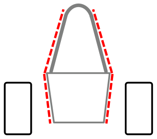

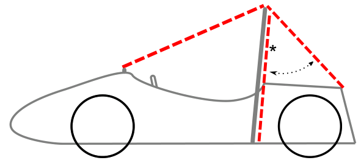

### F.1.14 Tire Surface Envelope

The volume enclosed by tangent lines between the Main Hoop and the outside edge of each of the four tires.

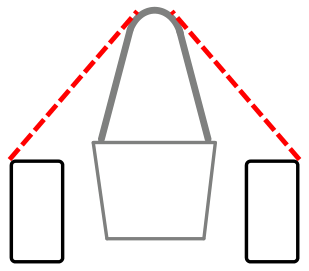

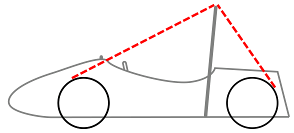

### F.1.15 Component Envelope

The area that is inside a plane from the top of the Main Hoop to the top of the Front Bulkhead, plus a plane from the top of the Main Hoop to the rearmost Triangulated structural tube, or monocoque equivalent. \* see note in step F.1.13 above

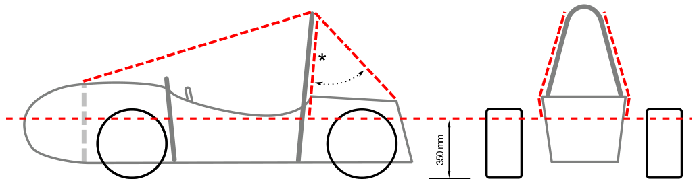

### F.1.16 Buckling Modulus (EI)

Equal to E\*I, where E = modulus of Elasticity, and I = area moment of inertia about the weakest axis

### F.1.17 Triangulation

An arrangement of Frame Members where all members and segments of members between bends or nodes with Structural tubes form a structure composed entirely of triangles.

- a. This is generally required between an upper member and a lower member, each may have multiple segments requiring a diagonal to form multiple triangles.
- b. This is also what is meant by “properly triangulated”

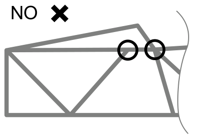

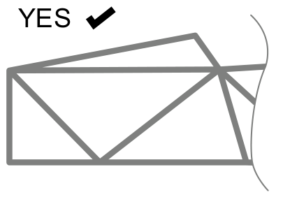

### F.1.18 Nonflammable Material

Metal or a Non Metallic material which meets UL94-V0, FAR25 or approved equivalent

## F.2 DOCUMENTATION

### F.2.1 Structural Equivalency Spreadsheet - SES

**F.2.1.1** The SES is a supplement to the Formula SAE Rules and may provide guidance or further details in addition to those of the Formula SAE Rules

**F.2.1.2** The SES provides the means to:

- a. Document the Primary Structure and show compliance with the Formula SAE Rules
- b. Determine Equivalence to Formula SAE Rules using an accepted basis
- c. Allow review of other items or areas that may be a concern

### F.2.2 Structural Documentation

**F.2.2.1** All teams must submit a Structural Equivalency Spreadsheet (SES) as given in section PS - Pre-Competition Submissions

**F.2.2.2** All comments and requests by the SES reviewer must be resolved

### F.2.3 Equivalence

**F.2.3.1** Equivalency in the structural context is determined and documented with the methods in the SES

**F.2.3.2** Any Equivalency calculations must prove Equivalency relative to Steel Tubing in the same application

**F.2.3.3** The properties of tubes and laminates may be combined to prove Equivalence

For example, in a Side Impact Structure consisting of one tube per F.3.2.1.e and a laminate panel, the panel only needs to be Equivalent to two Side Impact Tubes.

### F.2.4 Tolerance

Tolerance on dimensions given in the rules is permitted and is addressed in the SES

### F.2.5 Fabrication

Vehicles must be fabricated in accordance with the design, materials, and processes described in the SES.

## F.3 TUBING AND MATERIAL

### F.3.1 Dimensions

Diameter and Wall Thickness values provided in this Section F.3 are based on dimensions for commonly available tubing.

### F.3.2 Tubing Requirements

**F.3.2.1** Requirements by Application

|  | Application | Steel Tube Must Meet Size per F.3.4: | Aluminum Tubing Permitted per F.3.4.4 ? |
|---|---|---|---|
| a. | Front Bulkhead | Size B | Yes |
| b. | Front Bulkhead Support | Size C | Yes |
| c. | Front Hoop | Size A | Yes |
| d. | Front Hoop Bracing | Size B | Yes |
| e. | Side Impact Structure | Size B | Yes |
| f. | Bent Upper Side Impact Member | Size D | Yes |
| g. | Main Hoop | Size A | NO |
| h. | Main Hoop Bracing | Size B | NO |
| i. | Main Hoop Bracing Supports | Size C | Yes |
| j. | Driver Harness Attachment | Size B | Yes |
| k. | Shoulder Harness Mounting Bar | Size A | NO |
| l. | Shoulder Harness Mounting Bar Bracing | Size C | Yes |
| m. | Battery Pack Mounting and Protection | Size B | Yes |
| n. | Component Protection | Size C | Yes |
| o. | Structural Tubing | Size C | Yes |

### F.3.3 Non Structural Tubing

**F.3.3.1** Definition

Any tubing which does NOT meet F.3.2.1.o Structural Tubing

**F.3.3.2** Applicability

Non Structural Tubing is ignored when assessing compliance to any rule

### F.3.4 Steel Tubing and Material

**F.3.4.1** Minimum Requirements for Steel Tubing

A tube must have all four minimum requirements for each Size specified:

|  | Tube | Minimum Area Moment of Inertia | Minimum Cross Sectional Area | Minimum Outside Diameter or Square Width | Minimum Wall Thickness | Example Sizes of Round Tube |
|---|---|---|---|---|---|---|
| a. | Size A | 11320 mm4 | 173 mm2 | 25.0 mm | 2.0 mm | 1.0” x 0.095” 25 x 2.5 mm |
| b. | Size B | 8509 mm4 | 114 mm2 | 25.0 mm | 1.2 mm | 1.0” x 0.065” 25.4 x 1.6 mm |
| c. | Size C | 6695 mm4 | 91 mm2 | 25.0 mm | 1.2 mm | 1.0” x 0.049” 25.4 x 1.2 mm |
| d. | Size D | 18015 mm4 | 126 mm2 | 35.0 mm | 1.2 mm | 1.375” x 0.049” 35 x 1.2 mm |

**F.3.4.2** Properties for ANY steel material for calculations submitted in an SES must be:

- a. Non Welded Properties for continuous material calculations:
    Young’s Modulus (E) = 200 GPa (29,000 ksi)
    Yield Strength (Sy) = 305 MPa (44.2 ksi)
    Ultimate Strength (Su) = 365 MPa (52.9 ksi)
- b. Welded Properties for discontinuous material such as joint calculations:
    Yield Strength (Sy) = 180 MPa (26 ksi)
    Ultimate Strength (Su) = 300 MPa (43.5 ksi)

**F.3.4.3** If welded tubing reinforcements are required (examples: inserts for bolt holes, material to support suspension cutouts):

- a. Equivalence of the Welded tube and reinforcement must be shown to the original Non Welded tube
- b. Welded inserts must:
    - Have a wall thickness greater than the original Non Welded tube
    - Have outer diameter less than the original Non Welded tube diameter or square side
    - Be welded on both ends

**F.3.4.4** The shape of structural welds must not be mechanically changed

### F.3.5 Aluminum Tubing

**F.3.5.1** Alumimum Tubing may be used for applications shown as permitted in F.3.2.1

**F.3.5.2** If any Aluminum Tubing is used, the SES must contain:

- a. Documentation of material type, (purchase receipt, shipping document or letter of donation) and the material properties.
- b. Calculations that show equivalent to or better than the minimum requirements for steel tubing in the application as listed in F.3.4.1 for yield and ultimate strengths matching the Non Welded Steel properties from F.3.4.2.a above in bending, buckling and tension, for buckling modulus and for energy dissipation
- c. Details of the manufacturing technique and process

**F.3.5.3** Properties

- a. Minimum Wall Thickness for Aluminum Tubing: Non Welded 2.0 mm
    Welded 3.0 mm
- b. Non Welded properties for aluminum alloy 6061-T6 for calculations in an SES must be:
    Young’s Modulus (E) 69 GPa (10,000 ksi)
    Yield Strength (Sy) 240 MPa (34.8 ksi)
    Ultimate Strength (Su) 290 MPa (42.1 ksi)
- c. Welded properties for aluminum alloy 6061-T6 for calculations in an SES must be:
    Yield Strength (Sy) 115 MPa (16.7 ksi)
    Ultimate Strength (Su) 175 MPa (25.4 ksi)
- d. If welding is used on a regulated aluminum structure, the equivalent yield strength must be considered in the “as welded” condition for the alloy used unless the team provides detailed proof that the frame or component has been properly solution heat treated, artificially aged, and not subject to heating during team manufacturing.
- e. If aluminum was solution heat treated and age hardened to increase its strength after welding, the team must supply evidence of the process.
    This includes, but is not limited to, the heat treating facility used, the process applied, and the fixturing used.

## F.4 COMPOSITE AND OTHER MATERIALS

### F.4.1 Requirements

If any composite or other material is used, the SES must contain:

**F.4.1.1** Documentation of material type, (purchase receipt, shipping document or letter of donation) and the material properties.

**F.4.1.2** Details of the manufacturing technique and/or composite layup technique as well as the structural material used (examples - cloth type, weight, and resin type, number of layers, core material, and skin material if metal).

**F.4.1.3** Calculations that show equivalence of the structure to one of similar geometry made to meet the minimum requirements for a structure made from steel tubing per F.3.2. Equivalency calculations must be submitted for energy dissipation, yield and ultimate strengths in bending, buckling, and tension.

**F.4.1.4** Construction dates of the test panel(s) and monocoque, and approximate age(s) of the materials used.

### F.4.2 Laminate and Material Testing

**F.4.2.1** Testing Requirements

- a. Any tested samples must be engraved with the full date of construction and sample name
- b. The same set of test results must not be used for different monocoques in different years
- c. A new Comparison Test F.4.2.3 must be done before the laminate tests F.4.2.2

The intent is for the test panel to use the same material batch, material age, material storage, and student layup quality as the monocoque, and to make sure the calibration of the test machine is accurate

**F.4.2.2** Primary Structure Laminate Testing

Teams must build new representative test panels for each ply schedule used in the regulated regions of the new chassis as a flat panel and do a 3 point bending test on these panels. Refer to F.4.2.4

- a. Test panels must:
    - Measure one of the two options: 138 mm x 500 mm OR 275 mm x 500 mm
    - Have equal surface area for the top and bottom skin
    - Have bare edges, without skin material
- b. The SES must include:
    - Data from the 3 point bending tests
    - Pictures of the test samples
    - A picture of the test sample and test setup showing a measurement documenting the supported span distance used in the SES
- c. Test panel results must be used to derive stiffness, yield strength, ultimate strength and absorbed energy properties by the SES formula and limits for the purpose of calculating laminate panels equivalency corresponding to Primary Structure regions of the chassis.
- d. Test panels must use the thickest core associated with each skin layup
    Designs may use core thickness that is 50% - 100% of the test panel core thickness associated with each skin layup
- e. Calculation of derived properties must use the part of test data where deflection is 50 mm or less
- f. Calculation of absorbed energy must use the integral of force times displacement

**F.4.2.3** Comparison Test

Teams must make an equivalent test that will determine any compliance in the test rig and establish an absorbed energy value of the baseline tubes.

- a. The comparison test must use two Side Impact steel tubes (F.3.2.1.e)
- b. The steel tubes must be tested to a minimum displacement of 19.0 mm
- c. The calculation of absorbed energy must use the integral of force times displacement from the initiation of load to a displacement of 19.0 mm
- d. The derived bending modulus, as calculated by the SES, should be \>=85%

**F.4.2.4** Test Conduct

- a. The Laminate test F.4.2.2 and the Comparison test F.4.2.3 must use the same fixture
- b. The load applicator used to test any panel/tubes as required in this section F.4.2 must be:
    - Metallic
    - Radius 50 mm
- c. Test sample supports must:
    - Have a center to center span distance of 400 mm
    - Be round where the supports touch the sample
- d. The load applicator must overhang the test piece to prevent edge loading
- e. Any other material must not be put between the load applicator and the items on test

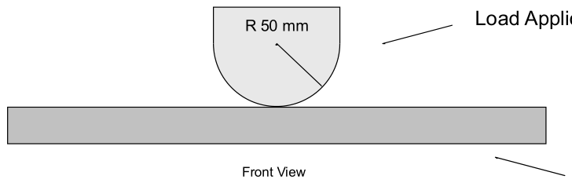

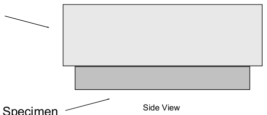

**F.4.2.5** Perimeter Shear Test

- a. The Perimeter Shear Test must be completed by measuring the force required to push or pull a 25 mm diameter flat punch through a flat laminate sample.
- b. The sample must:
    - Measure 100 mm x 100 mm minimum
    - Have core and skin thicknesses identical to those used in the actual application
    - Be manufactured using the same materials and processes
- c. The fixture must support the entire sample, except for a 32 mm hole aligned coaxially with the punch.
- d. The sample must not be clamped to the fixture
- e. The edge of the punch and hole in the fixture may include an optional fillet with a maximum radius of 1 mm
- f. The SES must include force and displacement data and photos of the test setup
- g. The first peak in the load-deflection curve must be used to determine the skin shear strength; this may be less than the minimum force required by F.7.3.3 / F.7.5.5
- h. The maximum force recorded must meet the requirements of F.7.3.3 / F.7.5.5

**F.4.2.6** Lap Joint Test

The Lap Joint Test measures the force required to pull apart a joint of two laminate samples that are bonded together

- a. A joint design with two perpendicular bond areas may show equivalence using the shear performance of the smaller of the two areas
- b. A joint design with a single bond area must have two separate pull tests with different orientations of the adhesive joint:
    - Parallel to the pull direction, with the adhesive joint in pure shear
    - T peel normal to the pull direction, with the adhesive joint in peel
- c. The samples used must:
    - Have skin thicknesses identical to those used in the actual monocoque
    - Be manufactured using the same materials and processes

The intent is to perform a test of the actual bond overlap, and fail the skin before the bond

- d. The force and displacement data and photos of the test setup must be included in the SES.
- e. The shear strength \* normal area of the bond must be more than the UTS \* cross sectional area of the skin

### F.4.3 Use of Laminates

**F.4.3.1** Unidirectional plies must:

- Be enclosed by balanced plies
- Not be the nearest plies to core material

**F.4.3.2** The monocoque must have the tested layup direction normal to the cross sections used for Equivalence in the SES, with allowance for taper of the monocoque normal to the cross section.

**F.4.3.3** Results from the 3 point bending test will be assigned to the 0 layup direction.

**F.4.3.4** All material properties in the directions specified by the SES must be 50% or more of those in the tested “0” direction as calculated by the SES

### F.4.4 Equivalent Flat Panel Calculation

**F.4.4.1** When specified, the Equivalence of the chassis must be calculated as a flat panel with the same composition as the chassis about the neutral axis of the laminate.

**F.4.4.2** The curvature of the panel and geometric cross section of the chassis must be ignored for these calculations.

**F.4.4.3** Calculations of Equivalence that do not reference this section F.4.3 may use the actual geometry of the chassis.

## F.5 CHASSIS REQUIREMENTS

This section applies to all Chassis, regardless of material or construction

### F.5.1 Primary Structure

**F.5.1.1** The Primary Structure must be constructed from one or a combination of:

|  |  |  |
|---|---|---|
| • | Steel Tubing and Material | F.3.2 F.3.4 |
| • | Alternative Tubing Materials | F.3.2 F.3.4.4 |
| • | Composite Material | F.4 |

**F.5.1.2** Any chassis design that combines the Tube Frame, Monocoque, tubing and/or composite types must:

- a. Meet all relevant requirements F.5.1.1
- b. Show Equivalence F.2.2.2, as applicable
- c. Any connections must meet F.5.4, F.5.5, F.7.8 as applicable, or Equivalent

### F.5.2 Bent Tubes or Multiple Tubes

**F.5.2.1** The minimum radius of any bend, measured at the tube centerline, must be three or more times the tube outside diameter (3 x OD)

**F.5.2.2** Bends must be smooth and continuous with no evidence of crimping or wall failure.

**F.5.2.3** If a bent tube (or member consisting of multiple tubes that are not in a line) is used anywhere in the Primary Structure other than the Roll Hoops (see F.5.6.3 for Roll Hoop requirements), an additional tube must be attached to support it.

- a. The support tube attachment point must be at the position along the bent tube where it deviates farthest from a straight line connecting the two ends
- b. The support tube must terminate at a node of the chassis
- c. The support tube for any bent tube (other than the Upper Side Impact Member or Shoulder Harness Mounting Bar) must be:
    - The same diameter and thickness as the bent tube
    - Angled no more than 30° from the plane of the bent tube

**F.5.2.4** If multiple tubes are used in place of a bend, the ends should be mitered together for a continuous load path. No open tube ends are allowed in regulated load paths.

### F.5.3 Holes and Openings in Regulated Tubing

**F.5.3.1** Any holes 4 mm and larger in any regulated tubing must be included in the SES

**F.5.3.2** Technical Inspectors may check the compliance of all tubes. This may be done by ultrasonic testing or by the drilling of inspection holes on request.

**F.5.3.3** Regulated tubing other than the open lower ends of Roll Hoops must have any open ends closed by a welded cap or inserted metal plug

### F.5.4 Fasteners in Primary Structure

**F.5.4.1** Bolted connections in the Primary Structure must use a removable bolt and nut

Bonded fasteners and blind nuts and bolts do not meet this requirement

**F.5.4.2** Threaded fasteners used in Primary Structure are Critical Fasteners, see T.8.2

**F.5.4.3** Bolted connections in the Primary Structure using tabs or brackets must have an edge distance ratio “e/D” of 1.5 or higher

“D” equals the hole diameter. “e” equals the distance from the edge of the hole to the nearest free edge

Tabs attaching the Suspension to the Primary Structure are NOT “in the Primary Structure”

### F.5.5 Bonding in Regulated Structure

**F.5.5.1** Adhesive used and referenced bonding strength must be correct for the two substrate types

**F.5.5.2** Document the adhesive choice, age and expiration date, substrate preparation, and the equivalency of the bonded joint in the SES

**F.5.5.3** The SES will reduce any referenced or tested adhesive values by 50%

### F.5.6 Roll Hoops

**F.5.6.1** The Chassis must include a Main Hoop and a Front Hoop

**F.5.6.2** The Main Hoop and Front Hoop must be Triangulated into the Primary Structure with Structural Tubing

**F.5.6.3** Any front or side view Roll Hoop bend below the respective Roll Hoop Braces must be one of the two:

- a. Triangulated at a side view node
- b. Less than 25 mm from an Attachment point F.7.8

**F.5.6.4** Roll Hoop and Driver Position

When seated and restrained by the Driver Restraint System, the helmet of a 95th percentile male (see V.2.1.1) and all of the team’s drivers must:

- a. Be a minimum of 50 mm from the straight line drawn from the top of the Main Hoop to the top of the Front Hoop.
- b. Be a minimum of 50 mm from the straight line drawn from the top of the Main Hoop to the lower end of the Main Hoop Bracing if the bracing extends rearwards.
- c. Be no further rearwards than the rear surface of the Main Hoop if the Main Hoop Bracing extends forwards.

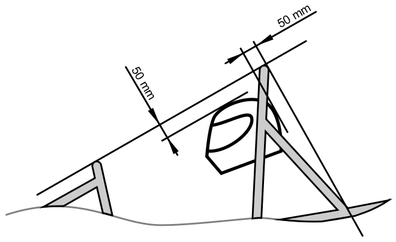

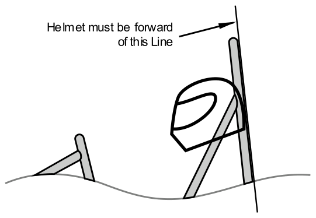

**F.5.6.5** Driver Template

A two dimensional template used to represent the 95th percentile male is made to these dimensions (see figure below):

- A circle of diameter 200 mm represent the hips and buttocks
- A circle of diameter 200 mm represent the shoulder/cervical region
- A circle of diameter 300 mm represent the head (with helmet)
- Tangent lines to the 200 mm and 300 mm circles represent the neck
- A straight line measuring 490 mm connects the centers of the two 200 mm circles
- A straight line measuring 280 mm connects the centers of the upper 200 mm circle and the 300 mm head circle

**F.5.6.6** Driver Template Position

The Driver Template will be positioned as follows:

- The seat will be adjusted to the rearmost position
- The pedals will be put in the most forward position
- The bottom 200 mm circle will be put on the seat bottom where the distance between the center of this circle and the rearmost face of the pedals is no less than 915 mm
- The middle 200 mm circle, representing the shoulders, will be positioned on the seat back
- The upper 300 mm circle will be positioned no more than 25 mm away from the head restraint (where the driver’s helmet is located while driving)

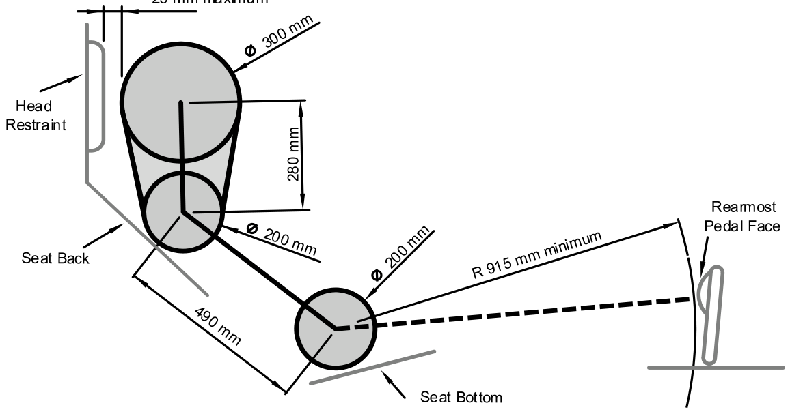

### F.5.7 Front Hoop

**F.5.7.1** The Front Hoop must be constructed of closed section metal tubing meeting F.3.2.1.c

**F.5.7.2** With proper Triangulation, the Front Hoop may be fabricated from more than one piece of tubing

**F.5.7.3** The Front Hoop must extend from the lowest Frame Member on one side of the Frame, up, over and down to the lowest Frame Member on the other side of the Frame

**F.5.7.4** The top-most surface of the Front Hoop must be no lower than the top of the steering wheel in any angular position. See figure after F.5.9.6 below

**F.5.7.5** The Front Hoop must be no more than 250 mm forward of the steering wheel

This distance is measured horizontally, on the vehicle centerline, from the rear surface of the Front Hoop to the forward most surface of the steering wheel rim with the steering in the straight ahead position.

**F.5.7.6** In side view, any part of the Front Hoop above the Upper Side Impact Structure must be inclined less than 20° from the vertical

**F.5.7.7** A Front Hoop that is not steel must have a 4 mm hole drilled in a location to access during Technical Inspection

**F.5.7.8** The outer perimeter of the front hoop should not have concave sections across the top

### F.5.8 Main Hoop

**F.5.8.1** The Main Hoop must be a single piece of uncut, continuous, closed section steel tubing meeting F.3.2.1.g

**F.5.8.2** The Main Hoop must extend from the lowest Frame Member / bottom of Monocoque on one side of the Frame, up, over and down to the lowest Frame Member / bottom of Monocoque on the other side of the Frame

**F.5.8.3** In the side view of the vehicle,

- a. The part of the Main Hoop that lies above its attachment point to the upper Side Impact Tube must be less than 10° from vertical
- b. The part of the Main Hoop below the Upper Side Impact Member attachment:
    - May be forward at any angle
    - Must not be rearward more than 10° from vertical

**F.5.8.4** In the front view of the vehicle, the vertical members of the Main Hoop must be minimum 380 mm apart (inside dimension) at the location where the Main Hoop is attached to the bottom tubes of the Major Structure of the Chassis

### F.5.9 Main Hoop Braces

**F.5.9.1** Main Hoop Braces must be constructed of closed section steel tubing meeting F.3.2.1.h

**F.5.9.2** The Main Hoop must be supported by two Braces extending in the forward or rearward direction, one on each of the left and right sides of the Main Hoop

**F.5.9.3** In the side view of the vehicle:

| If the Main Hoop: | then the Main Hoop Braces: |
|---|---|
| a. Leans forward | Must be forward of the Main Hoop |
| b. Leans rearward | Must be rearward of the Main Hoop |
| c. Is vertical | May be either forward or rearward of the Main Hoop |

**F.5.9.4** The Main Hoop Braces must be attached 160 mm or less below the top most surface of the Main Hoop

The Main Hoop Braces should be attached as near as possible to the top of the Main Hoop

**F.5.9.5** The included angle formed by the Main Hoop and the Main Hoop Braces must be 30° or more

**F.5.9.6** The Main Hoop Braces must be straight, without any bends

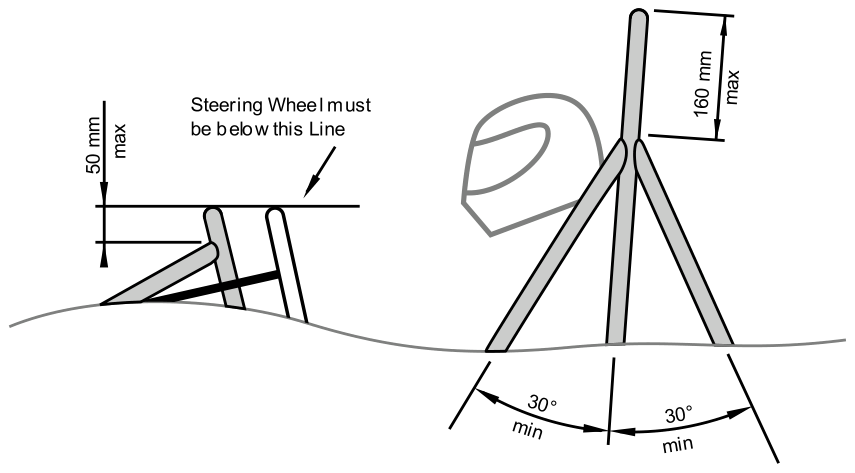

**F.5.9.7** The Main Hoop Braces must be:

- a. Securely integrated into the Frame
- b. Capable of transmitting all loads from the Main Hoop into the Major Structure of the Chassis without failing

### F.5.10 Head Restraint Protection

An additional frame member may be added to meet T.2.8.3.b

**F.5.10.1** If used, the Head Restraint Protection frame member must:

- a. Attach to the nodes where the Main Hoop Braces F.5.9.2 connect to the Main Hoop
- b. Be constructed of a single piece of uncut, continuous, closed section steel tubing meeting F.3.2.1.h
- c. Meet F.5.2.1 and F.5.2.2, as applicable (does not need to meet F.5.2.3)

**F.5.10.2** The Head Restraint or mounting T.2.8 must not attach to the Head Restraint Protection

### F.5.11 External Items

**F.5.11.1** Definition - items outside the exact outline of the part of the Primary Structure Envelope F.1.11 defined by the Main Hoop Braces and the parts of the Main Hoop tubes above other tube nodes or composite attachments

**F.5.11.2** External Items may be mounted on the outside of the Main Hoop or Main Hoop Brace tubes if the mount is one of the two:

- a. With tabs located at the Main Hoop to Main Hoop Brace node and is rotationally free about an axis
- b. Above additional bracing meeting F.3.2.1.o, with calculations that show the mount will fail below the permitted load as calculated by the SES

**F.5.11.3** If mounted between the tubes of the Main Hoop and Main Hoop Braces, these items may attach to the Main Hoop or Main Hoop Brace tubes and do not need to meet F.5.11.2 above:

- a. Crushable lightweight bodywork, intake manifolds, Head Restraint, Manual Service Disconnect, Master Switches or Shutdown Buttons
- b. Lightweight mounts for items inside the Main Hoop Braces

**F.5.11.4** Mounts for engine, motor, suspension or Tractive Battery Pack must not attach to the span of the Main Hoop Braces or Main Hoop above other tube nodes or composite attachments

**F.5.11.5** Items outside the Primary Structure from the Main Hoop Braces and Main Hoop tubes must be longitudinally offset to avoid point loading in a rollover

**F.5.11.6** External Items should not point at the driver

### F.5.12 Mechanically Attached Roll Hoop Bracing

**F.5.12.1** When Roll Hoop Bracing is mechanically attached:

- a. The threaded fasteners used to secure non permanent joints are Critical Fasteners, see T.8.2. Additional requirements apply in F.5.12.5 and F.5.12.7
- b. Spherical rod ends are not permitted
- c. The attachment holes in the lugs, the attached bracing and the sleeves and tubes must be a close fit with the pin or bolt
- d. Any mounting lug must have a distance from the edge of the hole to the nearest free edge (E) that is minimum 1.5 times the hole diameter (d)

**F.5.12.2** Any non permanent joint at the end(s) must be a Double Lug Joint or a Sleeved Butt Joint

Figure – Double Lug Joint

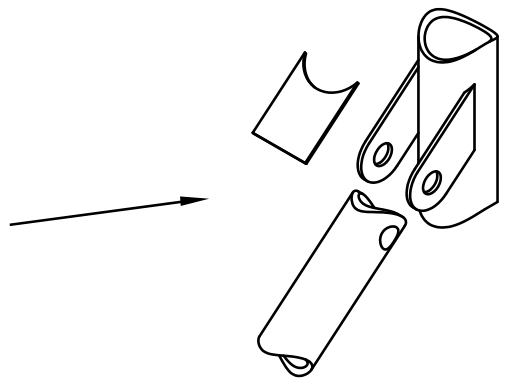

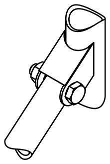

**F.5.12.3** For Double Lug Joints, each lug must:

- a. Be minimum 4.5 mm (0.177 in) thickness steel
- b. Measure 25 mm minimum perpendicular to the axis of the bracing
- c. Be as short as practical along the axis of the bracing

**F.5.12.4** All Double Lug Joints, whether fitted parallel or perpendicular to the axis of the tube, must include a cap of minimum 4.5 mm (0.177 in) thickness steel

**F.5.12.5** In a Double Lug Joint the pin or bolt and nut must be 10 mm Metric Grade 9.8 or 3/8 in SAE Grade 8 minimum diameter and grade. See F.5.12.1 above

Figure – Sleeved Butt Joint

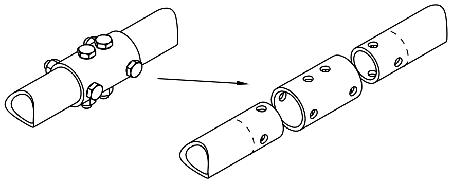

**F.5.12.6** For Sleeved Butt Joints, the sleeve must:

- a. Have a minimum length of 75 mm; 37.5 mm to each side of the joint
- b. Be external to the base tubes, with a close fit around the base tubes.
- c. Have a wall thickness of 2.0 mm or more

**F.5.12.7** In a Sleeved Butt Joint, the bolts and nuts must be 6 mm Metric Grade 9.8 or 1/4 in SAE Grade 8 minimum diameter and grade. See F.5.12.1 above

### F.5.13 Other Bracing Requirements

**F.5.13.1** Where the braces are not welded to steel Frame Members, the braces must be securely attached to the Frame using 8 mm or 5/16” minimum diameter Critical Fasteners, see T.8.2

**F.5.13.2** Mounting plates welded to Roll Hoop Bracing must be 2.0 mm (0.080 in) minimum thickness steel.

### F.5.14 Steering Protection

Steering system racks or mounting components that are external (vertically above or below) to the Primary Structure must be protected from frontal impact.

The protective structure must:

- a. Be F.3.2.1.n or Equivalent
- b. Extend to the vertical limit of the steering component(s)
- c. Extend to the local width of the Chassis
- d. Meet F.7.8 if not welded to the Chassis

### F.5.15 Other Side Tube Requirements

If there is a Roll Hoop Brace or other frame tube alongside the driver, at the height of the neck of any of the team’s drivers, a metal tube or piece of sheet metal must be attached to the Frame This is intended to prevent the drivers’ shoulders from passing under the Roll Hoop Brace or frame tube, and the driver’s neck contacting this brace or tube.

### F.5.16 Component Protection

When specified in the rules, components must be protected by one or two of:

- a. Fully Triangulated structure with tubes meeting F.3.2.1.n
- b. Structure Equivalent to the above, as determined per F.4.1.3

## F.6 TUBE FRAMES

### F.6.1 Front Bulkhead

The Front Bulkhead must be constructed of closed section tubing meeting F.3.2.1.a

### F.6.2 Front Bulkhead Support

**F.6.2.1** Frame Members of the Front Bulkhead Support system must be constructed of closed section tubing meeting F.3.2.1.b

**F.6.2.2** The Front Bulkhead must be securely integrated into the Frame.

**F.6.2.3** The Front Bulkhead must be supported back to the Upper and Lower Side Impact Structure at the Front Hoop by a minimum of three Frame Members on each side of the vehicle; an upper member; lower member and diagonal brace to provide Triangulation

- a. The top of the upper support member must be attached 50 mm or less from the top surface of the Front Bulkhead, and attach to the Front Hoop no more than 50 mm below the top of the Upper Side Impact member
- b. If the upper support member is further than 100 mm above the top of the Upper Side Impact member, then properly Triangulated bracing is required to transfer load to the Main Hoop by one of:
    - the Upper Side Impact member
    - an additional member transmitting load from the junction of the Upper Support Member with the Front Hoop
- c. The lower support member must be attached to the base of the Front Bulkhead and the base of the Front Hoop
- d. The diagonal brace must properly Triangulate the upper and lower support members

**F.6.2.4** Each of the above members may be multiple or bent tubes provided the requirements of F.5.2 are met

**F.6.2.5** Examples of acceptable configurations of members may be found in the SES

### F.6.3 Front Hoop Bracing

**F.6.3.1** Front Hoop Braces must be constructed of material meeting F.3.2.1.d

**F.6.3.2** The Front Hoop must be supported by two Braces extending in the forward direction, one on each of the left and right sides of the Front Hoop.

**F.6.3.3** The Front Hoop Braces must extend to one of the two:

- a. The Front Bulkhead
- b. A triangulated structural node

**F.6.3.4** The Front Hoop Braces must be attached as near as possible to the top of the Front Hoop but not more than 50 mm below the top-most surface of the Front Hoop. See figure after F.5.9.6 above

**F.6.3.5** If the Front Hoop above the Upper Side Impact Structure leans rearwards by more than 10° from the vertical, it must be supported by additional rearward Front Hoop Braces to a fully Triangulated structural node.

**F.6.3.6** The Front Hoop Braces must be straight, without any bends and should not point at the driver

### F.6.4 Side Impact Structure

**F.6.4.1** Frame Members of the Side Impact Structure must be constructed of closed section tubing meeting F.3.2.1.e or F.3.2.1.f, as applicable

**F.6.4.2** With proper Triangulation, Side Impact Structure members may be fabricated from more than one piece of straight, non bent tubing

**F.6.4.3** The Side Impact Structure must include three or more tubular members located on each side of the driver while seated in the driving position

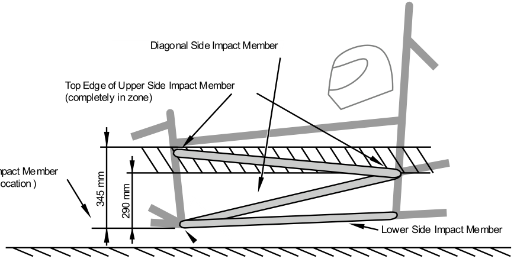

**F.6.4.4** The Upper Side Impact Member must:

- a. Connect the Main Hoop and the Front Hoop.
- b. Have its top edge entirely in a zone that is parallel to the ground between 290 mm and 345 mm above the lowest point of the bottom of the Lower Side Impact Member

**F.6.4.5** The Lower Side Impact Structure member must connect the bottom of the Main Hoop and the bottom of the Front Hoop.

**F.6.4.6** The Diagonal Side Impact Member must:

- a. Connect the Upper Side Impact Member and Lower Side Impact Member forward of the Main Hoop and rearward of the Front Hoop
- b. Completely Triangulate the bays created by the Upper and Lower Side Impact Members.

### F.6.5 Shoulder Harness Mounting

**F.6.5.1** The Shoulder Harness Mounting Bar must:

- a. Be a single piece of uncut, continuous, closed section steel tubing that meets F.3.2.1.k
- b. Attach to the Main Hoop on the left and right sides of the chassis

**F.6.5.2** Bent Shoulder Harness Mounting Bars must:

- a. Meet F.5.2.1 and F.5.2.2
- b. Have bracing members attached at the bend(s) and to the Main Hoop.
    - Material for this Shoulder Harness Mounting Bar Bracing must meet F.3.2.1.l
    - The included angle in side view between the Shoulder Harness Bar and the braces must be no less than 30°.

**F.6.5.3** The Shoulder Harness Mounting Bar must be loaded only by the Shoulder Harness

The Head Restraint, Firewall, driver’s seat and light bodywork may attach to the mounting bar

### F.6.6 Main Hoop Bracing Supports

**F.6.6.1** Frame Members of the Main Hoop Bracing Support system must be constructed of closed section tubing meeting F.3.2.1.i

**F.6.6.2** The lower end of the Main Hoop Braces must be supported back to the Main Hoop by a minimum of two Frame Members on each side of the vehicle: an upper member and a lower member in a properly Triangulated configuration

- a. The upper support member must attach to the node where the upper Side Impact Member attaches to the Main Hoop
- b. The lower support member must attach to the node where the lower Side Impact Member attaches to the Main Hoop
- c. Each of the above members may be multiple or bent tubes provided the requirements of F.5.2 are met
- d. Examples of acceptable configurations of members may be found in the SES

**F.6.6.3** The lower ends of the Main Hoop Brace tubes must be mitered to the Lower Main Hoop Brace Support tubes for a continuous load path

## F.7 MONOCOQUE

### F.7.1 General Requirements

**F.7.1.1** The Structural Equivalency Spreadsheet must show that the design is Equivalent to a welded frame in terms of energy dissipation, yield and ultimate strengths in bending, buckling and tension

**F.7.1.2** Composite and metallic monocoques have the same requirements

**F.7.1.3** Corners between panels used for structural equivalence must contain core

**F.7.1.4** An inspection hole approximately 4mm in diameter must be drilled through a low stress location of each monocoque section regulated by the Structural Equivalency Spreadsheet

This inspection hole is not required in the Vertical Side Impact Structure F.7.5.3.b

**F.7.1.5** Composite monocoques must:

- a. Meet the materials requirements in F.4 Composite and Other Materials
- b. Use data from the laminate testing results as the basis for any strength or stiffness calculations

**F.7.1.6** Composite monocoques made in two or more pieces must use scarf joints with structural adhesive for the length of the seam

**F.7.1.7** Core splice must be used between all adjacent core sections

### F.7.2 Front Bulkhead

**F.7.2.1** When modeled as an “L” shaped section the EI of the Front Bulkhead about vertical and lateral axis must be equivalent to that of the tubes specified for the Front Bulkhead per F.6.1

**F.7.2.2** The length of the section perpendicular to the Front Bulkhead may be a maximum of 25 mm measured from the rearmost face of the Front Bulkhead

**F.7.2.3** Any Front Bulkhead which supports the IA plate must have a perimeter shear strength equivalent to a 1.5 mm thick steel plate

### F.7.3 Front Bulkhead Support

**F.7.3.1** In addition to proving that the strength of the monocoque is sufficient, the monocoque must have equivalent EI to the sum of the EI of the six Steel Tubes (F.3.2.1.b) that it replaces.

**F.7.3.2** The EI of the vertical side of the Front Bulkhead support structure must be equivalent to or more than the EI of one steel tube that it replaces when calculated as per F.4.3

**F.7.3.3** The perimeter shear strength of the monocoque laminate in the Front Bulkhead support structure must be 4 kN or more for a section with a diameter of 25 mm.

This must be proven by a physical test completed per F.4.2.5 and the results included in the SES.

### F.7.4 Front Hoop Attachment

**F.7.4.1** The Front Hoop must be mechanically attached to the monocoque

- a. Front Hoop Mounting Plates must be the minimum thickness of the Front Hoop F.3.2.1.c
- b. The Front Hoop tube must be mechanically connected to the Mounting Plate with Mounting Plates parallel to the two sides of the tube, with gussets from the Front Hoop tube along the two sides of the mounting plate

**F.7.4.2** Front Hoop attachment to a monocoque must obey F.5.7.2 or F.7.8 within 25 mm of any bends and nodes that are not at the top center of the Front Hoop

**F.7.4.3** The Front Hoop may be fully laminated into the monocoque if:

- a. The Front Hoop has core fit tightly around its entire circumference. Expanding foam is not permitted
- b. Equivalence to six or more mounts compliant with F.7.8 must show in the SES
    The laminate used for Equivalence runs from the outer skin, around the Front Hoop, and back to the outer skin
- c. A small gap in the laminate (approximately 25 mm) exists for inspection of the Front Hoop F.5.7.7

**F.7.4.4** Adhesive must not be the sole method of attaching the Front Hoop to the monocoque

### F.7.5 Side Impact Structure

**F.7.5.1** Side Impact Zone - the region longitudinally forward of the Main Hoop and aft of the Front Hoop consisting of the combination of a vertical section minimum 290 mm in height from the bottom surface of the floor of the monocoque and half the horizontal floor

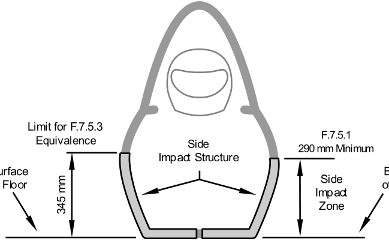

**F.7.5.2** The Side Impact Zone must have Equivalence to the three (3) Steel Tubes (F.3.2.1.e) that it replaces

**F.7.5.3** The portion of the Side Impact Zone that is vertically between the bottom surface of the floor and 345 mm above the lowest point of the bottom surface of the floor (see figure above) must have:

- a. Equivalence to minimum two (2) Steel Tubes (F.3.2.1.e) per F.4.3
- b. No openings in Side View between the Front Hoop and Main Hoop

**F.7.5.4** Horizontal floor Equivalence must be calculated per F.4.3

**F.7.5.5** The perimeter shear strength of the monocoque laminate must be 7.5 kN or more for a section with a diameter of 25 mm.

This must be proven by physical test completed per F.4.2.5 and the results included in the SES.

### F.7.6 Main Hoop Attachment

**F.7.6.1** The Main Hoop must be mechanically attached to the monocoque

- a. Main Hoop mounting plates must be 2.0 mm minimum thickness steel
- b. The Main Hoop tube must be mechanically connected to the mounting plate with 2.0 mm minimum thickness steel plates parallel to the two sides of the tube, with gussets from the Main Hoop tube along the two sides of the mounting plate

**F.7.6.2** Main Hoop attachment to a monocoque must obey F.7.8 within 25 mm of any bends and nodes that are below the top of the monocoque

### F.7.7 Roll Hoop Bracing Attachment

Attachment of tubular Front or Main Hoop Bracing to the monocoque must obey F.7.8.

### F.7.8 Attachments

**F.7.8.1** Each attachment point between the monocoque or composite panels and the other Primary Structure must be able to carry a minimum load of 30 kN in any direction

- a. When a Roll Hoop attaches in three locations on each side, the attachments must be located at the monocoque bottom, top, and a location near the midpoint
- b. When a Roll Hoop attaches at only the monocoque bottom and top on each side, each of the four attachments must show load strength of 45 kN in all directions

**F.7.8.2** If a tube frame ( F.6, F.11.2 ) meets the monocoque at the Attachments, the connection must

- a. Be 25 mm or less from a node
- b. Obey one of the two:
    - Parallel brackets attached to the two sides of the Main Hoop and the two sides of the Side Impact Structure
    - Two mostly perpendicular brackets attached to the Main Hoop and the side and back of the monocoque

**F.7.8.3** The laminate, brackets, backing plates and inserts must have sufficient stiffness, shear area, bearing area, weld area and strength to carry the load specified in F.7.8.1 in any direction.

Data obtained from the laminate perimeter shear strength test (F.4.2.5) must prove sufficient shear area is provided.

**F.7.8.4** Each attachment point requires no less than two 8 mm or 5/16” minimum diameter Critical Fasteners, see T.8.2

**F.7.8.5** Each attachment point requires backing plates which meet one of:

- Steel with a minimum thickness of 2 mm
- Alternate materials if Equivalency is approved

**F.7.8.6** Mounting and backing plates must:

- Have a continuous perimeter that is near circular or near oval
    The outer perimeter may have some straight sections, but no concave sections
- Not have any cut-outs within their outside perimeter except for bolt holes
- Have a distance from the edge of the hole to the nearest free edge (E) that is at least 1.5 times the hole diameter (d)

**F.7.8.7** The Front Hoop Bracing, Main Hoop Bracing and Main Hoop Bracing Supports may use only one 10 mm or 3/8” minimum diameter Critical Fasteners, see T.8.2 as an alternative to F.7.8.4 above if the bolt is on the centerline of the bracing tube to prevent loading the bolt in bending, similar to the figure below.

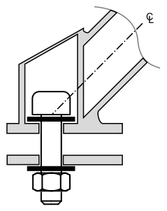

**F.7.8.8** Each Roll Hoop or Battery Pack to Chassis attachment point must contain one of the two:

- a. A solid insert that is fully enclosed by the inner and outer skin
- b. Local elimination of any gap between inner and outer skin, with or without repeating skin layups

**F.7.8.9** Load paths between attachments and the monocoque Side Impact Structure F.7.5 must use continuous laminates F.4.3 with core

### F.7.9 Driver Harness Attachment

**F.7.9.1** Required Loads

- a. Each attachment point for the Shoulder Belts must support a minimum load of 15 kN before failure with a required load of 30 kN distributed across the two belt attachments
- b. Each attachment point for the Lap Belts must support a minimum load of 15 kN before failure
- c. Each attachment point for the Anti-Submarine Belts must support a minimum load of 15 kN before failure
- d. If the Lap Belt and Anti-Submarine Belt mounting points are less than 125 mm apart, then each mounting point must support a minimum load of 30 kN before failure

**F.7.9.2** Load Testing

The strength of Lap Belt, Shoulder Belt, and Anti-Submarine Belt attachments must be proven by physical tests where the required load is applied to a representative attachment point where the proposed layup and attachment bracket are used.

- a. Edges of the test fixture supporting the sample must be a minimum of 125 mm from the load application point (load vector intersecting a plane)
- b. Test Load application of the Lap Belt and Anti Submarine Belts must be normal (90 degrees) to the plane of the test sample
- c. Shoulder Belt Test Load application must meet:

| Installed Shoulder Belt Angle: | Test Load Application Angle must be: | should be: |
|---|---|---|
| Between 90° and 45° | Between 90° and the installed Shoulder Belt Angle | 90° |
| Between 45° and 0° | Between 90° and 45° | 90° |

The angles are measured from the plane of the Test Sample (90° is normal to the Test Sample and 0° is parallel to the Test Sample)

- d. The Shoulder Harness test sample must not be any larger than the section of the monocoque as built
- e. The width of the Shoulder Harness test sample must not be any wider than the Shoulder Harness "panel height" (see Structural Equivalency Spreadsheet) used to show equivalency for the Shoulder Harness mounting bar
- f. Designs with attachments near a free edge must not support the free edge during the test

The intent is that the test specimen, to the best extent possible, represents the vehicle as driven at competition. Teams are expected to test a panel that is manufactured in as close a configuration to what is built in the vehicle as possible

## F.8 FRONT CHASSIS PROTECTION

### F.8.1 Requirements

**F.8.1.1** Forward of the Front Bulkhead there must be an Impact Attenuator with an Anti Intrusion Plate between the Impact Attenuator and the Front Bulkhead.

**F.8.1.2** All methods of attachment of the Impact Attenuator to the Anti Intrusion Plate, and of the Anti Intrusion Plate to the Front Bulkhead must provide sufficient load paths for transverse and vertical loads if off-axis impacts occur.

### F.8.2 Anti Intrusion Plate - AIP

**F.8.2.1** The Anti Intrusion Plate must be one of the three:

- a. 1.5 mm minimum thickness solid steel
- b. 4.0 mm minimum thickness solid aluminum plate
- c. Composite material per F.8.3

**F.8.2.2** The outside profile requirement of the Anti Intrusion Plate depends on the method of attachment to the Front Bulkhead:

- a. Welded joints: the profile must align with or be more than the centerline of the Front Bulkhead tubes on all sides
- b. Bolted joints, bonding, laminating: the profile must align with or be more than the outside dimensions of the Front Bulkhead around the entire periphery

**F.8.2.3** Attachment of the Anti Intrusion Plate directly to the Front Bulkhead must be documented in the team’s SES submission. The accepted methods of attachment are:

- a. Welding
    - All weld lengths must be 25 mm or longer
    - If interrupted, the weld/space ratio must be 1:1 or higher
- b. Bolted joints
    - Using no less than eight 8 mm or 5/16” minimum diameter Critical Fasteners, T.8.2.
    - The distance between any two bolt centers must be 50 mm minimum.
    - Each bolt attachment must have pullout and bending capabilities of 15 kN
    - Bolt tearout capability must meet one of the two:
        \- Each bolt attachment has tearout capability of 15 kN
        \- The total tearout strength of the mounting (not individual bolts) must be
        more than the attachment strength of the Impact Attenuator in F.8.5.3.b
- c. Bonding
    - The Front Bulkhead must have no openings
    - The entire surface of the Anti Intrusion Plate must be bonded, with shear and peel strength higher than 120 kN
- d. Laminating
    - The Anti Intrusion Plate must be in front of the outer skin of the Front Bulkhead
    - The lamination must fully enclose the Anti Intrusion Plate and have shear capability higher than 120 kN

### F.8.3 Composite Anti Intrusion Plate

**F.8.3.1** Composite Anti Intrusion Plates:

- a. Must not fail in a frontal impact
- b. Must withstand a minimum static load of 120 kN distributed over the 200 mm x 100 mm minimum Impact Attenuator area

**F.8.3.2** Strength of the Composite Anti Intrusion Plate must be verified by one of the two methods:

- a. Physical testing of the AIP attached to a structurally representative section of the intended chassis
    - The test fixture must have equivalent strength and stiffness to a baseline front bulkhead or must be the same as the first 50 mm of the Chassis
    - Test data is valid for only one Competition Year
- b. Laminate material testing under F.4.2.2 and F.4.2.5 and calculations of 3 point bending and perimeter shear

### F.8.4 Impact Attenuator - IA

**F.8.4.1** Teams must do one of:

- Use an approved Standard Impact Attenuator from the Event Website
- Build and test a Custom Impact Attenuator of their own design F.8.8

**F.8.4.2** The Custom Impact Attenuator must meet these:

- a. Length 200 mm or more, with its length oriented along the fore/aft axis of the Chassis.
- b. Minimum height 100 mm (perpendicular to the ground) and minimum width 200 mm (parallel to the ground) for a minimum distance of 200 mm forward of the Front Bulkhead.
- c. Segmented foam attenuators must have all segments bonded together to prevent sliding or parallelogramming.
- d. Honeycomb attenuators made of multiple segments must have a continuous panel between each segment.

**F.8.4.3** If the outside profile of the Front Bulkhead is more than 400 mm x 350 mm, or the team uses the Standard Honeycomb Impact Attenuator, and then one of the two must be met:

- a. The Front Bulkhead must include an additional support that is a diagonal or X-brace that meets F.3.2.1.b or Equivalent (integral or attached) for Monocoque bulkheads F.2.3.1
    - The structure must go across the entire Front Bulkhead opening on the diagonal
    - Attachment points at each end must carry a minimum load of 30 kN in any direction
- b. Physical testing per F.8.8.6 and F.8.8.7 must be done to prove that the Anti Intrusion Plate does not permanently deflect more than 25 mm.

### F.8.5 Impact Attenuator Attachment

**F.8.5.1** The attachment of the Impact Attenuator to the Anti Intrusion Plate or Front Bulkhead must be documented in the SES submission

**F.8.5.2** The Impact Attenuator must attach with an approved method:

<table>
<tr>
<td colspan="2">Impact Attenuator Type</td>
<td>Construction</td>
<td>Attachment Method(s):</td>
</tr>
<tr>
<td>a.</td>
<td>Standard or Custom</td>
<td>Foam, Honeycomb</td>
<td>Bonding</td>
</tr>
<tr>
<td>b.</td>
<td>Custom</td>
<td>other</td>
<td>Bonding, Welding, Bolting</td>
</tr>
</table>

**F.8.5.3** If the Impact Attenuator is attached by bonding:

- a. Bonding must meet F.5.5
- b. The shear strength of the bond must be higher than:
    - 95 kN for foam Impact Attenuators
    - 38.5 kN for honeycomb Impact Attenuators
    - The maximum compressive force for custom Impact Attenuators
- c. The entire surface of a foam Impact Attenuator must be bonded
- d. Only the pre-crushed area of a honeycomb Impact Attenuator may be used for bond equivalence

**F.8.5.4** If the Impact Attenuator is attached by welding:

- a. Welds may be continuous or interrupted
- b. If interrupted, the weld/space ratio must be 1:1 or higher
- c. All weld lengths must be more than 25 mm

**F.8.5.5** If the Impact Attenuator is attached by bolting:

- a. Must have no less than eight 8 mm or 5/16” minimum diameter Critical Fasteners, T.8.2
- b. The distance between any two bolt centers must be 50 mm minimum
- c. Each bolt attachment must have pullout, tearout and bending capabilities of 15 kN
- d. Must be bolted directly to the Primary Structure

**F.8.5.6** Impact Attenuator Position

- a. All Impact Attenuators must mount with the bottom leading edge 175 mm or less above the lowest point on the bottom of the Lower Side Impact Structure
- b. A Custom Impact Attenuator must mount with an area of 200 mm or more long and 200 mm or more wide that intersects a plane parallel to the ground that is 175 mm or less above the lowest point on the bottom of the Lower Side Impact Structure

**F.8.5.7** Impact Attenuator Orientation

- a. The Impact Attenuator must be centered laterally on the Front Bulkhead
- b. Standard Honeycomb must be mounted 200mm width x 100mm height
- c. Standard Foam may be mounted laterally or vertically

### F.8.6 Front Impact Objects

**F.8.6.1** The only items permitted forward of the Anti Intrusion Plate in front view are the Impact Attenuator, fastener heads, and light bodywork / nosecones

Fasteners should be oriented with the nuts rearwards

**F.8.6.2** Front Wing and Bodywork Attachment

- a. The front wing and front wing mounts must be able to move completely aft of the Anti Intrusion Plate and not touch the front bulkhead during a frontal impact
- b. The attachment points for the front wing and bodywork mounts should be aft of the Anti Intrusion Plate
- c. Tabs for wing and bodywork attachment must not extend more than 25 mm forward of the Anti Intrusion Plate

**F.8.6.3** Pedal assembly at full travel and adjustment must have a minimum 25 mm clearance to the:

- a. Rear face of the Anti Intrusion Plate
- b. All Front Bulkhead structure F.6.1, F.7.2, F.8.4.3
- c. All Non Crushable Items in the Primary Structure

Non Crushable Items include, but are not limited to batteries, master cylinders, hydraulic reservoirs

### F.8.7 Front Impact Verification

**F.8.7.1** The combination of the Impact Attenuator assembly and the force to crush or detach all other items forward of the Anti Intrusion plate must not exceed the peak deceleration specified in F.8.8.2

Ignore light bodywork, light nosecones, and outboard wheel assemblies

**F.8.7.2** The peak load for the type of Impact Attenuator:

|  |  |  |
|---|---|---|
| • | Standard Foam Impact Attenuator | 95 kN |
| • | Standard Honeycomb Impact Attenuator | 60 kN |
| • | Tested Impact Attenuator | peak as measured |

**F.8.7.3** Use the Test Method F.8.7.4 or the Calculation Method F.8.7.5 to prove the force requirement

**F.8.7.4** Test Method

Get the peak force from physical testing of the Impact Attenuator and any Non Crushable Object(s) as one of the two:

- a. Tested together with the Impact Attenuator
- b. Tested with the Impact Attenuator not attached, and add the peak load from F.8.7.2

**F.8.7.5** Calculation Method

- a. Calculate a failure load for the mounting of the Non Crushable Object(s) from fastener shear, tearout, and/or link buckling
- b. Add the peak attenuator load from F.8.7.2

### F.8.8 Impact Attenuator Data - IAD

**F.8.8.1** All teams must include an Impact Attenuator Data (IAD) report as part of the SES.

**F.8.8.2** Impact Attenuator Functional Requirements

These are not test requirements

- a. Decelerates the vehicle at a rate not exceeding 20 g average and 40 g peak
- b. Energy absorbed must be more than 7350 J

When:

- Total mass of Vehicle is 300 kg
- Impact velocity is 7.0 m/s

**F.8.8.3** When using the Standard Impact Attenuator, the SES must meet these:

- a. Test data will not be submitted
- b. All other requirements of this section must be included.
- c. Photos of the actual attenuator must be included
- d. Evidence that the Standard IA meets the design criteria provided in the Standard Impact Attenuator specification must be included with the SES. This may be a receipt or packing slip from the supplier.

**F.8.8.4** The Impact Attenuator Data Report when NOT using the Standard Impact Attenuator must include:

- a. Test data that proves that the Impact Attenuator Assembly meets the Functional Requirements F.8.8.2
- b. Calculations showing how the reported absorbed energy and decelerations have been derived.
- c. A schematic of the test method.
- d. Photos of the attenuator, annotated with the height of the attenuator before and after testing.

**F.8.8.5** The Impact Attenuator Test is valid for only one Competition Year

**F.8.8.6** Impact Attenuator Test Setup

- a. During any test, the Impact Attenuator must be attached to the Anti Intrusion Plate using the intended vehicle attachment method.
- b. The Impact Attenuator Assembly must be attached to a structurally representative section of the intended chassis.
    The test fixture must have equivalent strength and stiffness to a baseline front bulkhead. A solid block of material in the shape of the front bulkhead is not “structurally representative”.
- c. There must be 50 mm minimum clearance rearwards of the Anti Intrusion Plate to the test fixture.
- d. No part of the Anti Intrusion Plate may permanently deflect more than 25 mm beyond the position of the Anti Intrusion Plate before the test.

The 25 mm spacing represents the front bulkhead support and insures that the plate does not intrude excessively into the cockpit.

**F.8.8.7** Test Conduct

- a. Composite Impact Attenuators must be Dynamic Tested.
    Other Impact Attenuator constructions may be Dynamic Tested or Quasi-Static Tested
- b. Dynamic Testing (sled, pendulum, drop tower, etc.) of the Impact Attenuator must be conducted at a dedicated test facility. This facility may be part of the University, but must be supervised by professional staff or the University faculty. Teams must not construct their own dynamic test apparatus.
- c. Quasi-Static Testing may be done by teams using their University’s facilities/equipment, but teams are advised to exercise due care

**F.8.8.8** Test Analysis

- a. When using acceleration data from the dynamic test, the average deceleration must be calculated based on the raw unfiltered data.
- b. If peaks above the 40 g limit are present in the data, a Channel Filter Class (CFC) 60 (100Hz) filter per SAE Recommended Practice J211 “Instrumentation for Impact Test”, or a 100 Hz, 3rd order, low pass Butterworth (-3dB at 100 Hz) filter may be applied.

## F.9 FUEL SYSTEM (IC ONLY)

Fuel System Location and Protection are subject to approval during SES review and Technical Inspection.

### F.9.1 Location

**F.9.1.1** These components must be in the Primary Structure (F.1.10):

- a. Any part of the Fuel System that is below the Upper Side Impact Structure
- b. Parts of the Fuel Tank other than the Fuel Filler Neck and Sight Tube above the Upper Side Impact Structure IC.1.2

**F.9.1.2** In side view, any portion of the Fuel System must not project below the lower surface of the chassis

### F.9.2 Protection

All Fuel Tanks must be shielded from side or rear impact

## F.10 TRACTIVE BATTERY CONTAINER (EV ONLY)

### F.10.1 General Requirements

**F.10.1.1** All Tractive Battery Containers must be:

- a. Designed to withstand forces from deceleration in all directions
- b. Made from a Nonflammable Material ( F.1.18 )

**F.10.1.2** Design of the Tractive Battery Container must be documented in the SES

Documentation includes materials used, drawings/images, fastener locations, Cell/Module weight and Cell/Module position

**F.10.1.3** The Tractive Battery Container and mounting systems are subject to approval during SES review and Technical Inspection

**F.10.1.4** If the Tractive Battery Container and/or Module structure is not constructed from steel or aluminum, the material properties must be established at a temperature of 60°C

**F.10.1.5** If adhesives are used for credited bonding, the bond properties should be established for a temperature of 60°C

**F.10.1.6** Pop rivets should not be used in the Tractive Battery Container

### F.10.2 Structure

**F.10.2.1** The Floor or Bottom must be made from one of the three:

|  |  |  |
|---|---|---|
| a. | Steel | 1.25 mm minimum thickness |
| b. | Aluminum | 3.2 mm minimum thickness |

- c. Equivalent Alternate / Composite materials ( F.4.1, F.4.2 )

**F.10.2.2** All Walls (Internal and External), Covers and Lids must be made from one of the three:

|  |  |  |
|---|---|---|
| a. | Steel | 0.9 mm minimum thickness |
| b. | Aluminum | 2.3 mm minimum thickness |

- c. Equivalent Alternate / Composite materials ( F.4.1, F.4.2 )

**F.10.2.3** Internal Vertical Walls:

- a. Must surround and separate each Module EV.5.1.1
- b. Must extend to an internal or external lid above any Module
- c. Must surround no more than 12 kg on each side

The intent is to have each Module fully enclosed in its own six sided box

**F.10.2.4** If Modules are arranged vertically above other Modules, each layer of Modules must have a load path to the Chassis attachments that does not pass through another layer of Modules

**F.10.2.5** Floors and all Wall (Internal and External) sections must be joined on each side

The accepted methods of joining Walls to Walls and Walls to Floor are:

- a. Welding
    - Welds may be continuous or interrupted.
    - If interrupted, the weld/space ratio must be 1:1 or higher
    - All weld lengths must be more than 25 mm
- b. Fasteners
    Combined strength of the fasteners must be Equivalent to the strength of the welded joint ( F.10.2.5.a above )
- c. Bonding
    - Bonding must meet F.5.5
    - Strength of the bonded joint must be Equivalent to the strength of the welded joint ( F.10.2.5.a above )
    - Bonds must run the entire length of the joint

Folding or bending plate material to create flanges or to eliminate joints between walls is recommended.

**F.10.2.6** Covers and Lids must be mechanically attached and include Positive Locking Mechanisms

### F.10.3 Cells and Modules

**F.10.3.1** The Module structure EV.1.2 (without the structure of the Tractive Battery Container and without the structure of the Cells) must prevent Cells from being crushed in any direction under the following accelerations:

- a. 40 g in the longitudinal direction (forward/aft)
- b. 40 g in the lateral direction (left/right)
- c. 20 g in the vertical direction (up/down)

**F.10.3.2** Modules must be mechanically attached to the Tractive Battery Container

Attachments to the Tractive Battery Container must show they can support the acceleration loads F.10.3.1 above in the direction of removal

Container lids are not mechanical attachments

**F.10.3.3** Module attachments must include Positive Locking Mechanisms

**F.10.3.4** The properties of the Module structure must be determined by one of the two:

- a. Test an identical structure F.10.3.5
- b. Using the cross sectional properties F.10.3.6

**F.10.3.5** An identical spare Module structure without cells should be tested

- a. Test to the loads determined in the SES in all three directions
- b. No permanent deflection or cracking must result after the tests
- c. Present the tested sample at Technical Inspection
- d. The tested sample must not be used with cells installed

**F.10.3.6** Cross sectional properties of Module structures may be used for SES loads F.10.3.1

- a. A cross section must be continuous in area and continuous along its normal to be counted toward equivalence
- b. Enter the minimum principal moment of inertia for each cross section

### F.10.4 Holes and Openings

**F.10.4.1** The Tractive Battery Container(s) floors, lids, and exterior or interior walls may contain holes or openings, see EV.4.3.2

**F.10.4.2** Any Holes and Openings:

- a. Must be the minimum area necessary
- b. Must not cover more than 25% of each face of the Modules

**F.10.4.3** Holes and Openings for airflow:

- a. Must be round. Slots are prohibited
- b. Should be maximum 10 mm diameter
- c. Must not have line of sight to the driver, with the Firewall installed or removed

### F.10.5 Attachment

**F.10.5.1** Attachment of the Tractive Battery Container must be documented in the SES

**F.10.5.2** All attachment points for the Tractive Battery Containers must:

- a. Attach to the Major Structure of the chassis
- b. Attach between two triangulated nodes
- c. Use a maximum of two attachment points on a chassis tube between two triangulated nodes
- d. Not attach to the Shoulder Harness Mounting Bar or Braces, Main Hoop Braces or Main Hoop above other tube nodes or composite attachments

**F.10.5.3** Any fasteners used to attach Tractive Battery Container(s) are Critical Fasteners, see T.8.2

**F.10.5.4** Each fastened attachment point to a composite Tractive Battery Container requires backing plates that are one of the two:

- a. Steel with a thickness of 2 mm minimum
- b. Alternate materials Equivalent to 2 mm thickness steel

**F.10.5.5** Teams must justify the Tractive Battery Container attachment using one of the two methods:

- Corner Attachments and Analysis per F.10.5.6 and F.10.5.8
- Load Based Analysis per F.10.5.7 and F.10.5.8

**F.10.5.6** Tractive Battery Pack Attachment – Corner Attachments

- a. Eight or more attachments are required for any configuration
    - One attachment for each corner of a rectangular structure of multiple Modules
    - More than the minimum number of fasteners may be required for non rectangular arrangements
        Examples: If not filled in with additional structure, an extruded L shape would require attachments at 10 convex corners (the corners at the inside of the L are not convex); an extruded hexagon would require 12 attachments
- b. The mechanical connections at each corner must be 50 mm or less from the corner of the assembled Modules
- c. Each attachment point must be able to withstand a Test Load equal to 1/4 of total mass of the Tractive Battery Pack accelerating at 40 g

**F.10.5.7** Tractive Battery Pack Attachment – Load Based

- a. The minimum number of attachment points depends on the total mass of the Pack:

| Pack Weight | Minimum Attachment Points |
|---|---|
| \< 20 kg | 4 |
| 20 – 30 kg | 6 |
| 30 – 40 kg | 8 |
| \> 40 kg | 10 |

- b. Each attachment point, including any brackets, backing plates and inserts, must be able to withstand 15 kN minimum in any direction

**F.10.5.8** Tractive Battery Pack Attachment – All Types

- a. Each fastener must withstand the Test Load in pure shear, using the minor diameter if any threads are in shear
- b. Each Tractive Battery Container bracket, chassis bracket, or monocoque attachment point must withstand the Test Load in bending, in pure tearout, pure pullout, pure weld shear if welded, and pure bond shear and pure bond tensile if bonded
- c. Monocoque attachment points must meet F.7.8.8
- d. Fasteners must be spaced minimum 50 mm apart to be counted as separate attachment points
- e. Each Tractive Battery Container bracket must have no gap to a Module structure

## F.11 TRACTIVE SYSTEM (EV ONLY)

Tractive System Location and Protection are subject to approval during SES review and Technical Inspection

### F.11.1 Location

**F.11.1.1** All Tractive Battery Packs must lie in the Primary Structure (F.1.10)

**F.11.1.2** Motors mounted to a suspension upright and their connections must meet EV.4.1.3

**F.11.1.3** All Tractive Battery Packs, Motors, and Motor Controllers must be securely mounted below the height of the Shoulder Belt Mount T.2.6

**F.11.1.4** Tractive System (EV.1.1) components including Motors, cables and wiring other than those in F.11.1.2 above must be contained in one or two of:

- The Rollover Protection Envelope F.1.13
- Structure meeting F.5.16 Component Protection

### F.11.2 Side Impact Protection

**F.11.2.1** All Tractive Battery Packs must be protected from side impact by structure Equivalent to Side Impact Structure (F.6.4, F.7.5)

**F.11.2.2** The Tractive Battery Container must not be part of the Equivalent structure

**F.11.2.3** Tractive Battery Pack side impact protection must go to a minimum height that is the lower of the two:

- The height of the Upper Side Impact Structure F.6.4.4 / F.7.5.1
- The top of the Tractive Battery Container at that point

**F.11.2.4** Tractive System components other than Tractive Battery Pack in a position below 350 mm from the ground must be protected from side impact by structure that meets F.5.16 Component Protection

### F.11.3 Rear Impact Protection

**F.11.3.1** All Tractive System components must be protected from rear impact by a Rear Bulkhead

- a. When the Rear Bulkhead is 100 mm or less from a Tractive Battery Pack, the structure must be Equivalent to Side Impact Structure (F.6.4, F.7.5)
- b. When the Rear Bulkhead is more than 100 mm from a Tractive Battery Pack, the structure must meet F.5.16 Component Protection
- c. The Tractive Battery Container must not be part of the Equivalent structure

**F.11.3.2** The entire top edge of the upper Rear Bulkhead tube or monocoque equivalent must be in the Upper Side Impact Structure zone F.6.4.4 / F.7.5.1

**F.11.3.3** The top of the Rear Bulkhead must be vertically above the bottom of the Rear Bulkhead. Vertically above is defined as the upper and lower cross sections partially or fully overlapping in top view.

**F.11.3.4** The Rear Bulkhead Support must have:

- a. A structural and triangulated load path from the top of the Rear Impact Protection to the Upper Side Impact Structure F.6.4, F.7.5 at the Main Hoop
- b. A structural and triangulated load path from the bottom of the Rear Impact Protection to the Lower Side Impact Structure F.6.4, F.7.5 at the Main Hoop

**F.11.3.5** In rear view, the Rear Bulkhead must protect the Tractive System components with a diagonal structure or X brace that meets F.11.3.1 above

- a. Differential mounts, two vertical tubes with similar spacing, a metal plate, or an Equivalent composite panel may replace a diagonal
    If used, the mounts, plate, or panel must:
    - Be aft of the upper and lower Rear Bulkhead structures
    - Go to the top and bottom edges of the Rear Bulkhead structures
- b. A metal plate or composite Equivalent may replace upper, lower, and diagonal tubes
    If used, the plate must:
    - Fully overlap the Rear Bulkhead Support F.11.3.3 above
    - Attach by one of the two, as determined by the SES:
        \- Fully laminated to the Rear Bulkhead or Rear Bulkhead Support
        \- Attachment strength greater than 120 kN

**F.11.3.6** Inboard Tractive System components and mounts must be forward of the rear plane of the Rear Bulkhead

### F.11.4 Clearance and Non Crushable Items

**F.11.4.1** Non Crushable Items include, but are not limited to motors, differentials, and the chassis itself

Tractive Battery Pack mounts do not require clearance

**F.11.4.2** The Tractive Battery Pack should have a minimum 25 mm total clearance to each of the front, side, and rear impact structures

The clearance may be put together on either side of any Non Crushable items around the Tractive Battery Pack

**F.11.4.3** Non Crushable Items mounted behind the Rear Bulkhead must not be able to come through the Rear Bulkhead
