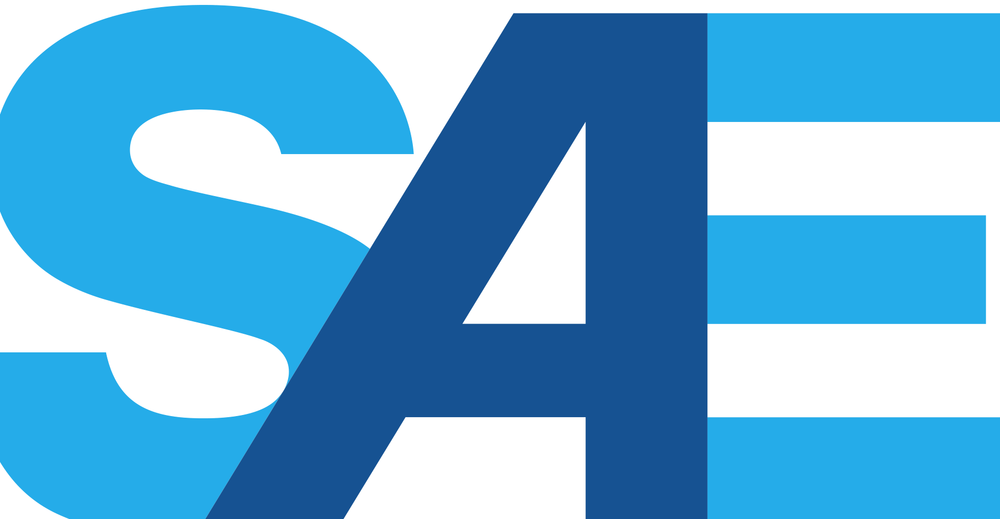

<!-- Source: Formula_SAE_Driverless_Implementation_Roadmap_rev8.5.2026.pdf, pages 1–8 -->

FORMULA SAE

DRIVERLESS ROADMAP

Revised August 5, 2026

## EXECUTIVE SUMMARY

SAE is introducing a phased implementation approach for autonomous mode technology under the Driverless Class within the Formula SAE series, specifically the Formula SAE Electric competition.

This roadmap offers teams a high-level view of the timeline and expectations, giving clarity on how driverless participation is planned to evolve toward 2030.

In this document you will find the following:

WHY DRIVERLESS? ............................................................................................... 3

2026 – INTRODUCTION PHASE (OPTIONAL) ...................................................... 4

2027 – 2029 EXPANSION PHASE (OPTIONAL) ................................................... 5

2030 – FULL INTEGRATION PHASE ..................................................................... 6

DRIVERLESS CUP .................................................................................................. 7

### WHY DRIVERLESS?

Driverless technology in Formula SAE Electric extends the competition’s mission of preparing students for the future of mobility. As automation reshapes industries, the addition of the autonomous systems ensures students gain relevant, workforce-ready skills.

Through hands-on work with sensors, controls, and autonomy software, students build experience that reflects the multidisciplinary nature of real engineering projects. This prepares them not only for automotive careers but also for roles in aerospace, robotics, defense, and commercial vehicles – all sectors SAE serves.

The phased rollout ensures all Formula SAE Electric teams will engage with autonomy by 2030, strengthening SAE’s role in developing the next generation of mobility leaders.

### 2026 – INTRODUCTION PHASE (OPTIONAL)

Starting with the 2026 Formula SAE competition season, teams may optionally design and compete with autonomous mode technology in a new Driverless Class.

- All teams will register as Electric Class.
    - Teams will compete in Static and Dynamic events with drivers as part of Electric Class for overall points.
- Participation in Driverless events is not mandatory for all teams; only teams approved for the Driverless Class will compete.
- To participate in the Driverless Class, teams will be required to “opt-in” for the Driverless class by submitting a Driverless Notice of Intent document submission.
- Teams participating in the Driverless Class for 2026 will have:
    - Additional technical documents to submit before the competition
    - Technical inspection of Driverless systems
    - Design evaluation
    - Up to three Dynamic events
- Points will be awarded to teams separately in both Electric and Driverless categories. Driverless will be scored separately from Electric. Incorporation of Driverless systems and components will not increase or decrease the Electric Class score

### 2027 – 2029 EXPANSION PHASE (OPTIONAL)

Teams may continue to optionally design and compete in the Driverless class to gain valuable experience.

The 2027-2029 Expansion Phase will be conducted like the 2026 Introduction Phase. Additional entries may be available to allow more teams to participate.

- The Driverless Class will have and may expand to include:
    - Additional technical documents to submit before the competition
    - Technical inspection of Driverless systems
    - Design evaluation
    - Cost evaluation
    - Up to four dynamic events

2027 Competition Operation:

- All teams will register as Electric Class.
    - Driverless Teams will still compete in Static and Dynamic events with drivers as part of Electric Class for overall points.
- Participation in Driverless events is not mandatory for all teams; only teams approved for the Driverless Class will compete.
    - To participate in the Driverless Class, teams will be required to “opt-in” for the Driverless class by submitting a Driverless Notice of Intent document submission.
- Teams participating in the Driverless Class for 2027 will have:
    - Additional technical documents to submit before the competition
    - Added onsite Technical inspection of Driverless systems
    - Design evaluation
    - Up to three Dynamic events
- Points will be awarded to teams separately in both Electric and Driverless categories. Driverless will be scored separately from Electric. Incorporation of Driverless systems and components will not increase or decrease the Electric Class score

### 2030 – FULL INTEGRATION PHASE

By 2030, Driverless technology should be fully integrated into Formula SAE Electric rules and competition operations.

The overall point structure of 1000 points will be modified to incorporate two Driverless events: Acceleration and Skid pad.

The preliminary point distribution is:

| Static Events: | Points |
|---|---|
| Business Presentation | 75 |
| Cost\* | 100 |
| Engineering Design\* | 150 |
|  |  |
| Dynamic Events: |  |
| Skid pad | 50 |
| Driverless (DV) Skid pad | 75 |
| Acceleration | 50 |
| Driverless (DV) Acceleration | 75 |
| Autocross | 100 |
| Endurance | 250 |
| Efficiency | 75 |
| Overall | 1000 |

Teams may choose to NOT incorporate Driverless features at the competition. They will be required to “opt out” during the registration process.

Teams that “opt out” of Driverless:

- Will not score points for the Driverless Dynamic events
- Will not score points for the portion of the Design and Cost Events for Driverless systems and implementation

### DRIVERLESS CUP

Teams with Driverless features may compete against each other for a Driverless Cup.

Teams may be required to “opt in” to the Driverless Cup during the registration process.

The Driverless Cup will be scored separately and feature additional Driverless specific Dynamic events. The preliminary point distribution is:

| Static Events: | Points |
|---|---|
| Engineering Design | 150 |
| Dynamic Events: |  |
| Driverless (DV) Skid pad | 75 |
| Driverless (DV) Acceleration | 75 |
| Driverless (DV) Autocross | 100 |
| Trackdrive | 200 |
| Overall | 600 |

### SUMMARY TIMELINE

| Year | Driverless Participation | Key Elements |
|---|---|---|
| 2026 | Optional | • Technical Inspection • Design • Up to 3 Dynamic Events |
| 2027 - 2029 | Optional | • Technical Inspection • Design • Cost • Up to 4 Dynamic Events |
| 2030 | Official | • Driverless Acceleration & Skid Pad events adopted into overall competition points o Teams may opt-out o Autonomous runs required for full scoring of 1000 points • Driverless Cup implemented |
