<!-- Source: EM_User_Manual_2026.pdf, pages 1–17 -->

FORMULA SAE

ENERGY METER USER MANUAL

Updated October 24, 2025

Introduction

Formula SAE Electric requires the installation of the competition provided Energy Meter in every vehicle. The Energy Meter will monitor energy usage and peak power, voltage and battery temperature. This information is used to check for power, voltage and temperature violations during the competition as well as computing the efficiency score.

Contents

Energy Meter Requirements .............................................................................................................. 3

Mechanical ...................................................................................................................................... 5

Tractive System Wiring ...................................................................................................................... 7

GLV Wiring ....................................................................................................................................... 8

CAN Messaging .............................................................................................................................. 10

Temperature Sensors ...................................................................................................................... 12

Download Connector ..................................................................................................................... 13

Downloading .................................................................................................................................. 14

Associating Data ............................................................................................................................ 16

### ENERGY METER REQUIREMENTS

EM.1 USER MANUAL

EM.1.1 Incorporated by Reference

The Energy Meter Requirements Section EM is Incorporated by Reference into the Formula SAE Rules GR.4.2.3

EM.1.2 Formula SAE Rules

Refer to Formula SAE Rules 2026 Section EV.3.2 for additional requirements

EM.2 DESCRIPTION

EM.2.1 Design

EM.2.1.1 The Energy Meter is designed as two components:

- a. Receptacle – modified Amphenol MSDXLF000F
- b. Energy Meter – modified Amphenol MSDXLM000
    The Energy Meter will not be available for purchase

EM.2.2 Implementation

EM.2.2.1 Prior to the Formula SAE Electric competition, each team must:

- a. Purchase the Receptacle from the given source
- b. Install the Receptacle per this User Manual
    An unmodified Amphenol MSDXLM000 may be purchased (from any source) to use as an Alternative to the Energy Meter and let the Tractive System operate

EM.2.2.2 At the Formula SAE Electric competition, an Energy Meter is given to the team. This Energy

Meter must be:

- a. Installed in the vehicle for the entire competition
- b. Removed and returned before the end of the competition

EM.3 INSTALLATION

EM.3.1 Physical

EM.3.1.1 The Energy Meter must be installed and removed from the Receptacle without opening any

enclosures or disassembling the vehicle. Bodywork, the firewall, or a cover may be removed.

EM.3.1.2 The Energy Meter Download Connector must:

- a. Be accessible without removing the Energy Meter from the vehicle
- b. Not be extended

EM.3.2 Electrical

The Energy Meter must be continuously supplied by GLV power on the specified pins before and when the Tractive System is Active

EM.3.3 Temperature Sensors

EM.3.3.1 Each Module in the Tractive Battery Pack must contain minimum one Temperature Sensor

EM.3.3.2 Each Temperature Sensor must be:

- a. Analog Devices DS18B20
- b. Located in the hottest area of each Module and meet EV.7.5.4
- c. Connected to the Energy Meter
- d. Free from EMI that would cause the sensor to not work

EM.4 DRIVERLESS

This section EM.4 only applies to vehicles with Driverless features

EM.4.1 CAN Connection

EM.4.1.1 The Energy Meter CAN bus must be connected to the Remote Emergency Stop CAN bus

EM.4.1.2 The Energy Meter must receive the Driverless vehicle CAN messages

EM.5 OPERATIONS

EM.5.1 Downloading Data

EM.5.1.1 Each team must:

- a. Download their Energy Meter Data prior to the published deadline
- b. Associate their Energy Meter Data to each Dynamic event

EM.5.1.2 The results website will show Violations EV.3.4

EM.5.1.3 Data not downloaded or missing may:

- a. Be treated as a violation EV.3.4.2
- b. Give no score D.13.3.4

### MECHANICAL

The receptacle cut-out is based off the Amphenol MSDXLF000F recommendations.

Additional clearance will be required to account for the Tractive System and GLV connectors.

Below provides a summary. Modification may be required to fit to teams’ specific applications.

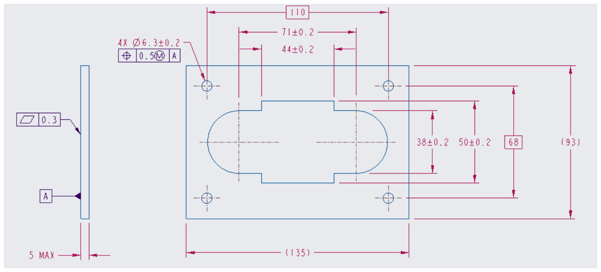

Receptacle mounting screws are M6 x 1.0, torque limit is 8 Nm.

The bolted connections for the series high current Tractive System connections are M8 x 1.25, torque limit is 13.4 Nm and must meet EV.6.4.3.

The receptacle is based on the front mount (MSDXLF000F) receptacle from Amphenol and is designed to be mounted on the outside side of an exterior panel of a Tractive System enclosure. Rear mount receptacles are not available.

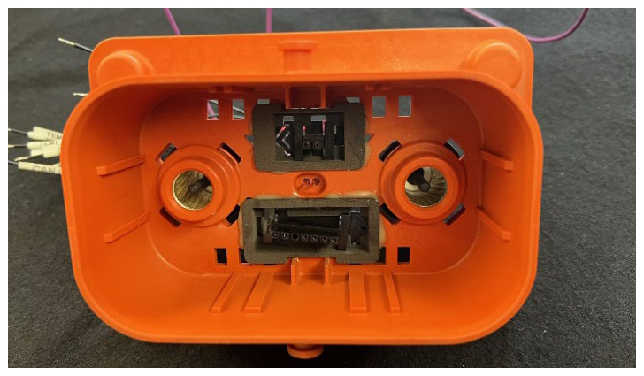

Picture of a SAE Energy Meter Base showing the added Molex blind mate connectors.

The Molex connector are designed to move in their cavities to facilitate its blind mate feature.

DO NOT OVER CONSTRAIN THE WIRES on the back of the Molex connectors – the connector body should easily move to any position in its cavity.

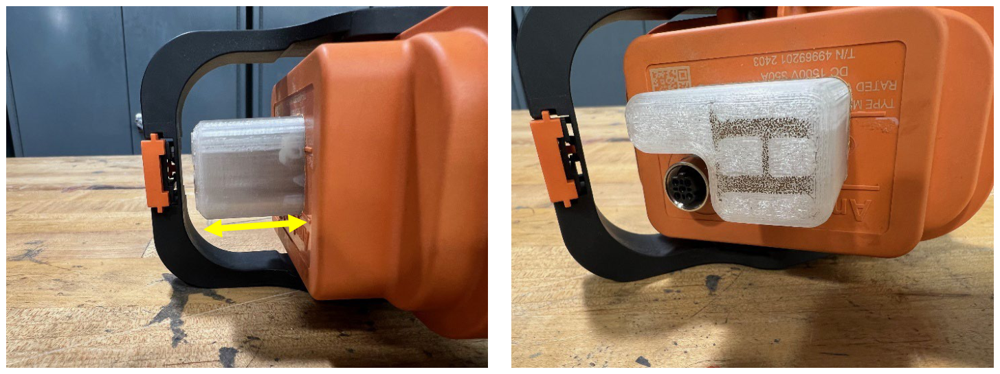

### Pictures of a SAE Energy Meter. The translucent cup extends 1.120” above the original disconnect surface (yellow arrow in left picture).

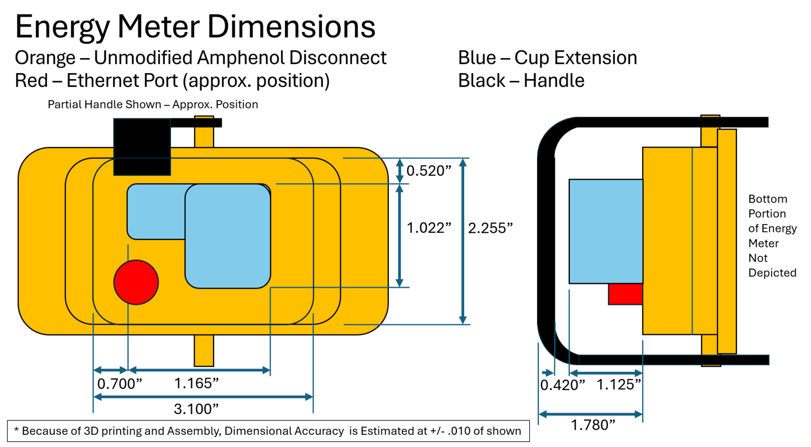

### TRACTIVE SYSTEM WIRING

The Energy Meter has three (3) Tractive System connections.

The first two connections must be wired in series with the high current path of the Tractive System such that all Tractive System power runs through the Energy Meter. This series connection must be in either the most positive or most negative side of the Tractive System. The Energy Meter cannot be wired midpack.

The third connection must be wired to the other pole of the Tractive System for sensing voltage (the wire lead in the #1 socket of the 2 pin connector).

The Energy Meter must be connected on the Tractive System (not always energized) side of the isolation relays.

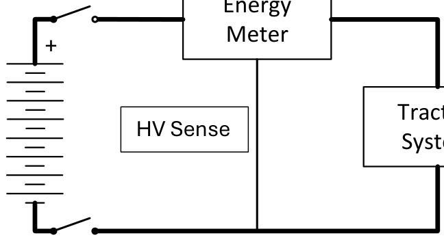

Energy Meter

\+

Option A: Energy Meter in HV+ Path

Tractive

HV Sense

System

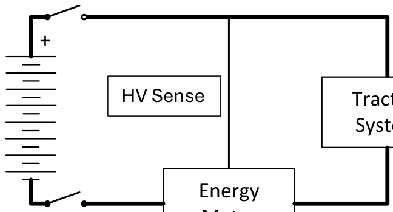

\+

Option B: Energy Meter in HV- Path

HV Sense

Tractive System

Energy Meter

### GLV WIRING

The Energy Meter must be provided with GLV power from the vehicle.

| Pin | Function |
|---|---|
| 1 | Temp Sense Return |
| 2 | Temp Sense One Wire |
| 3 | No Connection |
| 4 | CAN Low |
| 5 | CAN High |
| 6 | GLV Negative |
| 7 | GLV Positive |

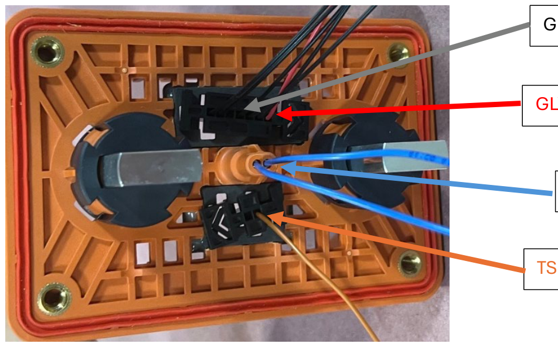

GLV Pins 1, 2, 3-6: Black

GLV Power Pin 7: Red Wire

HVIL: Blue Wires

TS Sense: Orange Wire

The Energy Meter receptacle is provided with 300 mm long leads terminated and installed in all low current connections of the Energy Meter. The other end of the leads is left unterminated and should be terminated as needed by the teams.

### The GLV wiring must not be restrained to allow the connectors to float in the

receptacle. This is to allow alignment with the Energy Meter when installed.

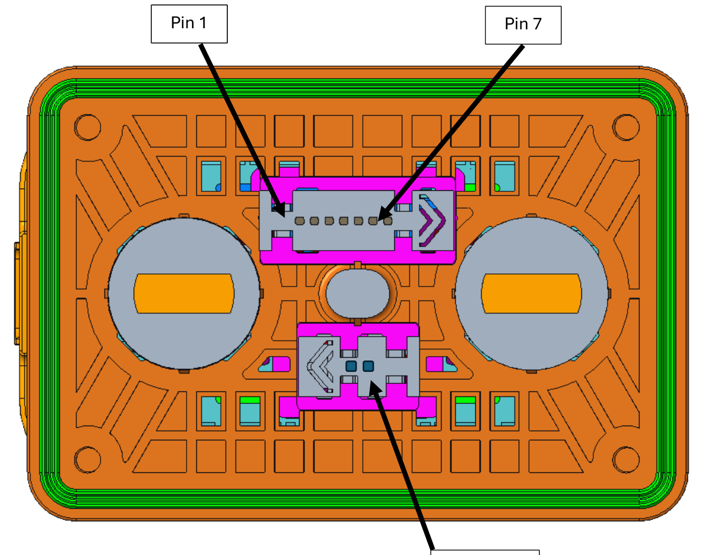

Pin 1 Pin 1 Pin 7

Pin 1

HV Sense

| Part Description | Supplier | Description | Part Number |
|---|---|---|---|
| 7 pin, Emeter Base | Molex or Distributor | 7 Pin Connector | 466230701 |
| 2 pin, Emeter Base | Molex or Distributor | 2 Pin Connector | 466230201 |
| Molex Female Pins | Molex or Distributor | Molex 20 awg Pins | 43030-0001 |

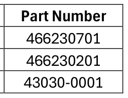

GLV Specifications

Voltage Input: 6 – 38V Current Draw: ~125mA CAN Baud Rate: 500k

### CAN MESSAGING

The Energy Meter provides a CAN bus connection which will allow access to the real time data within the Energy Meter. The CAN bus also allows the addition of team signals to the Energy Meter data log. These team signals are not required and are provided for the convenience of the team.

Use of the CAN bus connection of the Energy Meter is optional for non-driverless teams. The CAN bus connection is required for driverless teams to provide RES and other required signals.

All signals are little endian (Intel).

Measurement Message

Message Id: 0x10d (11 bit ID) Transmitted by Energy Meter Rate: 20ms

<table>
<tr>
<td>Data Byte</td>
<td>0</td>
<td>1</td>
<td>2</td>
<td>3</td>
<td>4</td>
<td>5</td>
<td>6</td>
<td>7</td>
</tr>
<tr>
<td>Signals</td>
<td colspan="4">Current [A] float</td>
<td colspan="4">Voltage [V] float</td>
</tr>
</table>

Status Message

Message Id: 0x40d (11 bit ID) Transmitted by Energy Meter Rate: 100ms

<table>
<tr>
<td>Data Byte</td>
<td>0</td>
<td>0</td>
<td>0</td>
<td>0</td>
<td>1</td>
<td>2</td>
<td>3</td>
<td>4</td>
<td>5</td>
<td>6</td>
<td>7</td>
</tr>
<tr>
<td>Data Bit</td>
<td>0</td>
<td>1</td>
<td>2</td>
<td>3</td>
<td></td>
<td></td>
<td></td>
<td></td>
<td></td>
<td></td>
<td></td>
</tr>
<tr>
<td>Signals</td>
<td>Violation</td>
<td>Logging</td>
<td>Fault Active</td>
<td>Fault Prev Active</td>
<td colspan="4">Energy [Whr] float</td>
<td></td>
<td></td>
<td></td>
</tr>
</table>

Temperature Message

Message Id: 0x60d (11 bit ID) Transmitted by Energy Meter Rate: 250ms

The temperature message includes a multiplexor signal. The first bits of the first byte of the message (the multiplexor) are used to determine the meaning of bytes 3-7.

All temperatures are sent as an unsigned byte with the following scaling. degC = raw \* 0.5

<table>
<tr>
<td>Data Byte</td>
<td>0</td>
<td>0</td>
<td>1</td>
<td>2</td>
<td>3</td>
<td>4</td>
<td>5</td>
<td>6</td>
<td>7</td>
</tr>
<tr>
<td>Data Bit</td>
<td>0-2</td>
<td>3-7</td>
<td></td>
<td></td>
<td></td>
<td></td>
<td></td>
<td></td>
<td></td>
</tr>
<tr>
<td rowspan="7">Signal</td>
<td>0</td>
<td rowspan="7">Num Sensors</td>
<td rowspan="7">Min Temp</td>
<td rowspan="7">Max Temp</td>
<td>Temp 0</td>
<td>Temp 1</td>
<td>Temp 2</td>
<td>Temp 3</td>
<td>Temp 4</td>
</tr>
<tr>
<td>1</td>
<td>Temp 5</td>
<td>Temp 6</td>
<td>Temp 7</td>
<td>Temp 8</td>
<td>Temp 9</td>
</tr>
<tr>
<td>2</td>
<td>Temp 10</td>
<td>Temp 11</td>
<td>Temp 12</td>
<td>Temp 13</td>
<td>Temp 14</td>
</tr>
<tr>
<td>3</td>
<td>Temp 15</td>
<td>Temp 16</td>
<td>Temp 17</td>
<td>Temp 18</td>
<td>Temp 19</td>
</tr>
<tr>
<td>4</td>
<td>Temp 20</td>
<td>Temp 21</td>
<td>Temp 22</td>
<td>Temp 23</td>
<td>Temp 24</td>
</tr>
<tr>
<td>5</td>
<td>Temp 25</td>
<td>Temp 26</td>
<td>Temp 27</td>
<td>Temp 28</td>
<td>Temp 29</td>
</tr>
<tr>
<td>6</td>
<td>Temp 30</td>
<td>Temp 31</td>
<td></td>
<td></td>
<td></td>
</tr>
</table>

Team Data 1 Message

Message Id: 0x30d (11 bit ID) Received by Energy Meter

<table>
<tr>
<td>Data Byte</td>
<td>0</td>
<td>1</td>
<td>2</td>
<td>3</td>
<td>4</td>
<td>5</td>
<td>6</td>
<td>7</td>
</tr>
<tr>
<td>Signals</td>
<td colspan="4">Team Signal 1 sint32</td>
<td colspan="4">Team Signal 2 sint32</td>
</tr>
</table>

Team Data 2 Message

Message Id: 0x30e (11 bit ID) Received by Energy Meter

<table>
<tr>
<td>Data Byte</td>
<td>0</td>
<td>1</td>
<td>2</td>
<td>3</td>
<td>4</td>
<td>5</td>
<td>6</td>
<td>7</td>
</tr>
<tr>
<td>Signals</td>
<td colspan="4">Team Signal 3 sint32</td>
<td colspan="4">Team Signal 4 sint32</td>
</tr>
</table>

### TEMPERATURE SENSORS

Teams are required to have at least one Energy Meter temperature sensor per Module in the Tractive Battery Pack.

The temperature sensors must be in the hottest region of each Module and meet EV.7.5.4.

The sensors must also have appropriate levels of electrical isolation between the sensor and cell. It is recommended to use a thermally conductive, electrically insulating thermal interface material (such as 3M 5519).

The sensors used must be an Analog Devices DS18B20 (any package) wired for parasite power Vdd connected to Gnd. Multiple sensors should be connected in parallel.

There are many counterfeit sensors on the market. Counterfeit sensors will not be accepted. Teams are encouraged to only purchase from trusted suppliers to ensure they are receiving genuine parts.

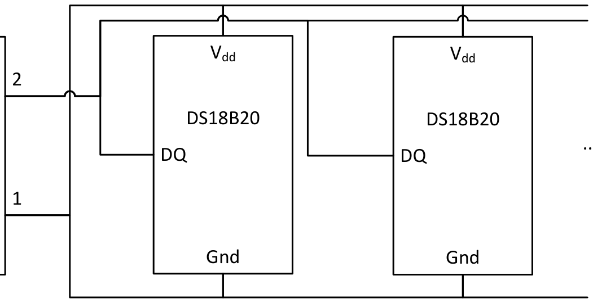

Vdd Vdd

2

Temp Sense

One Wire

DS18B20 DS18B20

...

Energy Meter

DQ DQ

1

Temp Sense

Return

Gnd Gnd

The Energy Meter temperature sense input is galvanically isolated from both Tractive System and GLV. Teams may choose one of the two configurations:

1\) Make connections only between Energy Meter and temperature sensors as shown above. This

will leave the temp sensors referenced to neither Tractive System nor GLV. In this case, the temp sense wiring will be considered as Tractive System with respect to the rules.

2\) In addition to connecting the temp sensors as shown above, also provide a connection

between Temp Sense Return and GLV ground. In this case the temp sense wiring will be considered as GLV wiring with respect to the rules.

### DOWNLOAD CONNECTOR

The download connector is located on top of the Energy Meter and must be accessible without removing the Energy Meter from the vehicle.

Teams are not allowed to extend or relocate the download connector.

Cabling to connect to the Energy Meter will be provided at the download stations at competition.

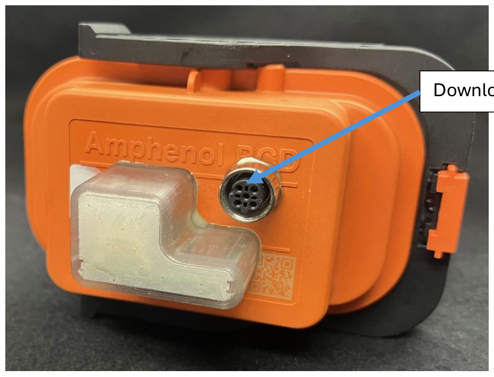

Download Connector

Operation

The Energy Meter requires GLV power to log data. Once GLV power is applied and the Energy Meter has booted, it will begin logging into a new file when the Tractive System voltage is detected to be \> 60V. The Energy Meter will stop logging when the Tractive System voltage is detected to be \< 60V.

The Energy Meter has a status LED visible through the translucent cover near the download connector. The LED has the following indications:

<table>
<tr>
<td>Condition</td>
<td colspan="30">Pattern</td>
<td>Description</td>
</tr>
<tr>
<td>Booting Up</td>
<td></td>
<td></td>
<td></td>
<td></td>
<td></td>
<td></td>
<td></td>
<td></td>
<td></td>
<td></td>
<td></td>
<td></td>
<td></td>
<td></td>
<td></td>
<td></td>
<td></td>
<td></td>
<td></td>
<td></td>
<td></td>
<td></td>
<td></td>
<td></td>
<td></td>
<td></td>
<td></td>
<td></td>
<td></td>
<td></td>
<td>solid red</td>
</tr>
<tr>
<td>Idle</td>
<td></td>
<td></td>
<td></td>
<td colspan="12"></td>
<td></td>
<td></td>
<td></td>
<td colspan="12"></td>
<td>orange single flash</td>
</tr>
<tr>
<td>Idle with Fault</td>
<td></td>
<td></td>
<td></td>
<td colspan="12"></td>
<td></td>
<td></td>
<td></td>
<td colspan="12"></td>
<td>red single flash</td>
</tr>
<tr>
<td>Logging</td>
<td></td>
<td></td>
<td></td>
<td></td>
<td></td>
<td></td>
<td></td>
<td></td>
<td></td>
<td></td>
<td></td>
<td></td>
<td colspan="3"></td>
<td></td>
<td></td>
<td></td>
<td></td>
<td></td>
<td></td>
<td></td>
<td></td>
<td></td>
<td></td>
<td></td>
<td></td>
<td colspan="3"></td>
<td>Orange single flash off</td>
</tr>
<tr>
<td>Logging with Fault</td>
<td></td>
<td></td>
<td></td>
<td></td>
<td></td>
<td></td>
<td></td>
<td></td>
<td></td>
<td></td>
<td></td>
<td></td>
<td colspan="3"></td>
<td></td>
<td></td>
<td></td>
<td></td>
<td></td>
<td></td>
<td></td>
<td></td>
<td></td>
<td></td>
<td></td>
<td></td>
<td colspan="3"></td>
<td>Red single flash off</td>
</tr>
<tr>
<td>Server Operation</td>
<td></td>
<td></td>
<td></td>
<td colspan="3"></td>
<td></td>
<td></td>
<td></td>
<td colspan="3"></td>
<td></td>
<td></td>
<td></td>
<td colspan="3"></td>
<td></td>
<td></td>
<td></td>
<td colspan="3"></td>
<td></td>
<td></td>
<td></td>
<td colspan="3"></td>
<td>orange flashing</td>
</tr>
<tr>
<td>Server Operation with Fault</td>
<td></td>
<td></td>
<td></td>
<td colspan="3"></td>
<td></td>
<td></td>
<td></td>
<td colspan="3"></td>
<td></td>
<td></td>
<td></td>
<td colspan="3"></td>
<td></td>
<td></td>
<td></td>
<td colspan="3"></td>
<td></td>
<td></td>
<td></td>
<td colspan="3"></td>
<td>red flashing</td>
</tr>
</table>

### DOWNLOADING

Downloading data from the Energy Meter will be the responsibility of the teams.

Download stations will be available at the competition near Dynamic events, the practice track, and EV Technical Inspection. The download station will provide a cable that must be plugged into the download connector on the Energy Meter. During the download process the Energy Meter will be powered by the download cable and GLV power is not required.

The status of the download process will be available through the FSAE website and the status LED on the Energy Meter. Teams may use this to monitor the download progress.

Data will be publicly available to download from the FSAE website.

After data has been transferred to the FSAE site teams will be required to associate their dynamic event runs to the data files. The team must ensure that data is downloaded from the Energy Meter and associated to their Dynamic event runs prior to the deadline. Teams do not have to be connected to the download station to associate their Dynamic runs to the data files.

Downloading

Once the green download cable is connected to the Energy Meter, the Energy Meter will be powered by the download station and GLV power is not required. The status of the download process will be visible by the status LED on the Energy Meter.

Teams may view the data transfer and monitor the transfer process online.

- 1\. Navigate to result.fsaeonline.com portal OR via the FSAE Mobile App select Live Results
- 2\. Select My Team’s Result
- 3\. Enter car number and click GO
- 4\. Select E-Meter Data

It will take approximately 10 – 15 seconds for the Energy Meter to make connection to download station to begin data transfer. The webpage does not need to be refreshed; it will do that when Connection Status changes like image below showing that and the Command in Progress.

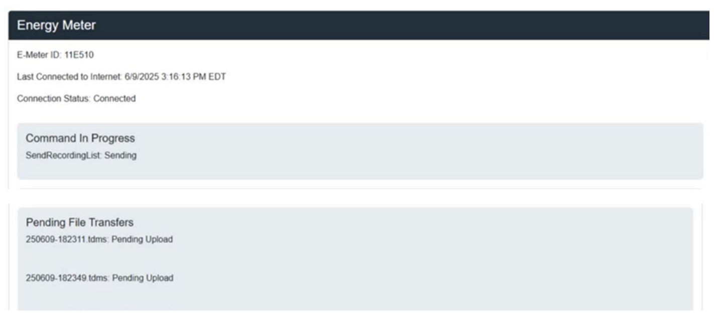

Data upload is complete when there is no Command In Progress and the Device Status is Idle.

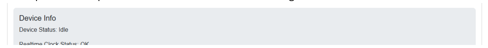

All recordings that are uploaded throughout duration of the competition will be visible under Recordings like shown in image below:

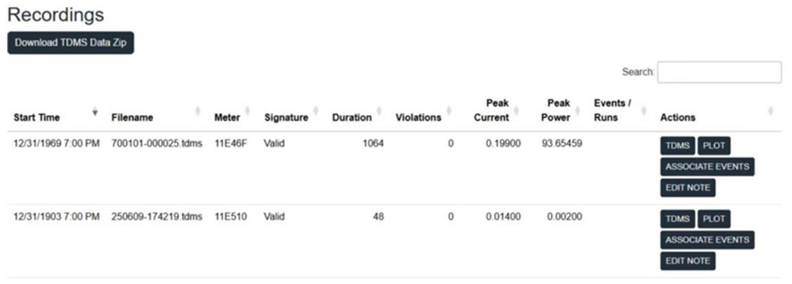

Additional information on the buttons under Actions:

TDMS – this will give you raw data and can be downloaded PLOT – gives you a quick glance of data via plot. This plot graph can be zoomed in/out as needed \*ASSOCIATE EVENTS – will use to associate data to dynamic runs. \*EDIT NOTE – this is only visible to the team data associated with or the EV Tech/Scoring volunteers \*These two buttons require you to log into your account on fsaeonline.com to associate data or edit any notes.

REMINDER:

Teams only need to be connected to the download station to download data from Energy Meter. Once files are downloaded, teams can disconnect from the download station to free up for other teams.

### ASSOCIATING DATA

Recordings must be associated to event runs. This allows the scoring system to understand which recordings have data for the dynamic event runs.

To associate data to events, select the Associate Events button of a recording which has data from an event. If not already logged into an fsaeonline.com account, the browser will navigate to the login page. Then, the browser will be directed to a page like this:

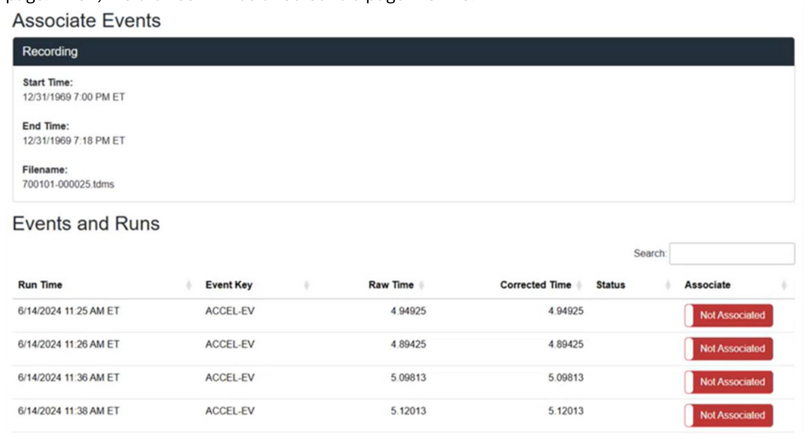

Toggle the Not Associated / Associated button in the Associate column for each event run contained in this data file to the Associated state. The associate state will change to a green Associated, and the association will be reviewed by a judge and approved. Teams may associate and unassociate data from a run if they make a mistake but ONLY before a Judge Reviews and accepts it.

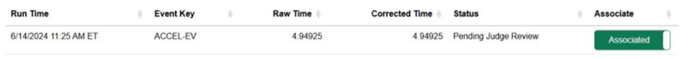

Multiple runs can be contained in and associated to a single recording file. Multiple recordings can be associated to the same event in the case that TS power was cycled during a run producing multiple data files.

After associating data to dynamic event runs, the Team Data page will show that the data has been associated to the event like the example below shows:

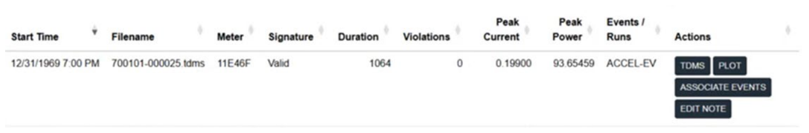

Please Note:

A recording can contain multiple runs, and a run could contain multiple recordings.

REMINDER:

- Teams should have all Energy Meter data associated to Dynamic Runs by or before 6PM on
    Friday Dynamic Event Day.
